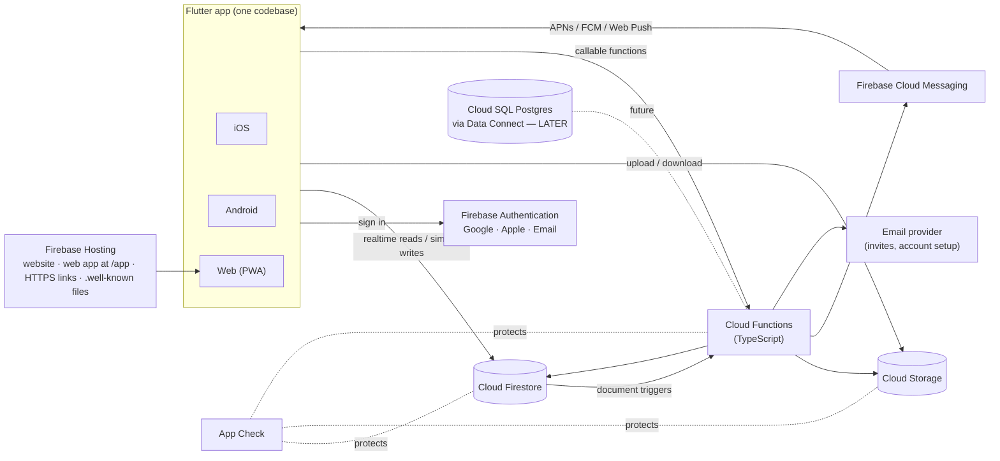
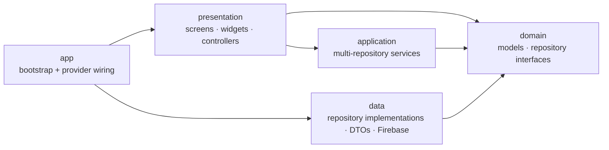
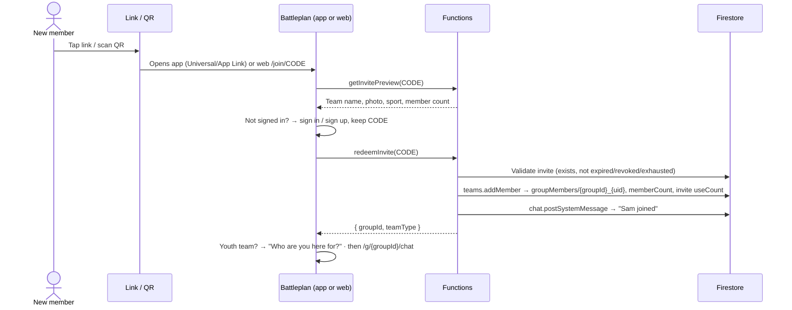
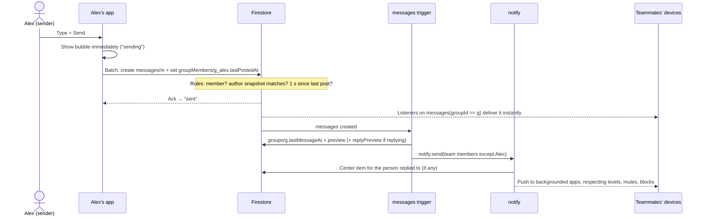

# Battleplan — Architecture

| | |
|---|---|
| **Status** | Draft v0.4 |
| **Owner** | Jared Freeman |
| **Last updated** | 2026-10-11 |
| **Companion doc** | [SPEC.md](SPEC.md): what gets built, feature by feature |

---

## 1. Purpose

Battleplan is a messaging and scheduling platform for sports teams. It combines what **GroupMe** (group chat) and **TeamReach** (schedules and RSVPs) do in one app on **iOS, Android, and the web**.

Like those apps, it hosts **many independent teams**. Each team is a **group** with its own members, admins, chat, schedule, and documents. One person can belong to several teams: a player on two teams, or a parent with kids on three. Our own team is the first to use it, but the design assumes anyone can sign up and create a team.

**Every account belongs to an adult (18+).** Teams come in two types:

- **Adult teams.** The players are the members, and each member answers RSVPs for themselves.
- **Youth teams.** The players are kids who **don't use the app**. Their parents and guardians are the members. Each player is a roster entry without an account, and their guardians answer RSVPs for them.

This document explains how it's built: one **Flutter/Dart** codebase on a **Firebase** backend, using **Cloud Firestore (NoSQL) as the only database**. The Firestore model is deliberately **SQL-shaped**, so a **Cloud SQL (PostgreSQL)** database can be added later, one feature at a time, without rewriting the app (§12).

> **Terminology.** In code and data a team is a **group** (`groups`, `groupId`), which also covers non-team groups such as a league board or a parents' committee. The UI labels them **Team** by default (decision D13). This document says "group" when it means the data and "team" when it means the people.

---

## 2. Goals, non-goals, assumptions

**Goals**

- **Multi-team.** Unlimited independent teams. A team's data is visible only to its members and to platform super admins.
- **Self-serve.** A coach or manager can create a team and invite the whole roster in a few minutes, with no help from us.
- **One Flutter codebase** that ships iOS, Android, and web with the same features, behavior, and look.
- Real-time group chat, polls, scheduling with RSVPs, shared documents, and push notifications.
- **Running cost close to $0 while usage is small.** Cost should grow with the number of active teams, with no fixed monthly server bills.
- **Maintainable by design.** Enforced layers, Firebase access in one place, and a SQL-shaped data model, so the code stays untangled as it grows and Cloud SQL can be added without a rewrite.

**Non-goals for v1**

- Cloud SQL or any other always-on database server.
- **Public team discovery or search.** Teams are invite-only, which matters for youth teams.
- **Accounts for anyone under 18.** Youth players appear only as roster entries managed by their parents and guardians.
- **Organizations and leagues** (several teams under one club admin). The data model reserves an `orgId` so this can come later.
- Full-text search across messages. This needs a search service or SQL (§12).
- SMS, voice or video calls, end-to-end encryption.

**Scale assumptions.** Past the v1 design target the design still works, but revisit §10 (cost) and §12 (the triggers for adding SQL).

| Dimension | At launch | v1 design target |
|---|---|---|
| Teams (groups) | a handful | ~2,000 |
| Total users | ~100 | ~50,000 |
| Members per team | 10–60 typical | max 500 |
| Players per youth team | 10–25 typical | max 200 |
| Teams per user | 1–3 typical | max 100 |
| Message volume | ~50/day per active team | bursts of a few per second in one team |

---

## 3. System overview



### Architectural principles

1. **Every team is an isolated tenant.** Every document a team owns carries its `groupId`, and every security rule checks the caller's membership of that team. Clients never query across teams except for the signed-in user's own memberships, players, and notifications.
2. **SQL-shaped data.** Firestore holds **flat, top-level collections only**, one per future SQL table, linked by explicit ID fields. There are no subcollections (§6.2).
3. **Firebase lives in one layer.** In the app, only the data layer talks to Firebase; screens and controllers see plain Dart models (§5.2). On the server, each domain module owns its collections (§6.4).
4. **Rules guard simple writes; Functions own everything else.**
   - Single-document writes (send a message, react, vote, RSVP) go straight to Firestore under Security Rules, so they're instant and work offline.
   - Privileged, multi-document, or side-effect work goes through callable Functions: creating teams, invites, deletions, role changes, email, and admin actions.
5. **The server computes derived data.** Counts, tallies, previews, and storage totals are written by Functions, never trusted from clients.
6. **One notification pipeline.** Every push notification and every notification-center item comes from one server module that applies preferences, mutes, and blocks (§6.5).
7. **Cost is a design constraint.** Every screen has a read budget, and the cost rules in §10.2 apply to every query.

---

## 4. Technology stack

| Layer | Choice | Notes |
|---|---|---|
| App framework | **Flutter** (stable channel), **Dart 3** | iOS, Android, and web from one codebase. Developed in VS Code with the Dart and Flutter extensions. |
| State management | **Riverpod** (with code generation) | Testable, no `BuildContext` coupling, easy to swap in fake repositories in tests. |
| Routing | **go_router** | URL-based. The same routes power web URLs, invite links, and notification taps. |
| Models | **freezed** + **json_serializable** | Immutable domain models with generated serialization. |
| Auth | **Firebase Authentication** | Email/password, email link, Google, Apple. |
| Database | **Cloud Firestore** (Native mode) | The only database in v1. |
| Files | **Cloud Storage for Firebase** | Chat photos, documents, avatars. |
| Server logic | **Cloud Functions for Firebase**, 2nd gen, **TypeScript / Node 22** | Callables, triggers, scheduled jobs. |
| Push | **Firebase Cloud Messaging (FCM)** | APNs for iOS, FCM for Android, Web Push for browsers. |
| Web hosting | **Firebase Hosting** | The website (`website/`, static) at the root and the Flutter web build at `/app/`; the HTTPS link domain, the Apple/Android link-verification files, legal pages. |
| Abuse protection | **Firebase App Check** | Play Integrity (Android), App Attest (iOS), reCAPTCHA Enterprise (web). |
| Config and flags | **Firebase Remote Config** | Feature flags and minimum supported app version (forced update). |
| Crashes and analytics | **Crashlytics** (iOS/Android), **Google Analytics for Firebase** | Crashlytics doesn't support web; web errors are handled in §9. |
| Email | Transactional provider (Postmark, SendGrid, Resend, or similar) called from Functions | Firebase Auth sends password-reset and verification emails itself. |
| CI/CD | **GitHub Actions**, Firebase Hosting preview channels, **Fastlane** (or Codemagic) for store builds | Includes the import-boundary check (§5.2). |
| Local development | **Firebase Local Emulator Suite** | Emulates Auth, Firestore, Storage, Functions, and Hosting. |

**Why TypeScript for Functions when the app is Dart?** Cloud Functions for Firebase officially supports Node.js and Python. TypeScript has the most complete Admin SDK, documentation, and examples. The server code is small and lives in `functions/`. Enums, limits, and collection names shared by app and server are defined once in `shared/constants.json` and code-generated into both Dart and TypeScript, so the two can't drift.

**Firebase plan: Blaze (pay-as-you-go) is required to run Cloud Functions and Cloud Storage in the cloud.** They aren't available on the free Spark plan. Development starts on Spark against the local emulators, and each project moves to Blaze when it first needs deployed Functions or Storage ([TODO.md](../TODO.md)). Blaze still includes the free-tier quotas, so at launch the expected bill is about **$0–5/month** (§10). **Set up budget alerts the day a project moves to Blaze.**

**"Deployed to Firebase", precisely:**

- The **web app** and the **backend** (rules, functions, indexes) deploy to Firebase.
- The **iOS and Android apps** reach users through the **App Store and Google Play** and talk to the same Firebase backend.
- **Firebase App Distribution** delivers internal test builds.

---

## 5. Client architecture (Flutter)

### 5.1 Repository layout

```
battleplan/
├── lib/
│   ├── main_dev.dart            # entry point, dev flavor
│   ├── main_prod.dart           # entry point, prod flavor
│   ├── app/                     # bootstrap (Firebase init), router, theme, provider wiring,
│   │                            #   Firebase-backed platform services (analytics, crash, config)
│   ├── core/                    # design system, AppFailure, logging, IDs, time zones, links
│   ├── l10n/                    # ARB string files
│   └── features/
│       ├── auth/                # sign-in, account setup, linking
│       ├── groups/              # teams, roster, switcher, settings, invites
│       ├── players/             # youth teams: players, guardians, requests
│       ├── chat/  polls/  schedule/  documents/
│       ├── notifications/       # push registration, notification center
│       ├── safety/              # report, block
│       ├── settings/
│       └── admin/               # God admin panel (deferred-loaded on web)
│
│   Every feature has the same four folders:
│       domain/                  # models + repository interfaces (pure Dart)
│       data/                    # repository implementations, DTOs: the only Firebase code
│       application/             # services that coordinate several repositories (optional)
│       presentation/            # screens, widgets, Riverpod controllers
│
├── test/  integration_test/
├── ios/  android/  web/
├── website/                     # the static explainer site and legal pages at getbattleplan.app (§6.6); the app is under /app
├── functions/                   # Cloud Functions (TypeScript), same domains (§6.4)
├── shared/constants.json        # enums, limits, collection names → generated Dart + TS
├── firestore.rules  firestore.indexes.json  storage.rules
├── firebase.json  .firebaserc
├── tools/                       # seed/ (emulator data), gen_constants.dart, check_imports.sh, super-admin bootstrap
└── docs/
```

### 5.2 Layers and dependency rules

These rules keep the code from turning into spaghetti. They're enforced in CI and code review, not just suggested.



Arrows mean "may import". Nothing imports against the arrows.

1. **Only `data/` and `app/` import Firebase packages** (`cloud_firestore`, `cloud_functions`, `firebase_*`). Screens, widgets, controllers, and domain code never do. CI enforces this (below).
2. **`domain/` is pure Dart.** No Flutter, no Firebase: immutable models (freezed) and repository interfaces only.
3. **Widgets hold no business logic and no data access.** They render controller state and call controller methods.
4. **Controllers** (Riverpod notifiers) hold screen state and call repositories or application services. They never construct repositories; providers inject them, wired in one place (`app/providers.dart`).
5. **Repositories return domain models and typed `AppFailure`s** (`notFound`, `permissionDenied`, `offline`, `rateLimited`, …). Firebase types and exceptions never leave `data/`.
6. **Each collection has exactly one owning repository** (table below). Other features ask that repository; they never query its collection themselves.
7. **Features import each other only through `domain/`** and a feature's public widget barrel (`features/<x>/<x>.dart`), never another feature's `data/` or private files.
8. **Platform services sit behind interfaces too**: auth, push registration, analytics, crash reporting, remote config, file picking, calendar, sharing, and link building. `kIsWeb` and `Platform.isX` checks live only in those implementations.
9. **One way to do each thing.** That means one each of:
   - router
   - DI mechanism (Riverpod)
   - failure type
   - logger
   - time-zone utility
   - ID builder for composite IDs (`core/ids.dart`)
   - link builder
   - analytics facade

   Adding a second way needs a decision-log entry (§14).

**Collection ownership**

| Repository | Feature | Collections |
|---|---|---|
| `AuthRepository`, `UserRepository` | auth, settings | `users` |
| `DeviceRepository`, `NotificationRepository` | notifications | `devices`, `notifications` |
| `BlockRepository`, `ReportRepository` | safety | `userBlocks`, `reports` (reports via Functions) |
| `GroupRepository`, `MemberRepository`, `InviteRepository` | groups | `groups`, `groupMembers`, `invites` (invites via Functions) |
| `PlayerRepository` | players | `players`, `playerGuardians`, `guardianRequests` |
| `MessageRepository` | chat | `messages` |
| `PollRepository` | polls | `polls`, `pollVotes` |
| `EventRepository`, `RsvpRepository` | schedule | `eventSeries`, `events`, `rsvps` |
| `DocumentRepository` | documents | `groupDocuments`, plus Storage files |
| `AdminRepository` | admin | `auditLogs`, `config`, admin callables |

**Boundary check (runs in CI on every PR)**

```sh
# tools/check_imports.sh — fail the build if Firebase leaks out of the data layer
bad=$(grep -rlE "package:(cloud_firestore|cloud_functions|firebase_[a-z_]+)/" lib \
      | grep -vE "^lib/(app|features/[a-z_]+/data)/")
if [ -n "$bad" ]; then echo "Firebase imported outside data/ or app/:"; echo "$bad"; exit 1; fi
bad=$(grep -rlE "package:flutter/" lib/features/*/domain)
if [ -n "$bad" ]; then echo "Flutter imported in domain/:"; echo "$bad"; exit 1; fi
```

### 5.3 Repositories and pagination

The repository interface is also the seam for Cloud SQL: a SQL-backed implementation can replace a Firestore one without touching any screen.

```dart
abstract interface class MessageRepository {
  Stream<List<Message>> watchNewest(GroupId groupId, {int limit = 50});
  Future<MessagePage> loadOlder(GroupId groupId, PageCursor before, {int limit = 50});
  Future<MessagePage> loadNewer(GroupId groupId, PageCursor after, {int limit = 50});
  Future<int> countUnread(GroupId groupId, DateTime since, {int cap = 100});
  Future<void> send(GroupId groupId, NewMessage message);   // text, photos, replyToId
  Future<void> setReaction(GroupId groupId, MessageId id, Reaction? reaction);
  Future<void> delete(GroupId groupId, MessageId id);       // calls deleteMessage
}
```

- **Domain code never sees Firestore types.** No `DocumentSnapshot`, `Timestamp`, `FieldValue`, or `Query` outside `data/`.
- **Pagination is cursor-based and opaque.**
  - `PageCursor` wraps a Firestore document snapshot today; a SQL implementation would use `(created_at, id)` keyset pagination.
  - The newest page of chat is a live listener. Older and newer pages are one-shot reads of 50.
  - Opening a chat at the first unread message uses `loadNewer` from that point.
  - Offsets are never used.
- **IDs are value types** (`GroupId`, `UserId`, `PlayerId`) wrapping strings. Composite IDs (§6.2) are built only by `core/ids.dart`, which uses the separator from `shared/constants.json`, so the server builds them identically.

### 5.4 Routing and deep links

go_router routes. The same paths are used for web URLs, Universal/App Links, and push-notification taps.

| Route | Screen |
|---|---|
| `/sign-in`, `/sign-in/email`, `/reset-password` | Sign-in flows |
| `/activate` | Account setup from an emailed link (§6.1) |
| `/welcome` | No teams yet: join (code, QR, or link) or create a team |
| `/g/new` | Create a team |
| `/join/:code` | Invite landing. Works signed out: sign in, then auto-redeem. |
| `/notifications` | Notification center |
| `/g/:groupId/chat`, `/g/:groupId/chat/m/:messageId` | Chat; jump to a message (replies, notifications) |
| `/g/:groupId/schedule`, `/g/:groupId/schedule/:eventId`, `/g/:groupId/schedule/new` | Schedule tab |
| `/g/:groupId/docs`, `/g/:groupId/docs/:docId` | Documents tab |
| `/g/:groupId/roster`, `/g/:groupId/roster/players/:playerId`, `/g/:groupId/invite`, `/g/:groupId/settings`, `/g/:groupId/reports` | Team menu |
| `/settings/...` | Profile, appearance, notifications, sign-in methods, account |
| `/admin`, `/admin/teams/:id`, `/admin/users/:uid`, `/admin/reports`, `/admin/audit`, `/admin/settings` | God admin panel |

- A `StatefulShellRoute.indexedStack` hosts the three tabs, so each tab keeps its scroll position and state.
- Redirect guards:
  - Signed out → `/sign-in?from=…`.
  - `/admin/**` requires the `superAdmin` claim.
  - `/g/:groupId/**` requires membership; non-members see a "not a member" screen.
- Web uses the **path URL strategy** (no `#`). The web app is built with `--base-href /app/`, so in the browser every route above sits under `/app` (`getbattleplan.app/app/g/…`); Hosting rewrites `/app/**` to `/app/index.html`. Native apps accept links with or without the `/app` prefix and route the rest (§6.6).

### 5.5 Theming and adaptive layout

- Material 3 `ThemeData` is generated from design tokens in `core/design/tokens.dart`: light and dark color schemes, typography, spacing, and radii. App-specific colors (RSVP status, chat bubbles, event types, team accent colors) live in a `ThemeExtension`.
- Theme mode is **System / Light / Dark**. It's stored locally so the right theme shows at launch, and synced to the profile so it follows the user across devices.
- **Fonts are bundled as assets** rather than fetched at runtime, so text renders identically on all platforms and offline.
- **One design system on every platform.** We don't use Cupertino widgets on iOS and Material on Android. Platform-specific behavior appears only where users expect it: iOS back-swipe and scroll physics, haptics on mobile, hover states, right-click menus, and keyboard shortcuts on web.
- Breakpoints:

  | Width | Navigation | Notes |
  |---|---|---|
  | < 840 px (phones, narrow browser windows) | **Bottom navigation bar** with Chat · Schedule · Documents | |
  | ≥ 840 px (desktop browsers, tablets in landscape) | Same three destinations, same order and icons, as a **left navigation rail** | Content width is capped (~840 px for chat) so it stays readable. *(Decision D9; can be overridden to keep the bottom bar everywhere.)* |

### 5.6 Offline and performance

- Firestore offline persistence is on: the default on mobile, enabled explicitly on web.
- Sent messages appear instantly (latency compensation) with a "sending" state. Writes made offline queue and sync when the connection returns. File uploads need a connection and offer retry.
- Pending server timestamps are read as local estimates (Firestore's `estimate` server-timestamp behavior), so pending messages sort correctly.
- Lists show **thumbnails**. Full-resolution images load only when tapped. Everything goes through `cached_network_image`.
- Web:
  - Build with `flutter build web --wasm`, falling back to JS/CanvasKit if a plugin isn't WASM-compatible.
  - `index.html` shows a branded loading screen.
  - The admin panel is **deferred-loaded** so regular users never download it.

### 5.7 Environments and flavors

| | Dev | Prod |
|---|---|---|
| Firebase project | `battleplan-dev-ecce4` | `battleplan-prod` |
| Bundle / application ID | `app.getbattleplan.dev` | `app.getbattleplan` |
| Entry point | `lib/main_dev.dart` | `lib/main_prod.dart` |
| Web | `battleplan-dev-ecce4.web.app` (website at the root, app at `/app`) + PR preview channels | `getbattleplan.app` (website) and `getbattleplan.app/app` (web app) |

- The two flavors have separate app IDs, so dev and prod builds can be installed side by side.
- `flutterfire configure` generates `lib/app/firebase_options_dev.dart` and `firebase_options_prod.dart`.
- `--dart-define=USE_EMULATORS=true` points a dev build at the Emulator Suite under the project ID `demo-battleplan` (D31). Prod builds refuse it.
- **Never test against prod.**
- Local development runs on the **Emulator Suite** ([DEVELOPMENT.md](DEVELOPMENT.md)). `tools/seed/seed.ts` loads sample adult and youth teams, people on several teams, parents with several players, and messages, polls, events, and documents.

---

## 6. Backend (Firebase)

### 6.1 Authentication and accounts

**Enabled providers:**

- Email/Password, including **Email link** (passwordless) sign-in
- Google (any Google account, Gmail or Workspace)
- Apple

Leave the default **"One account per email address"** setting on. We don't need Firebase Auth's **Identity Platform upgrade**: email and social sign-in stay free without it, while the upgrade adds per-user pricing above 50k monthly active users.

#### Battleplan profiles are separate from sign-in identities

- **Firebase Authentication stores identities**: the Google, Apple, and email/password credentials linked to one `uid`. **Firestore `users/{uid}` stores the Battleplan profile**: name, photo, contact email, preferences.
- **Provider data is used once**, at first sign-in, to prefill the profile. The provider's photo is copied into our Storage at that point, so the profile never depends on a provider URL.
- **After that, only the person changes the profile.** None of these touch it:
  - signing in with another provider;
  - linking or unlinking a provider;
  - a provider changing its own data.
- **`users.email` is the verified contact address** used for notifications and invites. It changes only through a verified change-email flow (`verifyBeforeUpdateEmail`), and Firebase sends a notice to the old address.
- **Everything is keyed by `uid`**, never by provider IDs or provider emails. Memberships, roles, messages, and RSVPs survive any change of sign-in method.
- **Accounts are for adults (18+) only.** Youth players never get one; they exist only as roster entries (`players`, §6.2).

#### How accounts get created

1. **Self sign-up.** The first sign-in with any provider creates the Auth user. The app then calls the idempotent callable `ensureUserProfile`, which creates `users/{uid}`. A client call is used instead of an Auth trigger so the app knows the profile exists before it continues.
2. **Admin-created ("local") accounts.** A super admin, or a team admin for their own team, enters **a name and an email, nothing else**. Then `adminCreateUser`, `addMemberByEmail`, or `addPlayers` (for guardians):
   - creates the Firebase Auth user **with no password**;
   - creates `users/{uid}` with `status: 'provisioned'`, plus the memberships or guardian links;
   - emails a **setup link**: an email-link sign-in generated with `generateSignInWithEmailLink` and sent through our email provider (§6.6).

   **Nobody ever sets, sees, or knows another person's password.** No screen, callable, or admin tool can set one; admins can only trigger setup or password-reset emails. Setup links expire, and "Resend" sends a fresh one. The person shows up on the roster right away, and admins can RSVP on their behalf before they ever sign in.

#### How a person with an admin-created account gets in

| They do this | What happens |
|---|---|
| Tap the setup link | Signed into their account, and the email is marked verified. The app then asks: *"How do you want to sign in next time?"* They choose Google, Apple, or a password they create themselves, and the app links it to the account. |
| Tap **Continue with Google** using the same Gmail address | Firebase signs them into the same account, because Google is a trusted provider for Gmail addresses. |
| Use **Apple** or a non-Gmail Google account with the same email | Handled by linking rule 2 below. |
| Use Apple **"Hide My Email"** | The relay address won't match. The welcome screen says *"Added by a coach or admin? Use the link in your setup email."* They can link Apple from Settings afterward. |

#### Safe account linking

1. **Prove both sides.** A sign-in method is linked only from a signed-in session with a recent sign-in, by completing that provider's own sign-in (`linkWithProvider`, or `linkWithCredential` for a pending credential).
2. **No silent merges by email.**
   - Firebase joins a new sign-in to an existing account automatically only when the provider is authoritative for that email (Google for Gmail addresses).
   - Otherwise Firebase returns `account-exists-with-different-credential`. The app holds the pending credential and sends a sign-in link to that email. It links the credential only after that link is opened.
3. **An unverified email never links anything.**
4. **Security emails.** These changes send a notice to the account email ("Google sign-in was added to your Battleplan account. Not you? Contact support."):
   - adding or removing a sign-in method;
   - changing the password;
   - changing the email.

   The app reports each change to `recordSignInMethodChange`. `dailyCleanup` also compares recently active accounts' sign-in methods with `users.signInMethods`, and sends the notice for any change the app didn't report.
5. **A fresh sign-in is required** before linking, unlinking, changing the email or password, and deleting the account.
6. **The last sign-in method can't be removed.**
7. **Two existing accounts are never merged automatically.** If someone ends up with two, a super admin moves their memberships by hand (a merge tool is Later).

#### Password reset

- The app calls `sendPasswordResetEmail`. The email template is customized in the Firebase console.
- **Email enumeration protection** (on by default for new projects) means the app can't reveal which provider an email uses. The reset screen always says *"If an account exists for that email, we've sent a link."* It also reminds people who use Google or Apple that they don't need a password.

#### God admin (super admin)

- Super admins carry a custom claim, `superAdmin: true`. They're platform operators: they can see and manage every team.
- The first one is set with `tools/seed/set-super-admin.ts` (`npm --prefix tools/seed run super-admin -- <project> <email>`), which runs locally with your own `gcloud` sign-in, so no service-account key exists. After that, super admins grant and revoke the claim from the admin panel through a callable.
- Rules and Functions both check the claim. The client force-refreshes its ID token after a change.
- **Team roles are *not* claims.** They're per-team, change often, and claims are capped at 1,000 bytes. Team roles live in `groupMembers` and are checked by rules.

#### Account deletion

App Store and Google Play both require in-app account deletion. The callable `deleteAccount`:

- transfers ownership of any teams the user owns;
- deletes their memberships, guardian links, guardian requests, devices, blocks, and notifications (a player left with no guardian stays on the roster for admins to manage);
- deletes their RSVPs for upcoming events and keeps past ones;
- anonymizes their messages to "Deleted user";
- deletes the profile, avatar, and the Auth user.

#### Provider setup gotchas (do these in the M0/M1 spike)

- **Apple**
  - App Store guideline 4.8 requires a privacy-focused login option whenever Google login is offered. Sign in with Apple satisfies it.
  - On Android and web, Apple sign-in runs as a web flow. It needs a Services ID and return URL.
  - Register our email sending domain with Apple's **private email relay** so emails reach `@privaterelay.appleid.com` addresses.
- **Google on web.** Use Firebase Auth's `signInWithPopup(GoogleAuthProvider())`. The `google_sign_in` plugin's web support is button-based and doesn't fit our sign-in screen.
- **All web sign-in.** Prefer popups. If redirects are ever used, set `authDomain` to the app's own custom domain, because browser third-party-storage partitioning (Safari, Chrome) breaks cross-domain redirects.

### 6.2 Firestore data model (SQL-shaped)

#### Modeling rules

1. **Top-level collections only, no subcollections.** Each collection is one future SQL table.
2. **Relationships are explicit ID fields**: `groupId`, `uid`, `playerId`, `eventId`, `pollId`, `messageId`. These become foreign keys later.
3. **Every team-owned document stores `groupId`**, even when it could be derived, so one rule pattern secures everything and team-wide jobs work on one field.
4. **One-per-pair records use composite IDs**, the equivalent of a composite primary key:

   | Collection | Document ID |
   |---|---|
   | `groupMembers` | `{groupId}_{uid}` |
   | `playerGuardians` | `{playerId}_{uid}` |
   | `guardianRequests` | `{playerId}_{uid}` |
   | `pollVotes` | `{pollId}_{uid}` |
   | `rsvps` | `{eventId}_{participantId}` |
   | `userBlocks` | `{uid}_{blockedUid}` |

   Writing the same pair twice updates one document instead of creating a duplicate. Auto-IDs and Auth uids never contain `_`.
5. **Embed only what is small, bounded, owned by its parent, and always read with it.** Every bounded list has its maximum in `shared/constants.json`, and each maps to columns or a child table later (§12.3):
   - message attachments (≤ 10)
   - message reactions (one per person)
   - poll options (≤ 10)
   - a vote's chosen options (≤ 10)
   - event reminder times (≤ 6)
   - a series' skipped dates (≤ 100)
   - fixed-shape maps (settings, location, counts)
6. **Naming.**
   - Fields are camelCase.
   - Timestamps end in `At` and are UTC Firestore Timestamps.
   - Dates end in `Date` and are `YYYY-MM-DD` strings, so all-day events never shift across time zones.
   - Enums are lowercase strings from `shared/constants.json`.
   - Every document has `createdAt`, `updatedAt`, and `schemaVersion`.
7. **Caches are labeled.** Denormalized copies are marked `(cache ← source)`. Only Functions write them, or rules check them against their source.
8. **Soft delete only for messages**, so the "deleted" placeholder stays in the conversation. Everything else is deleted for real.
9. **No document grows without bound.**

#### Collections

| Collection | Document ID | One document per | Future table | Written by |
|---|---|---|---|---|
| `users` | `uid` | account | `users` | owner (profile fields), Functions |
| `devices` | installation ID | app install | `user_devices` | owner |
| `userBlocks` | `{uid}_{blockedUid}` | blocker + blocked | `user_blocks` | owner |
| `groups` | auto | team | `groups` | Functions; admins edit profile and settings |
| `groupMembers` | `{groupId}_{uid}` | team + person | `group_members` | Functions; members edit their own preferences |
| `players` | auto | youth player | `players` | Functions; guardians and admins edit details |
| `playerGuardians` | `{playerId}_{uid}` | player + guardian | `player_guardians` | Functions |
| `guardianRequests` | `{playerId}_{uid}` | player + requester | `guardian_requests` | Functions |
| `invites` | invite code | invite | `invites` | Functions |
| `messages` | auto | message | `messages` | members (create, own reaction), Functions |
| `polls` | auto | poll | `polls` | members (create), Functions |
| `pollVotes` | `{pollId}_{uid}` | poll + voter | `poll_votes` | the voter |
| `eventSeries` | auto | repeating series | `event_series` | Functions |
| `events` | auto | event | `events` | admins and allowed members, Functions |
| `rsvps` | `{eventId}_{participantId}` | event + participant | `event_rsvps` | the member, the player's guardians, admins |
| `groupDocuments` | auto | file or link | `documents` | members if allowed, Functions |
| `notifications` | `{dedupeKey}_{uid}` | notification-center item | `notifications` | Functions; the recipient marks read |
| `notifyLog` | dedupe key | one notification send | — | Functions only (TTL 7 days) |
| `reports` | auto | report | `reports` | Functions |
| `auditLogs` | auto | admin action | `audit_logs` | Functions |
| `rateLimits` | `{uid}_{action}_{window}` | counter window | — (operational) | Functions |
| `config` | `app` | — | `app_config` | super admins |

#### Fields

```
users/{uid}
  displayName, displayNameLower, email, emailLower      # Battleplan's own profile (§6.1)
  photoPath                                              # copied into our Storage at first sign-in
  status: 'provisioned' | 'active' | 'disabled'
  signInMethods: ['password' | 'google.com' | 'apple.com']   # cache ← Firebase Auth
  themeMode: 'system' | 'light' | 'dark'
  notificationPrefs: { messages, replies, mentions, polls, eventsNew, eventsChanged, reminders, documents }   # bools; a missing key is on (NOTIF-4)
  acceptedTermsAt, adultConfirmedAt, lastActiveAt, createdAt, updatedAt, schemaVersion

devices/{installationId}                                # a random 20+ character ID each install keeps
  uid, token, platform: 'ios' | 'android' | 'web', appVersion, updatedAt   # pruned after 60 days without an update

userBlocks/{uid}_{blockedUid}
  uid, blockedUid, createdAt

groups/{groupId}
  name, nameLower, description, photoPath, color?, sport, teamType: 'adult' | 'youth'
  ownerId, createdBy, timeZone, orgId?                  # orgId reserved for leagues (later)
  settings: { membersCanCreateEvents, membersCanCreatePolls, membersCanUploadDocs,
              membersCanInvite, allowMaybe, defaultReminderOffsets: [minutes] }
  memberCount, playerCount                              # cache ← groupMembers, players
  lastMessageAt, lastMessagePreview: { authorName, text, type }   # cache ← messages
  storageBytes, storageQuotaBytes                       # cache ← Storage triggers; limit 500 MB unless a super admin changes it (§6.11)
  storageAlert: 'none' | 'warn' | 'full'                # Functions only; which storage notification was last sent (STORE-3, STORE-4)
  chatTheme?: { bubbleColor, background: 'plain' | 'pattern' | 'photo', backgroundPath? }   # CHAT-18
  archivedAt?, suspendedAt?, createdAt, updatedAt, schemaVersion

groupMembers/{groupId}_{uid}
  groupId, uid, role: 'owner' | 'admin' | 'member', title?
  jerseyNumber?, position?                              # adult teams (v1.1)
  displayName, photoPath                                # cache ← users
  playerSummary?                                        # youth teams, e.g. "Emma #7"; cache ← players
  notificationLevel: 'all' | 'important' | 'none', mutedUntil?   # "until unmuted" = 9999-12-31 (Limits.mutedForeverMs)
  lastReadAt                                            # unread counts
  lastPostedAt, lastPostedMessageId                     # message rate limit (§6.3, §6.9)
  pending?                                              # added by email, hasn't signed in yet (AUTH-6); cleared by ensureUserProfile
  joinedAt, addedBy, inviteCode?

players/{playerId}
  groupId, displayName, displayNameLower, jerseyNumber?, position?
  createdBy, createdAt, updatedAt

playerGuardians/{playerId}_{uid}
  playerId, groupId, uid, addedBy, via: 'admin' | 'request' | 'guardian' | 'self', createdAt

guardianRequests/{playerId}_{uid}
  playerId, groupId, uid, status: 'pending' | 'approved' | 'declined'
  decidedBy?, decidedAt?, createdAt

invites/{code}
  groupId, type: 'link' | 'email', email?, role: 'member'
  createdBy, expiresAt?, maxUses?, useCount, revokedAt?, createdAt

messages/{messageId}
  groupId, authorId, authorName, authorPhotoPath, authorPlayerSummary?   # snapshot; rules check it
  type: 'text' | 'image' | 'poll' | 'event' | 'system'
  text (≤ 4000), mentions: [uid] (≤ 20, v1.1)
  attachments: [{ path, thumbPath, contentType, width, height, size }]   # ≤ 10
  replyToId?, replyPreview?: { authorName, text, type, deleted }        # cache ← messages
  pollId?, eventId?, systemEvent?: { kind, actorId, targetId }
  reactions: { <uid>: <one of the 16 reactions> }       # one per person (CHAT-6)
  editedAt?, deletedAt?, deletedBy?, deletedReason?: 'author' | 'admin'
  createdAt

polls/{pollId}                                          # same ID as its poll message
  groupId, messageId, createdBy, question               # the message's text is the question
  options: [{ id, text }]                               # 2–10; ids '0'…'9' in order
  allowMultiple, anonymous, closesAt (or null), closedAt (null while open), closedBy?
  voteCounts: { <optionId>: n }, voterCount             # cache ← pollVotes
  createdAt

pollVotes/{pollId}_{uid}
  pollId, groupId, uid, optionIds: [optionId], updatedAt

eventSeries/{seriesId}
  groupId
  recurrence: { freq: 'daily' | 'weekly', interval, byWeekday?: [1..7],   # byWeekday for weekly only
                startDate, untilDate, count?, skipDates: [YYYY-MM-DD] }   # untilDate ≤ 12 months out; skipDates ≤ 100
  template: { …event fields… }, timeZone                # occurrences keep wall-clock time across DST
  createdBy, createdAt, updatedAt

events/{eventId}
  groupId, seriesId?, seriesOverrides?: [fieldName]    # fields edited with "This event"; series edits skip them
  type: 'game' | 'practice' | 'meeting' | 'social' | 'other'
  title, description, location: { name, address, lat?, lng? }
  allDay, startAt, endAt, startDate?, endDate?, timeZone
  arriveMinutesBefore?, opponent?, homeAway?: 'home' | 'away'
  rsvpEnabled, rsvpFor: 'members' | 'players'          # copied from teamType at creation; 'players' events also take team admins' own RSVPs (Q14)
  rsvpDeadline?, reminderOffsets: [minutes]            # ≤ 6
  nextReminderAt?                                       # computed; drives the reminder job
  rsvpCounts: { going, maybe, notGoing }                # cache ← rsvps
  canceledAt?, createdBy, createdAt, updatedAt

rsvps/{eventId}_{participantId}                         # exactly one per event + participant
  eventId, groupId
  participantType: 'member' | 'player', participantId  # a uid, or a playerId
  participantName, eventStartAt                         # cache ← groupMembers/players, events
  status: 'going' | 'maybe' | 'not_going', note?, guests (default 0)
  respondedBy (uid), updatedAt

groupDocuments/{docId}
  groupId, kind: 'file' | 'link', name, nameLower, description?, pinned
  path?, contentType?, size?                            # kind = file
  url?                                                  # kind = link
  uploadedBy, createdAt, updatedAt

notifications/{dedupeKey}_{uid}                         # notification-center items
  uid, groupId, type: notifyKind, params: { … }, title, body, route
  actorId?, targetType, targetId, read, createdAt, expiresAt   # TTL: 90 days

notifyLog/{dedupeKey}                                   # one per send, so a retried trigger can't push twice
  kind, groupId, createdAt, expiresAt                   # TTL: 7 days

reports/{reportId}
  reporterId, groupId, targetType: 'message' | 'user' | 'document', targetId
  reason: 'spam' | 'harassment' | 'inappropriate' | 'other', details?
  status: 'open' | 'actioned' | 'dismissed', resolvedBy?, resolution?, createdAt

auditLogs/{logId}
  actorId, action, groupId?, targetType, targetId, before?, after?
  createdAt, expiresAt                                  # TTL: 1 year

rateLimits/{uid}_{action}_{window}
  count, expiresAt                                      # TTL: 2 days

config/app
  allowUserGroupCreation, maxGroupsCreatedPerUserPerDay, defaultStorageQuotaMb
  maxUploadMb, maxImageMb, supportEmail
  announcementBanner?: { text, severity, expiresAt }
```

**Why `rsvps/{eventId}_{participantId}` matters.** There is exactly one RSVP document per event and participant. On a youth team the participant is the player, so when Mom and Dad both answer for Emma, they write **the same document**. The latest answer wins, `respondedBy` shows who gave it, and attendance can never conflict or double-count. No answer means no document ("No response").

#### Key queries and indexes

Every query that reads team data filters on `groupId`, so rules can check membership once per query. Views that span teams (team switcher, all-teams schedule) run one query per team.

| Screen | Query | Cost |
|---|---|---|
| Team switcher | `groupMembers.where('uid','==',me)`, then each `groups` doc | 1 read per team |
| Unread count | `messages.where('groupId','==',g).where('createdAt','>',lastReadAt).limit(100).count()`, only for teams where `lastMessageAt > lastReadAt` | 1 read per team with unread |
| Chat, newest page | `messages.where('groupId','==',g).orderBy('createdAt','desc').limit(50)` (listener) | 50 on open, then 1 per new message |
| Chat, older or newer page | the same, with `startAfter(cursor)` (one-shot) | 50 per page |
| Roster | `groupMembers.where('groupId','==',g)`. Youth teams add `players` and `playerGuardians` with the same filter. | 1 per row; cached for the session |
| Team schedule | `events.where('groupId','==',g).where('startAt','>=',today).orderBy('startAt').limit(50)` | 1 per event |
| My players | `playerGuardians.where('uid','==',me)` | 1 per player |
| My RSVPs | `rsvps.where('groupId','==',g).where('participantId','in',[me, …myPlayers]).where('eventStartAt','>=',today)` | 1 per answer |
| Event attendees | `rsvps.where('groupId','==',g).where('eventId','==',e)` | 1 per answer |
| Notification center | `notifications.where('uid','==',me).orderBy('createdAt','desc').limit(30)` | 30 per page |
| Notification badge | `notifications.where('uid','==',me).where('read','==',false).limit(100).count()` | 1 read |
| Reminder job | `events.where('nextReminderAt','<=',now)` | due events only |
| Replies to a message (server) | `messages.where('replyToId','==',id)` | rare |
| Admin search | prefix queries on `nameLower`, `displayNameLower`, `emailLower`, `.limit(20)` | |
| Admin dashboard | `count()` / `sum()` aggregations | 1 read per 1,000 entries |

- **Composite indexes** live in `firestore.indexes.json`, which is checked in and deployed by CI.
- **Index exemptions** (single-field indexes turned off) cover large or never-queried fields:
  - `messages.text`, `messages.reactions`, `messages.attachments`, `messages.replyPreview`
  - `groups.lastMessagePreview`, `groups.settings`
  - `notifications.params`, `notifications.body`
  - `auditLogs.before`, `auditLogs.after`
  - `eventSeries.template`, `events.description`

  Without the exemption, a reactions map keyed by user ID would create an index entry for every person who reacts.
- **TTL policies** delete expired documents automatically: `notifications.expiresAt` (90 days), `rateLimits.expiresAt` (2 days), and `auditLogs.expiresAt` (1 year).

### 6.3 Security rules

`firestore.rules` is **deny-by-default**. Helpers:

```
function signedIn()      { return request.auth != null; }
function superAdmin()    { return signedIn() && request.auth.token.superAdmin == true; }
function memberPath(g)   { return /databases/$(database)/documents/groupMembers/$(g + '_' + request.auth.uid); }
function isMember(g)     { return signedIn() && exists(memberPath(g))
                                  && get(/databases/$(database)/documents/groups/$(g)).data.suspendedAt == null; }
function isAdmin(g)      { return isMember(g) && get(memberPath(g)).data.role in ['owner', 'admin']; }
function isGuardian(p)   { return exists(/databases/$(database)/documents/playerGuardians/$(p + '_' + request.auth.uid)); }
function hasRoom(g)      { let t = get(/databases/$(database)/documents/groups/$(g)).data;
                           return t.storageBytes < t.storageQuotaBytes; }   // STORE-4: new events need room too (§6.11)
```

| Collection | Read | Client write |
|---|---|---|
| `users/{uid}` | self, super admin | Self only, and only profile fields (`displayName`, `photoPath`, `themeMode`, `notificationPrefs`). Never `status`, `email`, or `signInMethods`. |
| `devices/{id}` | owner | owner (`uid == auth.uid`) |
| `userBlocks/{id}` | owner | owner; the ID must be `{auth.uid}_{blockedUid}` |
| `groups/{g}` | members, super admin | Team admins, on `name`, `description`, `photoPath`, `color`, `sport`, `timeZone`, `settings` only |
| `groupMembers/{id}` | own memberships; members of that team | Self, on `notificationLevel`, `mutedUntil`, `lastReadAt`, `lastPostedAt`, `lastPostedMessageId` only |
| `players/{id}` | members | Guardians and admins, on `displayName`, `jerseyNumber`, `position` only. Creation goes through Functions. |
| `playerGuardians`, `guardianRequests` | own links and requests; members (links), admins (requests) | Functions only |
| `messages/{id}` | members | **Create:** see below. **Update:** a member may change only `reactions.<own uid>`, to an allowed value or removed. Deletion goes through `deleteMessage`. |
| `polls/{id}` | members | Created in the same batch as its `poll` message, if `membersCanCreatePolls` or admin. Tallies and closing go through Functions. |
| `pollVotes/{id}` | the voter; members, if the poll isn't anonymous | The voter, while the poll is open. The ID must be `{pollId}_{auth.uid}`, and choices must be valid (one unless `allowMultiple`). |
| `events/{id}` | members | Admins, or the creator when `membersCanCreateEvents`. Cache and computed fields are rejected. Clients can't set `seriesId` or `seriesOverrides`, and can't update or delete an event that has a `seriesId`; those go through `saveEventSeries`. |
| `rsvps/{id}` | members | See below |
| `groupDocuments/{id}` | members | Create if `membersCanUploadDocs` or admin. The uploader or an admin may update or delete. |
| `notifications/{id}` | the recipient | The recipient may set `read` to `true`, nothing else |
| `reports`, `auditLogs`, `rateLimits` | super admins (team admins read their team's reports) | Functions only |
| `invites`, `eventSeries` | members (`eventSeries`); Functions only (`invites`) | Functions only |
| `config/app` | signed in | super admins |

**Message create rule.** All of these must hold:

- The author is a member, and `authorId == auth.uid`.
- **Players (PLAYER-10):** only Functions create players. Guardians and admins may edit `displayName` (1 to 60 characters, with a matching `displayNameLower`), `jerseyNumber` (up to 4), and `position` (up to 30), and nothing else, so a player record can never gain a photo, birthdate, or contact field.
- `authorName`, `authorPhotoPath`, and `authorPlayerSummary` equal the member's own `groupMembers` doc. The rule already fetches that doc, so this check costs nothing extra.
- `type` is `text`, `image`, or `poll`. A `poll` message must be written in the same batch as its poll (`getAfter()`). Event cards and system messages come only from Functions.
- `text` is ≤ 4,000 characters, and `createdAt == request.time`.
- No `reactions`, `replyPreview`, or deletion fields are set.
- **Rate limit.** The same batch sets the member's `lastPostedAt` to `request.time` and `lastPostedMessageId` to the new message's ID, and the previous `lastPostedAt` must be at least 1 second earlier (§6.9). The message ID ties the batch to one message, since a batch can otherwise carry many (M0 spike 5, [docs/spikes/M0.md](spikes/M0.md)).

**RSVP write rule.** All of these must hold:

- The document ID is `{eventId}_{participantId}`.
- The event belongs to the same team, and its `rsvpFor` matches `participantType`.
- The writer is one of these:
  - the member themselves (`participantId == auth.uid`);
  - a guardian of the player (`isGuardian(participantId)`);
  - a team admin.
- It's before `rsvpDeadline` (admins may answer any time).
- `respondedBy == auth.uid`.

**Other rules**

- **Query guards.** List queries must filter on `groupId` (or on the caller's own `uid`) and set `limit <= 100`.
- **Admin SDK bypasses rules.** Functions enforce their own authorization with shared helpers that mirror these rules.
- **Rule lookups are billed.** Each `get()`/`exists()` bills as a read, once per document per request. Most requests use two lookups (membership and team); RSVP writes use up to four.

**Storage rules**

```
users/{uid}/avatar/{file}                       write: self; read: signed in
groups/{g}/avatar/{file}                        write: team admin; read: member
groups/{g}/messages/{messageId}/{file}          write: member; read: member
groups/{g}/documents/{docId}/{file}             write: member if allowed; read: member
```

- Membership is checked with cross-service rules: `firestore.exists(/databases/(default)/documents/groupMembers/$(g + '_' + request.auth.uid))`.
- **Per-team storage quota.** An upload is rejected once the group's `storageBytes >= storageQuotaBytes`, checked with `firestore.get`.
- Size limits: images ≤ 10 MB, documents ≤ 10 MB (STORE-1); the team's chat background (`groups/{g}/theme/`) is admins only, images ≤ 10 MB. Nobody deletes team files directly; Functions do.
- Content-type allowlist: images, PDF, Office documents, text, CSV.

**Testing.** Rules are unit-tested in CI against the emulator with `@firebase/rules-unit-testing`. The tests cover every collection and role, plus:

- cross-team isolation: a member of team A can't read or write anything in team B;
- one RSVP per event and player, even when two guardians write;
- the message rate limit;
- rejected cache fields.

**A rules change without a test fails review.**

### 6.4 Cloud Functions

#### Structure

```
functions/src/
├── index.ts            # exports only, no logic
├── shared/             # auth guards, zod validation, errors, rate limiter, audit log,
│                       #   composite IDs, generated constants
├── notify/             # the only code that writes notifications or calls FCM (§6.5)
├── links/              # the only code that builds URLs (§6.6)
└── accounts/  teams/  players/  invites/  chat/  polls/  schedule/
    documents/  safety/  admin/  ops/
    ├── handlers.ts     # thin entry points: validate → authorize → call the service
    └── service.ts      # business logic; the only code that writes this domain's collections
```

#### Rules that keep the server untangled

1. **Handlers are thin.** They validate input (zod), check auth and App Check, apply rate limits, and call one service function.
2. **Services own their collections**, using the same ownership as the client (§5.2). A service that needs another domain calls that domain's service; it never writes another domain's collections directly. For example, `redeemInvite` calls `teams.addMember()` and `chat.postSystemMessage()`.
3. **Callables do their own follow-up work** (counts, system messages, notifications, audit entries) in the same call. **Triggers exist only to react to writes clients make directly.** Every side effect can be traced from one entry point.
4. **Triggers never fan out silently.** Each one is listed in the trigger map below with what it writes. A trigger exits early when only irrelevant fields changed, and a trigger may cause another trigger only where the map says so.
5. **Every notification goes through `notify.send()`.** Nothing else calls FCM or writes `notifications`.
6. **Idempotency.** Triggers can run more than once. Derived counts are **recomputed** with `count()` rather than incremented, and notifications dedupe on the triggering document ID.

#### Callables

All callables:

- require auth (except `getInvitePreview`) and App Check;
- validate input;
- enforce authorization and rate limits;
- write an `auditLogs` entry for every admin or destructive action.

| Domain | Callables |
|---|---|
| accounts | `ensureUserProfile`, `recordSignInMethodChange`, `signOutEverywhere`, `deleteAccount` |
| teams | `createGroup` (verified email; rate-limited), `updateGroupMember` (admins promote; only the owner or a super admin demotes), `removeMember`, `leaveGroup`, `transferOwnership`, `archiveGroup`, `deleteGroup`, `addMemberByEmail` (one or a pasted list) |
| players | `addPlayers` (admins; one or a pasted list, with guardian emails), `addMyPlayer` (a parent adds an unlisted player), `requestGuardianLink`, `resolveGuardianLink` (admins), `inviteGuardian` (a guardian adds a co-parent), `removeGuardian`, `removePlayer` |
| invites | `getInvitePreview` (works signed out; rate-limited), `createInvite`, `resetGroupInvite`, `revokeInvite`, `sendEmailInvites`, `redeemInvite` |
| chat | `deleteMessage`: the author, a team admin, or a super admin. Soft-deletes, erases text and attachments, removes Storage files, marks replies' previews as deleted, writes the audit log. |
| polls | `closePoll` |
| schedule | `saveEventSeries`: create, edit, cancel, or delete a repeating series, or one event in it (`scope: 'this' \| 'following'`). Expands the rule into individual events in the series' time zone, minus `skipDates`. "This and following" splits the series: the old one ends the day before, and a new one starts from the chosen event. Events that keep their date keep their RSVPs; removed events' RSVPs are deleted; past events are never touched. Posts one event card and sends one `notify` per call, not per event, and sets `nextReminderAt` itself. |
| safety | `reportContent` |
| storage (teams) | `listTeamMedia` and `deleteTeamMedia` (team admins: every file under `groups/{g}/` with what it belongs to, and deleting one, STORE-5); `adminSetGroupQuota` (super admins, STORE-6). |
| admin | `adminCreateUser`, `adminSetUserDisabled`, `adminSetSuperAdmin`, `adminRevokeSessions`, `adminSendPasswordReset`, `adminSetGroupSuspended`, `adminSetGroupQuota`, `adminOpenGroup` (records a super admin viewing a team), `adminArchiveGroup`, `adminDeleteGroup`, `adminResolveReport`, `adminUpdateConfig`. Each checks the `superAdmin` claim. |
| ops | `logClientError` (sampled web error reports, §9) |

#### Trigger map

These are the only triggers, and they react only to writes clients make directly.

| Trigger | Writes | Exits early when |
|---|---|---|
| `messages` created | `groups.lastMessageAt`/`lastMessagePreview`; `replyPreview` on the new message; `notify` for text, image, and poll messages (event cards and system messages notify through their own domain) | — |
| `messages` updated | `replyPreview` on replies to an edited message (CHAT-15) | `text` unchanged |
| `pollVotes` written | `polls.voteCounts`, `voterCount` | — |
| `rsvps` written | `events.rsvpCounts` (which fires the `events` trigger, which exits early) | — |
| `events` written | Create: event card in chat. Create, time or place change, cancel: `notify`. Any change: `nextReminderAt`. Delete: the event's `rsvps`. | only `rsvpCounts` or `nextReminderAt` changed; the event has a `seriesId` (`saveEventSeries` did the follow-up) |
| `players` updated | `groupMembers.playerSummary` for the player's guardians; `participantName` on upcoming `rsvps` | name and number unchanged |
| `groupDocuments` created / deleted | Create: `notify`. Delete: the file in Storage (which fires the Storage trigger). | — |
| `users` updated | `displayName` and `photoPath` on the person's `groupMembers` | name and photo unchanged |
| Storage object finalized / deleted | `groups.storageBytes`; `groups.storageAlert` and a `storageWarning` notification to admins when usage rises past 90% or 100% (§6.11) | — |

Unit tests cover every early-exit condition.

#### Scheduled jobs

| Job | Every | Does |
|---|---|---|
| `tick` | 5 min | Auto-close polls past `closesAt` (`closedAt == null`, `closesAt <= now`, one index) and notify voters; send due event reminders (`nextReminderAt <= now`) once M6 adds them. Lives in `ops/jobs.ts` |
| `dailyCleanup` | 24 h | Expire invites; prune device tokens not updated in 60 days; reconcile `storageBytes`; compare recently active accounts' sign-in methods with `users.signInMethods` (§6.1); update each team's storage warning (§6.11) |

**Operations**

- **Region:** same as Firestore (§6.10).
- **Secrets:** the email-provider API key lives in Secret Manager (`defineSecret`).
- **Cold starts:** `minInstances: 0`. Callable cold starts of ~1–3 s are acceptable at this scale; revisit if users notice.

### 6.5 Notifications: push and notification center

**One pipeline.** `functions/src/notify/` is the only code that writes `notifications` or calls FCM. Every domain calls `notify.send({ kind, groupId, recipients, exclude?, actor, target, route, params, body, dedupeKey })`.

**The kind table** lives in `shared/constants.json` (`notifyKinds`, generated as `NOTIFY_KINDS` for Functions and `notifyKindInfo` for the app): for each kind, whether it pushes at "Important only", which global switch (`notificationPref`) turns it off, whether it lands in the notification center, and its Android channel. The server filters with it and the Settings screens are built from it, so they always agree.

**Steps in `notify.send()`**

0. **Dedupe.** Create `notifyLog/{dedupeKey}`; if it already exists the send already happened (triggers can run twice), so stop.
1. **Recipients.** Resolve them as all team members, the team's admins, or listed people (on youth teams, the guardians of the affected players, M6). Drop the actor, anyone in `exclude`, people who blocked the actor, and disabled accounts.
2. **Notification center.** For kinds that have center items (SPEC NOTIF-2), write one `notifications/{dedupeKey}_{uid}` doc per recipient, in batches, with a 90-day `expiresAt`. These are written **even when push is muted or off for that team**, so nothing important is missed.
3. **Push.** Keep only recipients whose team level (Off drops everything; Important only keeps important kinds), mute (`mutedUntil` ahead), and global switch for this kind allow it. Profiles are read for every recipient of a notification-center kind (disabled accounts are dropped before center items are written) and, for chat messages, only for members who pass level and mute. On youth teams, send one push per guardian naming their players ("Emma, Liam: Practice today at 6:00 PM").
4. **Deliver.**
   - Load device tokens with `devices.where('uid','in', chunk of 30)`.
   - Send with `sendEach`, 500 per batch (one message per token, so each person can get their own wording).
   - Delete devices whose token comes back `registration-token-not-registered` or `invalid-registration-token`. `invalid-argument` deletes a token only if others in the same batch succeeded, since a bad payload fails every token.
   - On the emulators, log instead of sending.

**Devices.** `signOutEverywhere` and `deleteAccount` remove all of the person's devices; `dailyCleanup` removes devices not updated in 60 days (the app rewrites its device at least daily). Removing someone from a team, or leaving, deletes their notification-center items for that team.

Plain chat messages don't create center items; unread counts cover them. Replies to you, and mentions in v1.1, do.

**Device registration.** After sign-in, and whenever the FCM token refreshes, the app writes `devices/{installationId}`. On sign-out it deletes that doc and the local FCM token.

**Platform setup**

| Platform | Setup |
|---|---|
| **iOS** | Upload an APNs auth key to Firebase. Ask for permission after the user joins or creates their first team, with a pre-prompt that explains why. |
| **Android** | Request the Android 13+ `POST_NOTIFICATIONS` permission. Create channels: *Messages*, *Replies & mentions*, *Events & reminders*, *Polls*, *Documents*. |
| **Web** | FCM Web Push through `web/firebase-messaging-sw.js` and a VAPID key. Works in Chrome, Edge, Firefox, and Safari on macOS. **On iPhone and iPad, web push works only if the user adds the web app to the Home Screen** (iOS 16.4+); the native iOS app is the intended path there. |

**Payload**

- `title` = team name. Users on several teams always know which team a notification is from.
- `body` = "Alex: See you at 6", truncated to ~140 chars.
- `data` = `{ route, groupId, kind, nkey }` (all strings). The app's center item for this push is `notifications/{nkey}_{myUid}`, so one multicast serves everyone.
- Grouping (NOTIF-8): iOS stacks by team with `thread-id = groupId`. Android and web don't get a `tag`, because a tag *replaces* the previous notification instead of stacking; the OS bundles Battleplan's notifications instead.
- Android channel by kind (`team` covers added to a team, made admin, guardian requests, reports, and storage warnings). Web gets `fcmOptions.link = https://<host>/app<route>`, which the service worker opens on click.

**In the app**

- **Foreground.** Show an in-app banner instead of a system notification. Show nothing if the user is already looking at that team's chat.
- **Tap.** go_router navigates to `data.route`, switching teams if needed.
- **Bell badge.** The app counts unread center items with a capped `count()` when it opens and when a push arrives.
- **Read state.** Opening an item marks it read. "Mark all as read" is a client batch over the unread items; rules allow changing only `read`.

### 6.6 Links: invites, QR codes, and email links

**Battleplan does not use Firebase Dynamic Links.** Google shut the service down on **August 25, 2025**. Every link Battleplan creates is a plain HTTPS URL on our own domain, opened by standard platform mechanisms:

**One domain, two parts (D40).** The website (`website/`, static HTML and CSS, no framework or build step) is served at the root of `getbattleplan.app`; the Flutter web app is served under `/app/`. Hosting serves both from one site: CI copies `website/` into `build/hosting/` and builds Flutter into `build/hosting/app/` with `--base-href /app/`. Dev uses the same layout on `battleplan-dev-ecce4.web.app`.

| Path | Used for |
|---|---|
| `/`, `/support`, `/privacy`, `/terms`, `/delete-account` | The website and legal pages (SPEC §4.3) |
| `/app/…` | The web app; every app route lives here in the browser |
| `/join/<CODE>` | Invite links, QR codes, email invites. Kept short at the root; Hosting redirects it to `/app/join/<CODE>` in the browser |
| `/app/activate` | Account setup and email-link sign-in (the `url` in Auth's `ActionCodeSettings`) |
| `/app/g/<groupId>/…` | Links into content from emails and notifications |

- **Redirects.** `/join/:code` → `/app/join/:code`, `/activate` → `/app/activate` (keeping the query string), and `/g/**` → `/app/g/**`, so older links and short QR codes keep working in browsers.
- **The web app's own files** (service worker, `manifest.json`, icons) live under `/app/`, and FCM's `firebase-messaging-sw.js` is registered with the `/app/` scope.

**How the links open the app**

- **iOS: Universal Links.** `/.well-known/apple-app-site-association` lists `/join/*`, `/activate*`, `/g/*`, and `/app/*`, plus the Associated Domains entitlement in the app. The website's own pages aren't listed, so they open in the browser.
- **Android: App Links.** `/.well-known/assetlinks.json` plus intent filters with `autoVerify` for the same paths. The app strips a leading `/app` before routing.
- **Hosting.** Firebase Hosting hosts the domain and serves both files from the website as `application/json`, with no redirects. The domain is registered at Cloudflare, which also runs its DNS and email forwarding; the records pointing at Hosting are DNS-only, not proxied (D29).
- **Web fallback.** When the app isn't installed, the same URL opens the **web app** under `/app`, which is fully functional. Someone can join and start using Battleplan in the browser right away.
- **Email links from Firebase Auth** (setup and sign-in links) use `ActionCodeSettings` with:
  - `url` on our domain and `handleCodeInApp: true`;
  - the iOS bundle ID and Android package name;
  - **`linkDomain`** set to our Hosting domain, **never** `dynamicLinkDomain`. It must be a custom domain (`getbattleplan.app`); Firebase rejects `web.app` and `firebaseapp.com`, so dev builds leave it unset and links use the project's `firebaseapp.com` domain (M0 spike 2).
- **One builder.** One `LinkService` in the app (`core/`) and one `links` module in Functions build every URL, so link formats live in one place.

**Invite details**

- **Team preview.** The `/join` page calls `getInvitePreview` to show the team before sign-in.
- **Link previews in messaging apps** (v1.1). A Hosting rewrite sends `/join/*` to a small Function that renders a lightweight page with team-specific Open Graph tags ("Join Thunder U14 on Battleplan").
- **No deferred deep linking.** A link doesn't survive an app install. After installing, the welcome screen offers **"Enter invite code"** and **"Scan QR code"**, and the `/join` page shows the code prominently.
- **QR codes** encode the same `/join/<CODE>` URL, rendered with `qr_flutter`. The in-app scanner uses `mobile_scanner`, and the phone's camera app works too.
- **Codes.** 8 characters from an unambiguous alphabet (no `0/O/1/I/L`), shown as `K7XP-M2QR`. That's about 40 bits of entropy, and redemption is rate-limited (§6.9). Admins can reset a team's link, which revokes the old code.



### 6.7 Email

- **Sent by Firebase Auth:** email verification and password reset. Customize the templates and sender name ("Battleplan") in the console.
- **Sent by our Functions:** setup links, invites, security notices, and later digests. They go through a transactional email provider, or the Firebase **Trigger Email from Firestore** extension with the provider's SMTP.
- **Deliverability.** Use a custom sending domain with **SPF, DKIM, and DMARC**. Register that domain with Apple's private email relay.

### 6.8 Storage and media

```
users/{uid}/avatar/{fileId}.jpg
groups/{groupId}/avatar/{fileId}.jpg
groups/{groupId}/theme/{fileId}.jpg                     (chat background, CHAT-18)
groups/{groupId}/messages/{messageId}/{fileId}.jpg      (+ thumbs/{fileId}_400x400.jpg)
groups/{groupId}/documents/{docId}/{originalFileName}
```

- The client resizes photos to **max 2048 px on the long edge** and JPEG quality ~80 before upload, and strips EXIF location data.
- The **Resize Images** extension (or a small Function) generates 400 px thumbnails.
- Deleting a message, document, team, or account deletes its files through Functions.
- Every file under `groups/{groupId}/` counts toward that team's 500 MB limit (STORE-1, §6.11), and admins can see and delete each one in Media (STORE-5).

### 6.9 Abuse protection and rate limits

**App Check**

- Providers: Play Integrity (Android), App Attest with DeviceCheck fallback (iOS), and reCAPTCHA Enterprise (web). The debug provider covers emulators and CI.
- Run in **monitor mode** first, then **enforce** on Firestore, Storage, and Functions before public launch.

**Rate limits.** All limits live in `shared/constants.json`.

| Action | Limit | Enforced by |
|---|---|---|
| Sending messages | 1 per second per person per team | Security rules: each message's batch sets `lastPostedAt`. The app's send queue spaces messages automatically, so real people never notice. |
| Creating teams | 5 per person per day | `createGroup` |
| Email invites | 50 per person and 200 per team per day | `sendEmailInvites` |
| Adding people or players by email | 200 per team per day | `addMemberByEmail`, `addPlayers` |
| Redeeming invite codes | 20 attempts per person per hour | `redeemInvite` |
| Invite previews (signed out) | 60 per IP address per hour | `getInvitePreview` |
| Guardian requests | 10 per person per day | `requestGuardianLink` |
| Reports | 20 per person per day | `reportContent` |
| Uploads | Size limits and per-team storage quota | Storage rules |
| Sign-in attempts | Firebase Auth's built-in throttling | Firebase Auth |

Callable limits use `rateLimits` counters (`shared/rate_limit.ts`: one document per key, action, and UTC day or hour, removed by a TTL policy), and a limit hit returns a typed `rateLimited` error the app shows as "Slow down, try again in a minute." `consumeRateLimits` checks several limits in one transaction and counts a bulk request's uses together, all or nothing: sending 30 invites with 10 left sends none and uses none of the allowance, and the per-person and per-team email invite limits are checked together.

**Other controls**

- A verified email is required to create teams, send email invites, or add people by email.
- Every team has a storage quota.
- Super admins can disable users and suspend teams.

### 6.10 Region

**The Firestore location is permanent; choose it before creating the prod database.**

Default to **`us-central1`** for Firestore, Functions, and Storage, assuming most users are in the US:

- Regional Firestore costs less than multi-region.
- Storage's no-cost tier applies to `us-central1`.
- Cloud SQL and Data Connect are available there for later.

If most teams will be outside the US, pick the nearest single region instead.

### 6.11 Team storage and the Media section

Every feature is free for every team (SPEC §6.14, [PLANS.md](PLANS.md)); storage is the one thing limited per team.

**Counting.** `groups.storageBytes` is kept by the Storage triggers (§6.4) and recomputed daily; `groups.storageQuotaBytes` starts at 500 MB (`Limits.defaultStorageQuotaMb`) and only `adminSetGroupQuota` (super admins, audited, up to `Limits.storageQuotaMaxMb`) changes it. The option isn't shown to anyone but super admins.

**Full means no new files, no attachments, and no new events (STORE-4).**

- Storage rules refuse every upload under `groups/{g}/` when `storageBytes >= storageQuotaBytes` (`underQuota`), and files over 10 MB (`Limits.maxUploadMb`; images 10 MB).
- Firestore rules' `hasRoom(g)` is the same test; event creation (M6) requires it, so scheduling new events stops too.
- Nothing else is blocked: messages without photos, reactions, polls, RSVPs, and edits keep working. Nothing is deleted automatically.
- The app reads the same two numbers from the group it already watches, disables the + menu, logo, background, and New event, and shows one message for all of them.

**Warnings (STORE-3).** After each Storage trigger and the daily recount, `teams.updateStorageAlert(g)` compares usage with 90% (`Limits.storageWarnPercent`) and 100%. When the level rises (none → warn → full), it records `groups.storageAlert` and notifies the team's admins once (`storageWarning` kind, a center item and a push). When usage falls back, the level drops without a notification, so the next rise notifies again.

**Media (STORE-5).** `listTeamMedia(g)` (admins) lists every file under `groups/{g}/` from the bucket (path, size, content type, created), matched to what uses it: a chat photo (message ID and author), the team logo, the chat background, a document (M7), or nothing (an orphan). `deleteTeamMedia(g, path)` deletes one file and fixes what pointed at it: a chat photo is removed from its message's `attachments` (a message left with no text or photos becomes "Photo removed by a team admin"), the logo or background is cleared, and an orphan is just deleted. The Storage trigger then lowers `storageBytes`. Admin deletions are audited.

---

## 7. Key flow: sending a message



---

## 8. Development environment (VS Code)

Required:

- **Flutter SDK** (stable)
- **Xcode** (iOS builds need macOS) and **Android Studio** for the Android SDK and emulator. Android Studio's bundled Java runtime also runs Android's build tools and the Firebase emulators; no Java code is written.
- **Node 22**, **Firebase CLI**, **FlutterFire CLI**
- **VS Code extensions:** Dart, Flutter, ESLint, Prettier, and a Firestore rules syntax extension

Repo conventions:

- `.vscode/launch.json` holds launch configs for *Dev (emulators)*, *Dev*, *Prod*, and *Web (Chrome)*.
- `firebase emulators:start --import=./.emulator-data --export-on-exit` gives local development persistent emulator data.
- Lints: `very_good_analysis` (or `flutter_lints` with strict options) for Dart; ESLint for Functions.
- Formatting is enforced in CI.

---

## 9. Observability, testing, CI/CD

**Observability**

- **Crashlytics** on iOS and Android.
- **Web errors.** Crashlytics doesn't support web. Catch `FlutterError.onError` and `PlatformDispatcher.onError` and send a sampled report to the `logClientError` callable, which writes to Cloud Logging. If richer tooling becomes worth it, adopt Sentry on all platforms.
- **Analytics** events, never including message content:
  - `sign_in`, `team_created`, `invite_redeemed`
  - `message_sent`, `reply_sent`, `reaction_set`
  - `poll_created`, `vote_cast`
  - `event_created`, `rsvp_set`
  - `document_uploaded`, `notification_opened`

  Teams created and teams active per week are the platform's core health metrics.
- **Functions** use structured logging, with a Cloud Monitoring alert on error rate.
- **Budget alerts** at $5, $25, $50, and $100/month (GCP Billing), emailed to the owner.
- **Backups.** Firestore **scheduled backups** run daily with 7-day retention. Enable them at launch; storage cost is minimal.
- **Remote Config.** `min_supported_version` triggers a "please update" screen, so old clients can be retired. This matters for schema changes and the SQL migration.

**Testing**

| Level | What | Where |
|---|---|---|
| Unit | Domain logic, controllers (with fake repositories), DTO mappers, composite IDs | `test/` |
| Widget + golden | Key screens and components in **light and dark** | `test/` |
| Integration | The adult-team and youth-team flows below | `integration_test/`, against emulators |
| Functions | Services, handlers, and every trigger's early-exit conditions | `functions/test/` |
| Rules | Every collection and role, cross-team isolation, one RSVP per event and player, the message rate limit | `functions/test/rules/` |

Integration flows:

- **Adult team:** sign in → create team → invite → send message → reply → vote → RSVP → upload doc → switch teams.
- **Youth team:** add players → link a guardian → RSVP for a player.

**CI/CD (GitHub Actions)**

- **On every PR:**
  - `dart format --set-exit-if-changed`, `flutter analyze`, `flutter test`
  - `tools/check_imports.sh` (§5.2)
  - Functions lint and test
  - Rules tests on the emulator
  - `flutter build web --base-href /app/`, assembled with `website/` into `build/hosting/`, and a deploy to a **Hosting preview channel**, with the URL posted on the PR
- **On merge to `main`:** deploy rules, indexes, TTL policies, functions, and hosting to **dev**.
- **On a release**, started by hand: deploy to **prod**. A private repo on GitHub Free has no approval gates (environments and required reviewers), so starting the workflow is the approval. Google accepts prod deploys only from this workflow, through a condition on its Workload Identity Federation provider. Fastlane or Codemagic builds and uploads to **TestFlight** and the **Play Console internal track**.
- **Deploy access** is keyless: Workload Identity Federation, with one deploy service account per project and no key files in GitHub.
- **Minutes.** A private repo on GitHub Free gets 2,000 Actions minutes a month. Linux jobs (checks, web builds, Firebase deploys) take a few minutes each and fit easily. macOS jobs count 10×, so where iOS builds run (GitHub, Fastlane on the Mac, Codemagic, or Xcode Cloud) is decided before the team beta.
- **Versioning.** One semantic version for all platforms, plus a monotonically increasing build number.

---

## 10. Cost

### 10.1 Cost model

**Free quotas that matter.** These are approximate as of 2026; **verify at firebase.google.com/pricing** before relying on them.

| Service | No-cost allowance (Blaze) | Beyond it (approx.) |
|---|---|---|
| Firestore | 50k reads, 20k writes, 20k deletes **per day**; 1 GiB stored | ~$0.03–0.06 per 100k reads, ~$0.09–0.18 per 100k writes |
| Cloud Functions | ~2M invocations/month + compute allowance | pennies per 100k invocations |
| Cloud Storage | ~5 GB stored, ~100 GB/month download (US regions) | ~$0.02–0.03/GB-month stored; downloads ~$0.12/GB |
| Hosting | 10 GB stored, ~360 MB/day transfer | ~$0.15/GB |
| Auth (email + social, no Identity Platform) | Free | — |
| FCM, Remote Config, Crashlytics, Analytics, App Check (Play Integrity/App Attest) | Free | reCAPTCHA Enterprise has a free monthly tier |

**Cost per active team.** Costs grow with the number of **active teams**, so the useful number is cost per team.

Assumptions for one active team: 25 members; 50 messages and 10 photos a day; each member opens the app 6 times a day.

| Driver | Per team per month | Approx. cost |
|---|---|---|
| Firestore reads, up to ~300k:<br>• delivering messages, ~1.3k/day<br>• opening chats, up to ~7.5k/day (a listener re-reads the latest 50 messages after 30 minutes away)<br>• schedules, polls, docs, and member lists, ~1k/day | up to ~300k reads | $0.10–0.20 |
| Firestore writes: messages, reactions, read markers, RSVPs | ~10k writes | ~$0.01 |
| Photo downloads: thumbnails for everyone, full size for ~30% | ~1.2 GB | ~$0.15 |
| Photo storage, growing ~135 MB a month | | ~$0.04 after a year |
| Functions, FCM, Auth, Hosting | | ≈ $0 |
| **Total, before free tiers** | | **≈ $0.25–0.40 per active team per month** |

**What that means at different sizes**

| Active teams | Estimated monthly bill | Notes |
|---|---|---|
| 1–10 (launch) | **≈ $0–3** | Mostly covered by the free tier |
| 100 | **≈ $15–35** | |
| 1,000 | **≈ $250–400** | Needs a funding model by this point (SPEC §12, Q4) |

**Takeaways**

- **The largest costs are chat reads and photo downloads.** Cloud SQL wouldn't remove either one: chat still needs realtime delivery, and photos are still downloaded. Adding SQL is a **feature decision** (search, reporting), not a way to cut this bill.
- **Cloud SQL adds a fixed cost on top.** The smallest instances run **24/7** and cost roughly **$10–30/month**, or **$50+** for a production-grade instance, before storage and backups. That fixed cost is why we wait (§12).
- **The dev project adds about $0.** It costs nothing while on Spark, and most development runs on the emulators.
  - On Blaze, Firestore and Hosting have free quotas per project, so testing in dev doesn't use prod's.
  - The Functions, Cloud Scheduler (3 jobs), and Secret Manager free tiers are shared across the billing account. `tick` and `dailyCleanup` in both projects make 4 jobs, so the fourth costs about $0.10/month.
  - Set the function-image cleanup policy (`firebase functions:artifacts:setpolicy`) in both projects, so deploy images don't pile up in Artifact Registry.

### 10.2 Cost-efficiency rules

These apply to every query and are checked in code review.

1. **Every list query has a `limit`.** Rules reject queries over 100.
2. **Page with cursors** (`startAfter`), never offsets; offsets bill for every skipped document.
3. **Listen only to what's on screen**:
   - the newest page of chat;
   - the visible team's upcoming events;
   - an open event's attendees;
   - the notification list while it's open.

   Listeners detach when screens close.
4. **Older pages are one-shot reads**, and the offline cache serves repeats.
5. **No per-row lookups.** Lists render from the documents being listed; names, previews, and player summaries are cached on them.
6. **Unread dots cost nothing**: they compare two timestamps already loaded. **Unread counts** use `count()` capped at 100, and run only for teams with something unread.
7. **Totals use `count()`/`sum()` or server-maintained counters**, never a downloaded collection.
8. **Throttle frequent writes.**
   - `lastReadAt` is written at most once every 10 seconds while reading, and when leaving the chat.
   - Typing indicators are never stored in Firestore.
9. **Large or never-queried fields are excluded from indexing** (§6.2). This saves index storage and write cost.
10. **Short-lived data expires through TTL policies** (§6.2) instead of cleanup reads.
11. **Server jobs read only what's due**, through indexed fields (`nextReminderAt`, `closesAt`). Clients never poll.
12. **Rules use few lookups**: two per request for most writes, at most four for RSVPs.
13. **Files never go in Firestore.** Lists show 400 px thumbnails; full-size images load on tap.
14. **Budgets are reviewed.** Every PR that adds a query states its read cost. The per-screen budgets below are checked in review, using the emulator's request log.

**Read budgets per screen**

| Screen | On open | Ongoing |
|---|---|---|
| Team switcher | 1 per team + 1 per team with unread messages | 1 per team update |
| Chat | ≤ 52 (50 messages + 2 rule lookups) | 1 per new message |
| Schedule (upcoming) | ≤ 50 events + your RSVPs | 1 per change |
| Event detail | 1 + 1 per answer | 1 per change |
| Roster | 1 per member (+ players and guardian links on youth teams) | cached for the session |
| Documents | ≤ 50 | 1 per change |
| Notification center | ≤ 30 + 1 for the badge | 1 per new item |

**Guardrails**

- Budget alerts (§9).
- Per-team storage quotas (§6.3).
- Rate limits (§6.9).
- App Check.
- An optional kill switch: route the budget alert to Pub/Sub, then to a Function that disables billing at a hard ceiling.

---

## 11. Firestore limits to respect

- **Sustained writes per document.** The soft limit is ~1 write/second. The group doc's `lastMessageAt` is the hottest document, and a team chat won't sustain more than 1 message per second, which is also the per-person rate limit. If a very large team ever does, throttle preview updates in the trigger.
- **Document size.** Max 1 MiB. Reactions are bounded by team size (≤ 500 entries), which is fine.
- **Queries filter on one team.** Views that span teams (team switcher, all-teams schedule) run one small query per team, which is cheap at 1–3 teams per person and fine up to the 100-team cap.
- **No full-text search, joins, or ad-hoc aggregates beyond `count`/`sum`/`average`.** These are the main reasons to add SQL or a search service later (§12).

---

## 12. Cloud SQL readiness and migration plan

### 12.1 When to add Cloud SQL

Add it when **one or more** of these holds for about two consecutive months. Don't add it before.

1. **Feature need.**
   - Full-text search over messages and documents.
   - Season-long or cross-team reporting: attendance rates, RSVP history, participation stats.
   - Platform analytics in the admin panel: active teams, retention, growth.
   - Complex filtering or joins in the admin panel.
2. **Cost crossover on a specific workload.** For example, admin dashboards or reports that cost more in Firestore reads than a Cloud SQL setup would (~$50+/month all-in). Chat and photos don't count here, because SQL won't make them cheaper (§10.1).

**Cheaper interim steps to try first:**

- **Reporting/analytics:** the **Stream Firestore to BigQuery** extension. It's pay-per-query with no always-on server.
- **Search:** a search extension such as Typesense or Algolia, or a scoped search inside a single team.

### 12.2 What we do now to keep the door open

1. **Flat, SQL-shaped collections** with explicit foreign-key fields and composite IDs (§6.2). Each collection maps to one table.
2. **Repository interfaces** in Dart with opaque cursors and ID value types (§5.3). Screens never import Firestore (§5.2).
3. **Domain services own all privileged writes** (§6.4), which gives a single place to add dual-writes.
4. **Firebase Auth `uid` is the universal user key** and remains the identity layer forever. Data Connect and Cloud SQL integrate with Firebase Auth.
5. **`schemaVersion` on every doc**, and this document's §6.2 is kept current as the schema of record.
6. **Forced-update mechanism** (Remote Config `min_supported_version`), so clients still on Firestore-only code paths can be retired.
7. **Authorization is documented as a permission matrix** (SPEC §3), not just encoded in rules, so it can be re-implemented in SQL policies or an API layer.

### 12.3 Target: Firebase Data Connect + Cloud SQL for PostgreSQL

**Firebase Data Connect** is Firebase's managed layer over Cloud SQL for PostgreSQL:

- The schema and operations are defined in GraphQL.
- It **generates typed client SDKs, including Flutter/Dart**.
- It enforces access with Firebase Auth.

It fits our stack without running our own API server. The alternative, a Cloud Run API (Dart or TypeScript) in front of Cloud SQL, offers more control for more work.

**Table mapping.** The model already matches tables, so the mapping is nearly one-to-one.

| Firestore collection | Postgres table(s) | Keys and notes |
|---|---|---|
| `users` | `users` | PK `id` (= uid) |
| `devices` | `user_devices` | FK `user_id` |
| `userBlocks` | `user_blocks` | PK `(user_id, blocked_user_id)` |
| `groups` | `groups` | `settings` → columns; `org_id` FK when organizations arrive |
| `groupMembers` | `group_members` | PK `(group_id, user_id)` |
| `players` | `players` | FK `group_id` |
| `playerGuardians` | `player_guardians` | PK `(player_id, user_id)` |
| `guardianRequests` | `guardian_requests` | PK `(player_id, user_id)` |
| `invites` | `invites` | PK `code` |
| `messages` | `messages`, `message_attachments`, `message_reactions` | Reactions PK `(message_id, user_id)`. Messages likely **stay in Firestore** (Phase C) and are mirrored for search. |
| `polls` | `polls`, `poll_options` | |
| `pollVotes` | `poll_votes` | PK `(poll_id, user_id, option_id)` |
| `eventSeries`, `events` | `event_series`, `events` | `reminder_offsets int[]`, `skip_dates date[]` |
| `rsvps` | `event_rsvps` | PK `(event_id, participant_type, participant_id)` |
| `groupDocuments` | `documents` | Files stay in Cloud Storage |
| `notifications` | `notifications` | Could also stay in Firestore |
| `reports`, `auditLogs`, `config` | `reports`, `audit_logs`, `app_config` | |
| `rateLimits` | — | Operational; stays in Firestore |

### 12.4 Migration path

Each phase is incremental and reversible.

- **Phase A: SQL as a read model.** This is likely the end state for a long time.
  - Firestore stays the source of truth.
  - Firestore triggers upsert each change into Postgres, and a one-time backfill script loads history.
  - New features (search, attendance reports, platform analytics) query Postgres.
  - **No changes to existing client code.**
- **Phase B: move relational domains**, such as teams, members, players, events, and RSVPs, if needed.
  - Add SQL-backed repository implementations behind the **same Dart interfaces**, switched by a Remote Config flag.
  - Domain services dual-write during the transition, and a reconcile job checks parity.
  - Flip reads, then writes, then stop writing the Firestore copies.
  - Use `min_supported_version` to retire old clients.
- **Phase C: chat stays in Firestore** unless there's a compelling reason. Firestore's realtime listeners and offline cache are exactly what chat needs; moving chat to Postgres would require an additional realtime layer.

---

## 13. Risks and early spikes

| Risk | Mitigation |
|---|---|
| Social-login edge cases across 3 platforms: account linking, Apple Hide My Email, Apple on Android and web | **Spike in M0.** Build a test matrix (provider × platform × new/existing/admin-created account). |
| Links without Dynamic Links, including email-link sign-in | Universal Links, App Links, and Auth `linkDomain` on our Hosting domain, with the web app as fallback. **Spike in M0.** |
| Rules on flat collections depend on queries filtering by `groupId` | **Spike in M0.** Prove the membership checks, the RSVP rule, and the message rate limit in the rules emulator before building features. |
| Layering erodes as the codebase grows | CI import-boundary check, collection ownership, the trigger map, and decision-log entries for new patterns (§5.2, §6.4, §14). |
| Web push limits on iOS | The native iOS app is the primary iPhone path; the limit is explained in-app. |
| Flutter web first-load size and chat scroll performance with images | WASM build, deferred loading, thumbnails, a performance budget (SPEC §8). |
| App Store rejection under the user-generated-content rules (guideline 1.2) | Report, block, terms acceptance, and admin removal are all in the MVP. Provide a demo account with a seeded team for reviewers. |
| Spam or abusive teams once sign-up is public | Verified email to create teams, rate limits (§6.9), App Check, report queue, team suspension and user disabling by super admins. |
| Costs grow with active teams (~$0.25–0.40 each per month) | Cost rules and read budgets (§10.2), per-team storage quota, budget alerts. Decide a funding model before reaching hundreds of teams (SPEC §12, Q4). |
| Children's data on youth teams | Kids never get accounts or sign in. Adults enter only a player's name, plus an optional jersey number and position: no photos, birthdates, or contact details. The Privacy Policy says so. |
| Runaway costs from a bug (read loops) | Budget alerts, query limits in rules, App Check, emulator testing. |
| Wrong Firestore region (it's permanent) | Decide before creating `battleplan-prod`'s database. |

---

## 14. Decision log

| # | Decision | Why | Revisit when |
|---|---|---|---|
| D1 | Firestore is the only database in v1 | Pay-per-use with a free tier, realtime and offline built in, no server to run | §12.1 triggers are met |
| D2 | Riverpod + go_router + freezed | Mainstream, testable, URL-based routing for web and deep links | — |
| D3 | Cloud Functions in TypeScript | Best-supported Functions runtime and Admin SDK | Dart server support matures |
| D4 | Plain HTTPS links with Universal Links and App Links, hosted on Firebase Hosting; no Dynamic Links | Firebase Dynamic Links was shut down on Aug 25, 2025 | Deferred deep linking becomes important |
| D5 | Memberships in a top-level `groupMembers` collection with composite IDs | One membership per person per team by construction; maps 1:1 to a SQL join table | — |
| D6 | One reaction per user per message (tap a different one to switch) | Matches iMessage and WhatsApp; simple, verifiable rules | Users ask for multiple |
| D7 | Recurring events are expanded into individual event docs | Firestore can't expand recurrence rules at query time; simple date-range queries | — |
| D8 | One custom design system on all platforms | The "consistent across all 3 platforms" requirement | — |
| D9 | Bottom tabs on phones, side rail on wide screens | Material adaptive guidance; a bottom bar stretched across a 1440 px desktop window looks out of place | If you want the bottom bar everywhere, it's a one-line change |
| D10 | Region `us-central1` | Cheapest, Storage free tier, Data Connect available | Before creating prod's database, if most teams aren't US-based |
| D11 | Team roles in Firestore; only super admin as a custom claim | Claims are small and slow to refresh; team roles change often | — |
| D12 | Derived counts recomputed rather than incremented | Triggers are at-least-once; recomputing is idempotent | Very large teams |
| D13 | UI says "Team"; code and data say "group" | Sports teams are the main use; "group" keeps the model general | If non-sports groups become common |
| D14 | Every team is an isolated, invite-only tenant with no public discovery | Privacy, especially for youth teams; simpler rules | Organizations/leagues (later) |
| D15 | `rsvps/{eventId}_{participantId}`: exactly one RSVP per event and participant (a member on adult teams, a player on youth teams) | Two guardians can't create conflicting or double-counted attendance | — |
| D16 | Per-team storage limit from day one (500 MB since 2026-10-12, D39; first planned as 5 GB) | One team can't run up the platform's bill | — |
| D17 | Accounts for adults only (18+); youth players are roster entries managed by guardians | Youth players don't use the app; keeps children's data to a minimum | — |
| D18 | Team type (adult or youth) set per team; each event records whether its RSVPs are per member or per player | Admins can change a team's type without breaking RSVPs already given | — |
| D19 | Flat, SQL-shaped Firestore model: top-level collections only, explicit foreign keys, composite IDs for pairs | Easy to reason about, one rule pattern, near 1:1 migration to Postgres | — |
| D20 | Firebase is imported only in `data/` and `app/`, enforced by a CI check | Keeps Firebase out of the UI and makes the SQL seam real | — |
| D21 | Callables do their own follow-up work; triggers only react to direct client writes, per the trigger map | Every side effect is traceable from one entry point; no hidden cascades | — |
| D22 | One server notification pipeline for push and the notification center | Preferences, mutes, and blocks are applied in exactly one place | — |
| D23 | Notification-center items stored in Firestore with a 90-day TTL | Cheap, syncs across devices, cleans itself up | Volume grows a lot |
| D24 | Message rate limit enforced by rules through `lastPostedAt` | Stops scripted floods without a server round trip | — |
| D25 | Reply previews written by the server | A client can't forge a quote | — |
| D26 | Bounded, owned lists embedded (attachments, reactions, poll options) | Cheaper reads; each still maps to a child table | — |
| D27 | Events in a series are written only by `saveEventSeries`, which posts one card and one notification per change | A 24-practice series would otherwise post 24 chat cards and send 24 pushes | — |
| D28 | Duplicate is client-only: it prefills the create form from an event, then saves like any new event (or through `saveEventSeries` if Repeat is set) | No new callable, field, or rule; the copy is an ordinary event | — |
| D29 | `getbattleplan.app` is registered at Cloudflare, which runs its DNS and email forwarding; the app and site stay on Firebase Hosting | Cloudflare sells domains at cost and forwards email free. Auth's `linkDomain` must be a Firebase Hosting domain, and Hosting's rewrites to Functions, preview channels, and auth handler are built in; Cloudflare has no sign-in, offline-sync, or push equivalent for the backend | Hosting bandwidth costs become significant |
| D30 | Widgets import Flutter's standalone `material_ui` package, not `package:flutter/material.dart` | Material moved out of the Flutter framework (Flutter 3.44+), and go_router 18 already uses it; one Material library avoids mismatched `ThemeData` types | — |
| D31 | Local development uses the emulators under a `demo-` project ID with placeholder app options, selected by `--dart-define=USE_EMULATORS=true` | Runs with no Firebase login or config, and a `demo-` project can't reach any cloud resource | — |
| D32 | Each feature's repository providers are declared in its `application/providers.dart` and overridden with Firebase implementations in `app/providers.dart` | Presentation never imports `data/` or `app/`, and tests swap in fakes with the same overrides | — |
| D33 | Facebook sign-in is removed from the plan (SPEC Q16, 2026-10-12). It can return as a backlog item | Not needed for our team; skips the Meta app, App Review, and Limited Login work. Google, Apple, and email cover sign-in, and Apple satisfies App Store guideline 4.8 | When teams ask for it |
| D34 | On youth teams, team admins (coaches, staff) RSVP for themselves as `participantType: 'member'` on `rsvpFor: 'players'` events; counts keep players and adults apart (SPEC Q14) | Coaches need to know which coaches are coming too, and parents answer only for their kids, so their own RSVPs would be noise | If parents ask to RSVP for themselves |
| D35 | ~~Plus is per team, through licenses held by a person and movable between teams they admin; `groups.plan` caches the active license (SPEC §6.14, PLANS.md)~~ Superseded by D39 (2026-10-12) | Matches how coaches pay (one person buys for a team) and lets a license follow a coach to next season's team; one cached field keeps every check cheap | — |
| D36 | ~~Plus features are enforced by rules and Functions from `groups.plan`, with `endsAt` checked at request time~~ Superseded by D39 (2026-10-12) | A Free team can't use Plus by calling the database directly, and Plus ends on time without waiting for a job | — |
| D37 | ~~Ending Plus never deletes or hides data written under it~~ Superseded by D39 (2026-10-12) | Teams don't lose content over a lapsed payment; resubscribing restores everything | — |
| D38 | ~~Super-admin grants during the beta; in-app purchase in both apps before Plus ships in the stores, plus Stripe Checkout on the web (SPEC Q19)~~ Superseded by D39 (2026-10-12) | App Store guideline 3.1.3(b) lets the iPhone app unlock web-bought features only if they're also sold by in-app purchase, and 3.1.1 forbids license-key unlocks | — |
| D39 | Everything is free with no ads; each team has a 500 MB storage limit (10 MB files) that only a super admin can change, unannounced; full storage stops uploads, attachments, and new events but nothing else (SPEC §6.14) | A paid tier meant store fees, Apple's in-app purchase rule (3.1.3(b)), and slower adoption; storage is the cost that grows per team | Ads, once adoption justifies them (with children's privacy rules) |
| D40 | A static explainer website (`website/`, plain HTML and CSS) at the root of `getbattleplan.app`, and the Flutter web app under `/app/`, served by one Hosting site; short invite links stay at `/join/<CODE>` and redirect into `/app` in browsers | People landing on the domain get an explanation and the legal pages, not a sign-in screen; one site keeps one domain for links, Universal Links, and App Links; no framework means nothing to maintain | A site generator (e.g. Astro) if the site grows beyond a few pages |

---

## 15. Components as built

What exists in the code today, and where. This section is updated with every change; the sections above describe the full design. Last updated: M0 (2026-10-11).

### App startup

| Component | File | What it does |
|---|---|---|
| Firebase config | `lib/app/firebase_options_dev.dart`, `_prod.dart`, `firebase_options_emulator.dart` | Per-platform app config for `battleplan-dev-ecce4`, `battleplan-prod`, and the `demo-battleplan` emulators |
| Entry points | `lib/main_dev.dart`, `lib/main_prod.dart` (`lib/main.dart` = dev) | Pick the flavor and call `bootstrap` |
| Bootstrap | `lib/app/bootstrap.dart` | Initializes Firebase (cloud, or the emulators with `USE_EMULATORS=true`), offline cache, error handlers, platform services; then runs the app inside a `ProviderScope` |
| Provider wiring | `lib/app/providers.dart` | The one place Firebase-backed repositories and services are constructed and injected (D32) |
| App services | `lib/app/app_services.dart`, `lib/app/services/` | Flavor, version, Analytics, Crashlytics or web error reporting, Remote Config |
| Root widget | `lib/app/app.dart` | Theme, localization, router; the EMU/DEV ribbon on dev builds |
| Router | `lib/app/router.dart` | go_router routes and guards: signed out → `/sign-in`; too old → `/update-required`; `/` → last-used or most recent team, or `/welcome`; `/admin` needs `superAdmin`. Remembers the last team and tab |

### Core (`lib/core/`)

| Component | File | What it does |
|---|---|---|
| Failures | `failure.dart` | `AppFailure` subtypes repositories throw instead of Firebase exceptions |
| IDs | `ids.dart` | `GroupId`, `UserId`, … value types; `CompositeIds` builds `{a}_{b}` keys |
| Constants | `constants.g.dart` | Generated from `shared/constants.json`: collection names, limits, enums |
| Design system | `design/tokens.dart`, `app_theme.dart`, `app_colors.dart`, `app_icons.dart` | Spacing, corners, breakpoints, type scale; light and dark themes; RSVP, bubble, and event colors; the icon set |
| Widgets | `widgets/` | `Avatar`, `TeamBadge`, `EmptyState`, `SkeletonList`, `showConfirmDialog`, `showAdaptiveSheet`, `showAppSnackBar` |
| Service interfaces | `services/` | `Analytics`, `CrashReporter`, `RemoteConfig`, `PhotoPicker`, `LinkOpener`, `TimeZones`, `Sharer`; `service_providers.dart` declares the ones screens use |
| Env, logging, versions | `env.dart`, `logging.dart`, `version.dart` | Build flavor; the one logger; version comparison for forced updates |

### Features (`lib/features/`)

| Feature | Built so far |
|---|---|
| `auth` | `AuthUser`, `AuthRepository` (Firebase impl), `SignInScreen` (Google, Apple, email; AUTH-1), `EmailSignInScreen` at `/sign-in/email` (sign in or create an account with an 8-character minimum; emailed sign-in links; AUTH-2), `ActivateScreen` (finishes email-link sign-in at `/activate` and `/__/auth/links`). `ResetPasswordScreen` at `/reset-password` (AUTH-4) and `VerifyEmailBanner`, placed above every screen from `app.dart` until an email account is verified (AUTH-3). Google uses a popup on web and the system browser sheet on mobile; Apple uses the same path and is enabled once the Apple membership exists (task 109) |
| `auth` (profiles) | `UserProfile`, `UserRepository` (Firestore reads; writes through the `ensureUserProfile` callable), the `myProfile` provider (creates the profile at first sign-in), and `SetupScreen` at `/setup` (name, 18+, Terms; AUTH-5). The router sends signed-in people to `/setup` until it's done |
| `groups` (settings) | `TeamSettingsScreen` at `/g/:groupId/settings` (admins): logo upload to `groups/{g}/avatar/`, name, description, sport, color, member permissions, default reminders, storage used. `Group` now carries `GroupSettings`, time zone, logo, and storage; `GroupRepository.updateGroup` writes directly under the rules' `validGroup` checks |
| `groups` (storage) | `Group.storageLevel` (ok, nearly full at 90%, full at the limit), `storageNearlyFull`, and `storageFull`, from `storageBytes` and `storageQuotaBytes` (500 MB if unset). `StorageMeter` in Team settings and Media: "212 MB of 500 MB used", amber when nearly full, red when full. A banner in the team shell warns admins at 90% (with Media) and tells everyone when full; when full, the + menu, Change logo, and a background photo show the one STORE-4 message instead, while text still sends. Super admins alone see Change storage limit (`adminSetGroupQuota`). `MediaScreen` at `/g/:groupId/media` (Team menu → Media, admins): every file largest first, with a preview, what it is ("Chat photo · Sam Rivera", "Team logo", "Chat background", "Document", or unused), size, date, and Delete; `MediaRepository` calls `listTeamMedia` and `deleteTeamMedia` |
| `groups` (chat look) | `ChatTheme` on `Group` (`bubbleColor` from the team palette, or null for the team color; `background` plain, pattern, or photo; `backgroundPath`). `ChatLookSection` in Team settings for admins (CHAT-18): color swatches and Plain / Pattern / Photo (photos upload to `groups/{g}/theme/`, refused when storage is full). The chat colors my bubbles with the chosen color or the team's color, with white or black text (whichever reads better), and draws the dot pattern or the photo under a 78% scrim. Rules allow `chatTheme` writes from the team's admins with a palette color and a path in the team's theme folder |
| `groups` (labels) | `Membership.shortName` ("Maria R.") and `nameWithPlayers` ("Maria R. · Emma #7" for guardians, PLAYER-8), built from the `playerSummary` that Functions keep current |
| `groups` (invites) | `InviteScreen` at `/g/:groupId/invite`: QR code (`qr_flutter`), the code as `K7XP-M2QR`, the link, Copy, Share (`Sharer`), full-screen QR, and for admins the link's expiry, use limit, and Reset. `EmailInvitesScreen` at `/g/:groupId/invite/email` (INV-4): paste up to 50 addresses (`emailsFrom` splits and de-duplicates them) with an optional note, then the sent list with Pending, Joined, Expired, or Revoked and Resend and Revoke. `InviteRepository` (Functions impl) calls `getTeamInvite`, `resetGroupInvite`, `getInvitePreview`, `redeemInvite`, `sendEmailInvites`, `listEmailInvites`, `resendEmailInvite`, and `revokeInvite`; `invites` are Functions-only |
| `groups` (leaving and ownership) | Team menu → Leave team (owners are told to transfer first). Team settings → Owner actions: transfer ownership (pick a member), archive or restore, delete (type the team's name). Archived teams are read-only in the rules (`active(g)`) |
| `groups` (roster) | `RosterScreen` at `/g/:groupId/roster` (Admins and Members, search) and `MemberCard` (make or remove admin, edit title, remove from team, shown only when allowed). `MemberRepository.watchRoster`, `updateMember`, and `removeMember`; the last two call `updateGroupMember` and `removeMember` |
| `groups` (creating) | `CreateTeamScreen` at `/g/new` (type, name, sport, one of the 13 colors, time zone from `TimeZones`, description; TEAM-1), reached from the welcome screen and the switcher. `GroupRepository.createGroup` calls the `createGroup` callable |
| `groups` | `JoinScreen` at `/join/<CODE>` (team preview before sign-in, Join, signing in first and joining automatically on return, INV-8 messages, the code shown large) and `EnterCodeScreen` at `/join` (type a code or scan the QR with `mobile_scanner`); `Group`, `Membership`, `MyTeam`; `GroupRepository` and `MemberRepository` (Firestore impls); the `myTeams` provider (switcher list, most recent first); `TeamShell` (header, bottom bar or rail, team menu, account menu, Ctrl/⌘+K), `TeamSwitcherList`, `WelcomeScreen` |
| `notifications` | `PushRepository` (FCM impl, unavailable with the emulators): permission status and request, the current token (fetched only once allowed, since on web asking for it shows the browser prompt), token refreshes, taps (`openedMessages`, `initialMessage`), foreground messages, and `deleteToken`, which reports failure. `DeviceRepository` writes `devices/{installId}` (a random 24-character ID kept in local prefs) with exactly the fields the rules require. `PushRegistration` (keepAlive, started from app.dart) writes it after sign-in, on token change, and at most daily on start or return to the app; when the session ends without `SessionService` (password change, Sign out everywhere on another device, or an offline sign-out) it deletes the leftover token and keeps retrying until that works. `SessionService` pauses registration, removes the device doc while still signed in, deletes the token, then signs out. `PushPrePrompt` wraps the team shell and asks once, after the first team (NOTIF-1), or shows the Add to Home Screen tip in iPhone browsers (`BrowserInfo`, NOTIF-9). `PushHandler` (app/) routes taps on cold start and in the background to `data.route` (only `/g/…` and `/notifications`) and marks `notifications/{nkey}_{uid}` read; in the foreground it shows `PushBanner` unless that team's chat is open (NOTIF-7) and refreshes the bell. `NotificationCenter` merges a live first page of 30 with older pages; the center hides items from blocked people and expired ones and marks those read so the bell, a capped `count()`, matches the list (NOTIF-11). Settings → Notifications (`/settings/notifications`: permission, the seven switches, each team's level) and a team's screen (`/g/:groupId/notifications`: All activity, Important only, Off; mute for 1 hour, 8 hours, 1 week, or until unmuted). `/g/:groupId/chat/m/:messageId` opens the chat at a message. Android creates six channels in `MainActivity.kt` (messages, replies, team, polls, events, documents) with `messages` as the default. The dev-only Push test screen remains at `/settings/push-test` |
| `auth` (sign-in methods) | `SignInMethodsScreen` at `/settings/sign-in-methods`: link or remove Google (never the last method), set or change a password, change the email through a confirmation link; actions needing a fresh sign-in ask for one and retry. A provider sign-in that hits an existing account emails a sign-in link instead of merging (AUTH-7). `recordSignInMethodChange` keeps `users.signInMethods` true |
| `auth` (sessions) | `SessionService` (application): sign out, sign out of all devices, and delete account, each unregistering this device's push token first (AUTH-9, AUTH-10). `withFreshSignIn` (public through `features/auth/auth.dart`) asks for a fresh sign-in and retries. `DisabledScreen` at `/disabled` (AUTH-11) |
| `auth` (profile) | `ProfileScreen` at `/settings/profile`: photo upload to Storage (`users/{uid}/avatar/`, through `PhotoPicker`) and display name (SET-1). `myPhotoUrl` resolves the photo's download URL |
| `players` | `Player`, `GuardianLink`, `GuardianRequest`, `PlayerRepository` (Firestore reads of players, links, and requests; callables `addPlayers`, `removePlayer`, `requestGuardianLink`, `resolveGuardianLink`, `addMyPlayer`, `inviteGuardian`, `removeGuardian`; direct edits of name, number, position), `parsePastedRoster` (mirrors the server's parser). `AddPlayersScreen` at `/g/:groupId/players/add` (one player with up to 4 guardians, or a pasted list, then a results summary). `PlayerCardScreen` at `/g/:groupId/roster/players/:playerId` (guardians and admins add a guardian by email; admins remove guardians, and a guardian can remove themself). `WhoAreYouScreen` at `/g/:groupId/who` (PLAYER-3): joining a youth team by link or code lands here unless an admin already linked you; pick players (a request to the admins), add a player who isn't listed, or skip as a coach. Youth rosters show guardian requests with Approve and Decline at the top for admins (PLAYER-4), a "Who are you here for?" row for parents not linked yet, then Players, then Parents & staff |
| `settings` | `LocalPrefsRepository` (SharedPreferences impl) for theme and last team; the settings screen (profile row, appearance, sign-in methods, About with version, Terms, Privacy, licenses, and support, then sign out, sign out everywhere, delete account). The theme syncs to `users.themeMode` and the account's value wins on a new device (SET-2) |
| `chat` | `Message`, `MessagePage`, `PageCursor` (opaque), `MessageRepository` with its Firestore implementation: `watchNewest` is a live listener on the newest 50 (`groupId` + `createdAt` desc, with metadata changes so local writes show as pending), `loadOlder` is a one-shot read of 50 from a cursor, `sendText` writes the message and the sender's `groupMembers` update (`lastPostedAt`, `lastPostedMessageId`, `lastReadAt`) in one batch, with the author snapshot read from the membership doc, and completes when the server has it. `ChatMessages` (application) merges the live page and older pages by ID, keeping messages that slide out of the live page so no gap opens, and queues sends so each starts at least 1.05 s after the server confirmed the previous one (the server stamps before it confirms, so stamps stay more than a second apart). `ChatScreen` is a reversed list that loads older pages near the top, with date separators (Today, Yesterday, "Mon, Oct 6"), sender groups (same person within 5 minutes: name, "Maria R. · Emma #7" on youth teams, photo, and time once), my bubbles on the right in the brand color, times on tap or hover, centered system lines, and a read-only note on archived teams. `Composer`: up to 4,000 characters with a counter in the last 500, Enter sends and Shift+Enter adds a line, and a + menu with Photo library, (on phones) Camera, and Poll (see `polls`). Photos (CHAT-3): `PhotoPicker.pickChatPhotos` resizes to 2048 px at JPEG quality 85 as it picks; `uploadPhotos` puts up to 10 at `groups/{g}/messages/{messageId}/{n}.jpg` with progress, reading each photo's size, and `sendPhotos` then posts an `image` message through the send queue, so a slow upload never holds up text sent after it. Uploading photos show in the chat with a progress bar, or Retry and Delete if they fail. `PhotoGrid` shows one photo at its shape or several as squares; `PhotoViewer` is full screen with pinch-zoom, swiping, Share (`Sharer.shareImage`, which offers Save on phones), and Download on web. Rules accept only photos stored under the message's own folder, at least one for an `image` message and none otherwise. Delivery (CHAT-4): each text gets its message ID when typed (`newMessageId`) and waits in `ChatState.queued`, shown as "Sending…" until its local write appears; offline, the queue holds the rest until the first commit completes, then sends them a second apart. A message the server refuses is rolled back by Firestore, dropped from the merged list (a pending message leaving the live page), and shown as "Not sent" with Retry and Delete. My newest confirmed message shows "Sent". Reactions (CHAT-6): `setReaction` updates `reactions.<uid>` (or deletes it), so Firestore shows it at once; `ChatMessages.react` removes mine when I pick the same one again. `ReactionChips` under a bubble show counts with mine highlighted, and tapping them opens `ReactionsSheet` (who reacted, names from the roster). The message menu (CHAT-7) opens on long-press, right-click, or the hover button on web: the reaction row, then Copy text. Double-tap loves a message on phones. Replies (CHAT-13): Reply in the menu or a swipe right on phones puts the message above the composer with ✕; the send carries only `replyToId`, and the `onMessageCreated` trigger copies the quote (author, first line up to 120 characters, type) from the original into `replyPreview`, or marks it deleted if the original is gone or in another team. Until the server writes it, `QuoteBlock` shows the quote from the loaded original. Tapping a quote calls `ChatMessages.loadUntil` (older pages, up to 2,000 messages), then steps the list until the original's row is built and scrolls it to the middle with a brief highlight. Reactions: `ReactionPicker` shows all 16 (CHAT-6), and rules accept them from any member. Editing (CHAT-15): Edit in the menu for my own text or photo messages opens a dialog, and `editText` writes `text` and `editedAt` (rules: the author, not deleted, text emptied only while photos remain). Edited messages show "edited" by the time. The `onMessageUpdated` trigger rewrites replies' quotes when the text changes. Unread (CHAT-9): `onMessageCreated` moves `groups.lastMessageAt` and `lastMessagePreview` forward in a transaction (never backward, since triggers can repeat or reorder). `unreadCountProvider` compares that with my `lastReadAt` and runs one `count()` aggregate (capped at 100, shown as 1 to 99+) only when the team has something newer, for the switcher and the Chat tab badge. The chat marks itself read (`MemberRepository.markRead`, at most every 2 seconds with a trailing retry) when the newest messages are on screen, the tab is showing, and the app is in front; sending marks read in the same batch. It opens at the first unread message, with a "New messages" divider that stays while the screen is open, and a "↓ 12 new" button while scrolled up. Delete (CHAT-8) is in the menu for my own messages, and for any message when I'm a team admin or super admin; it asks first, then the placeholder reads "This message was deleted." or "Removed by a team admin." `LinkifiedText` (core/widgets) makes web addresses, emails, and (on phones) phone numbers tappable through `LinkOpener` |
| `polls` | `Poll`, `PollOption`, `PollVote`, `NewPoll` (domain; `toggledVote` is the tap rule: pick, switch, or remove one answer, or toggle on a multiple-answer poll), `PollRepository` (Firestore): `watchPoll`, `watchMyVote` (my `pollVotes/{pollId}_{uid}` doc, live), `setVote` (writes the vote doc, or deletes it when empty), `loadVotes` (pages of 100 for "who voted"), and `closePoll` (callable). Posting goes through the chat's `MessageRepository.sendPoll`, which writes the poll, its `poll` message (same ID, text = question), and the sender's rate-limit stamp in one batch, through the chat's send queue. `CreatePollScreen` (full-screen, from the + menu for admins and, when `membersCanCreatePolls`, members; full storage doesn't hide it): question up to 200, 2 to 10 reorderable options up to 80, Allow multiple answers, Anonymous voting, and Close automatically with a date and time; it asks before discarding typed text. `PollCard` (in the message tile for `poll` messages; double-tap is off there so taps vote at once) shows the tags (Anonymous, Choose any), the question, each option with a bar filled to its share of voters, count, and percentage, my checkmarks, "N people voted", and "Closes Fri 5:00 PM" or "Closed" (leaders bold once closed). Tapping votes or removes the vote; See votes (or a long-press on an option) opens `PollVotersSheet` on regular polls: each option's voters and "Hasn't voted" from the roster. Close poll (creator or admin, open polls) asks, then calls `closePoll`. A poll deleted with its message shows "This poll was deleted." Exported through `polls/polls.dart`. Server: rules check the poll with its message in the same batch, valid votes only while open, and hide others' votes on anonymous polls; `onPollVoteWritten` recounts in a transaction; `closePoll` and the `tick` job close polls and send voters `pollClosed` with the result ("Poll closed: … Saturday (5 votes)", ties named); a new poll notifies the team as `pollCreated`; `eraseMessage` deletes a poll message's poll and votes, and its notifications go with the message's |
| `safety` | `BlockedPerson`, `Report`, `SafetyRepository` (Firestore): blocks are written directly to `userBlocks/{uid}_{blockedUid}` with the blocked person's name (rules allow only your own, with no extra fields); reports go through `reportContent` and `resolveReport`. `blockedIdsProvider` collapses blocked people's messages in chat ("Message from someone you blocked · Show", CHAT-12). `showReportSheet` (reason and details, SAFE-1) and `confirmBlock` are exported through `safety/safety.dart` and used from the message menu and the member card. `ReportsScreen` at `/g/:groupId/reports` (Team menu → Reports, admins, SAFE-4) shows each open report with a copy of what was reported and Delete message, Remove from team, or Dismiss; the action runs first, then `resolveReport` records it. `BlockedPeopleScreen` at `/settings/blocked` (SET-5) lists blocks with Unblock |
| `schedule`, `documents`, `admin` | Placeholder screens |

### Backend

| Component | File | What it does |
|---|---|---|
| Auth providers | `firebase.json` → `auth` | Email/Password and Google, deployed with `firebase deploy --only auth` |
| Firestore rules | `firestore.rules` | Deny by default; membership checks, message create and rate limit, reactions, RSVP rule, read rules for every collection; profiles editable only in their own name, photo, theme, and notification fields, with value checks |
| Storage rules | `storage.rules` | Member checks, team quota, size and type limits |
| Indexes | `firestore.indexes.json` | Composite indexes, index exemptions, TTL policies |
| Functions | `functions/src/` | `ensureUserProfile` (accounts: creates `users/{uid}` once from the Auth user, copies the provider photo into Storage, records setup), `signOutEverywhere` (accounts: revokes refresh tokens), `recordSignInMethodChange` (accounts: re-reads sign-in methods from Auth), `deleteAccount` (accounts: needs a sign-in within 5 minutes; each domain clears its own data: teams hand ownership to the longest-serving admin or member or archive the team, players drop guardian links, schedule drops upcoming RSVPs, chat renames past messages to "Deleted user", notify drops devices and notifications, safety drops blocks; then the profile, avatar files, and Auth user go), `logClientError` (ops). `createGroup` (teams: verified email, the platform switch, 5 a day per person through `rateLimits`; writes the group and the owner's membership). `updateGroupMember` and `removeMember` (teams: admins promote and remove members; only the owner or a super admin demotes or removes admins; each writes an audit entry and a system message). `transferOwnership`, `leaveGroup`, `archiveGroup`, `deleteGroup` (teams: owner or super admin; delete removes every document carrying the groupId, the team's Storage files, and the team; each writes an audit entry). `getTeamInvite` and `resetGroupInvite` (invites: one reusable link per team, 8-character codes without look-alikes, optional expiry and use limit; members get the link only when the team allows it). `sendEmailInvites`, `listEmailInvites`, `resendEmailInvite`, and `revokeInvite` (invites, INV-4: admins, or members when the team lets them invite; sending needs a verified email; each address gets its own `type: 'email'` invite that works once, only for that address, and expires in 14 days; 50 a day per person and 200 a day per team; Resend restarts the 14 days, Revoke turns the invite off). `getInvitePreview` (works signed out; 60 an hour per IP) and `redeemInvite` (20 tries an hour per person; adds the membership, counts the use, posts "Sam joined"). `requestGuardianLink` (players, PLAYER-3: youth members ask to be linked; 10 a day; a declined request can be sent again), `resolveGuardianLink` (admins approve, which links the guardian with `via: 'request'`, or decline; audited), `addMyPlayer` (a parent adds an unlisted player with themself as guardian, `via: 'self'`), `inviteGuardian` (PLAYER-5: a guardian or admin adds a co-parent by email, `via: 'guardian'`, with no approval; up to 4 guardians; new emails get a setup email, people already on Battleplan an added-to-team email), `removeGuardian` (admins, or the guardian themself; they stay on the team). `addPlayers` and `removePlayer` (players: admins; guardians with accounts are linked now, new emails get an added account through `accounts.findOrProvisionUser` (AUTH-6); every guardian becomes a member; `playerSummary` ("Emma #7, Mia #9") and `playerCount` are recomputed). `addMemberByEmail` and `resendSetupEmail` (teams: admins with a verified email; 200 adds a day per team; people with accounts are added and emailed, new emails get an added account marked `pending` on the roster and a setup link from `generateSignInWithEmailLink`). `email` is the only code that calls Resend (`RESEND_API_KEY` secret; on the emulators it logs instead of sending); templates for setup, added-to-team, invite, and security-notice emails. `links` builds every URL (`/join/<code>` on the dev Hosting domain or `getbattleplan.app`). Shared: `audit()` (auditLogs, 1-year TTL), `postSystemMessage()` (chat), `requireTeamAdmin()`, `consumeRateLimit()`. Trigger `onUserUpdated` copies a changed name or photo onto the person's `groupMembers`. Trigger `onMessageCreated` writes a reply's `replyPreview` from the original (chat/triggers.ts); `onMessageUpdated` rewrites replies' quotes after an edit (exits unless the text changed); the last-message preview and notifications join it in M4. `reportContent` (safety, SAFE-1: members; 20 a day; checks the target is in the team and stores a copy of it, `subjectId`, `subjectName`, and `excerpt`, so the report still reads after the content is deleted; admins aren't shown the reporter) and `resolveReport` (team admins or super admins; `actioned` with what was done, or `dismissed`; audited). Storage (§6.11): `adminSetGroupQuota` (super admins; 1 MB to 50 GB; audited), `listTeamMedia` (admins; every file under the team's folder, matched to its message, logo, background, or document, largest first, capped at the 2,000 largest), and `deleteTeamMedia` (admins; a chat photo is removed from its message, which becomes "Photo removed by a team admin" if nothing is left; the current logo or background is reset; audited). `updateStorageAlert` keeps `groups.storageAlert` and notifies admins when usage rises past 90% or 100%. New teams get 500 MB. Notifications (`notify/`, ARCH §6.5): `send()` dedupes on `notifyLog`, resolves members (paged, no cap), admins, or listed people, drops the actor, `exclude`, people who blocked the actor, and disabled accounts, writes center items, filters pushes by level, mute, and switch, and sends with `sendEach`, deleting dead tokens; `trySend()` wraps it so a notification never fails the action. Hooks: messages and replies (`onMessageCreated`), added to a team (add by email, add players, add a guardian), made admin, guardian requested and approved, player added, content reported (to admins, without the reporter or the person reported), and storage warnings. `removeDevices` runs on sign out everywhere and account deletion, `pruneDevices` daily, and `removeTeamNotifications` when someone is removed or leaves; deleting a message also deletes center items about it. `deleteMessage` (chat, CHAT-8): the author, a team admin, or a super admin; erases the text, photos (Storage files under the message's folder), reactions, and quote, stamps `deletedAt`, `deletedBy`, and `deletedReason` (`author` or `admin`), marks replies' quotes deleted, and audits admin deletions. System messages can't be deleted. Storage triggers `onGroupFileAdded` and `onGroupFileRemoved` (teams/storage.ts) add or subtract each file under `groups/{g}/` from `groups.storageBytes` (an overwrite fires a delete for the old version, so totals stay even; files of a deleted team are ignored). Scheduled `dailyCleanup` (04:00 Central) first removes devices not updated in 60 days (so that day's sends skip them), then recomputes every team's total from the bucket and logs `storage_drift` when it had to correct one; expiring invites and pruning device tokens join it later. Shared helpers: Admin SDK init, auth guard, zod validation, composite IDs. Deployed to dev (on Blaze) from a developer's machine |
| Rules tests | `functions/test/rules/` and `functions/test/emulator/` | 130 tests: team isolation, message rate limit, RSVPs, cache fields, kids' privacy, photos in messages (`firestore.test.ts`); profiles and avatar uploads (`users.test.ts`); teams, memberships, players, guardian requests, invites, reports, blocks, audit logs, and team files in Storage with the quota, each checked across teams (`teams.test.ts`); storage fields, uploads when full, theme uploads, and document sizes (`storage.test.ts`); the notification pipeline, storage warnings, and Media against the emulators (`test/emulator/`) |
| Super-admin bootstrap | `tools/seed/set-super-admin.ts` | Grants or revokes the `superAdmin` claim with your gcloud sign-in |
| Seed data | `tools/seed/seed.ts` | Sample people, adult and youth teams, players, messages, events, RSVPs for the emulators |

### Tooling

| Component | File |
|---|---|
| Constants generator | `tools/gen_constants.dart` |
| Import-boundary check | `tools/check_imports.sh` |
| CI and deploys | `.github/workflows/ci.yml` (checks on every push; deploys Firestore rules and hosting to dev on every push to `main`, keyless through Workload Identity Federation set up by `tools/setup_github_deploys.sh`) |
| Dev web app | https://battleplan-dev-ecce4.web.app (Firebase Hosting on the dev project) |
| App Links | `web/.well-known/assetlinks.json`, the `autoVerify` intent filter in `AndroidManifest.xml`, `appLinkHost` per flavor in `build.gradle.kts` |
| VS Code | `.vscode/launch.json`, `tasks.json` |
| How to run locally | [DEVELOPMENT.md](DEVELOPMENT.md) |
