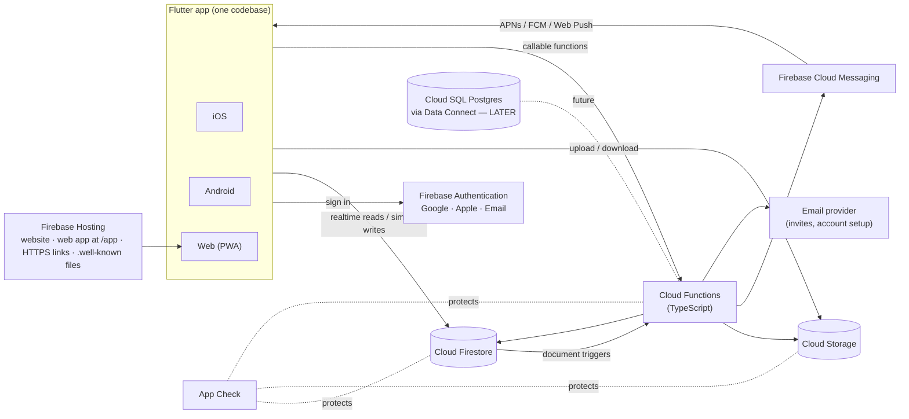
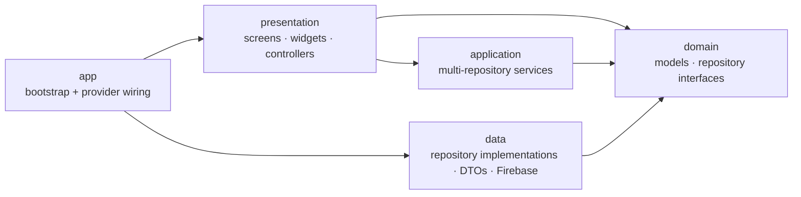
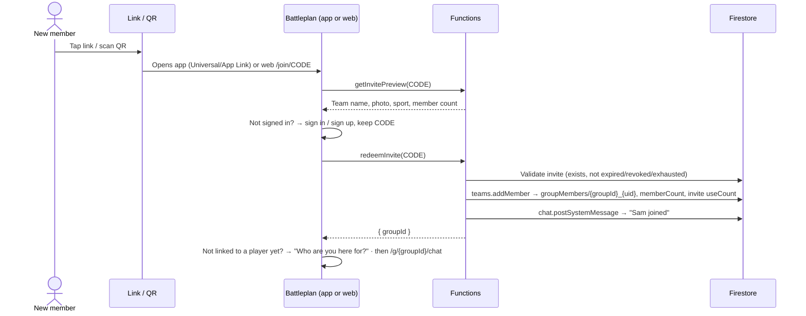
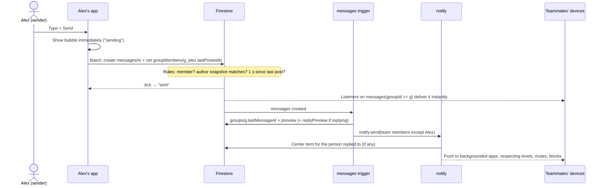

# Battleplan — Architecture

| | |
|---|---|
| **Status** | Draft v0.4 |
| **Owner** | Jared Freeman |
| **Last updated** | 2026-10-12 |
| **Companion doc** | [SPEC.md](SPEC.md): what gets built, feature by feature |

---

## 1. Purpose

Battleplan is a messaging and scheduling platform for sports teams. It combines what **GroupMe** (group chat) and **TeamReach** (schedules and RSVPs) do in one app on **iOS, Android, and the web**.

Like those apps, it hosts **many independent teams**. Each team is a **group** with its own members, admins, chat, schedule, and documents. One person can belong to several teams: a player on two teams, or a parent with kids on three. Our own team is the first to use it, but the design assumes anyone can sign up and create a team.

**Every account belongs to an adult (18+).** There's one kind of team, and every team has a roster of **players** (D59). A member links to a player in one of two ways, each approved by a team admin:

- **As the player** ("I am this player"). An adult player answers RSVPs for themselves on their player's row.
- **As a parent or guardian.** Players who **don't use the app**, such as kids, are roster entries without accounts, and their guardians answer RSVPs for them.

Members can also add players, which stay pending until an admin approves them.

This document explains how it's built: one **Flutter/Dart** codebase on a **Firebase** backend, using **Cloud Firestore (NoSQL) as the only database**. The Firestore model is deliberately **SQL-shaped**, so a **Cloud SQL (PostgreSQL)** database can be added later, one feature at a time, without rewriting the app (§12).

> **Terminology.** In code and data a team is a **group** (`groups`, `groupId`), which also covers non-team groups such as a league board or a parents' committee. The UI labels them **Team** by default (decision D13). This document says "group" when it means the data and "team" when it means the people.

---

## 2. Goals, non-goals, assumptions

**Goals**

- **Multi-team.** Unlimited independent teams. A team's data is visible only to its members and to platform super admins.
- **Self-serve.** A coach or manager can create a team and invite the whole roster in a few minutes, with no help from us.
- **One Flutter codebase** that ships iOS, Android, and web with the same features, behavior, and look.
- Real-time group chat, polls, scheduling with RSVPs, shared documents, and push notifications.
- **Running cost close to $0 while usage is small.** Cost should grow with the number of active teams, with no fixed monthly server bills.
- **Maintainable by design.** Enforced layers, Firebase access in one place, and a SQL-shaped data model, so the code stays untangled as it grows and Cloud SQL can be added without a rewrite.

**Non-goals for v1**

- Cloud SQL or any other always-on database server.
- **Public team discovery or search.** Teams are invite-only, which matters for youth teams.
- **Accounts for anyone under 18.** Youth players appear only as roster entries managed by their parents and guardians. Players never get accounts of their own; an adult player is a member linked to their player record.
- **Organizations and leagues** (several teams under one club admin). The data model reserves an `orgId` so this can come later.
- Full-text search across messages. This needs a search service or SQL (§12).
- SMS, voice or video calls, end-to-end encryption.

**Scale assumptions.** Past the v1 design target the design still works, but revisit §10 (cost) and §12 (the triggers for adding SQL).

| Dimension | At launch | v1 design target |
|---|---|---|
| Teams (groups) | a handful | ~2,000 |
| Total users | ~100 | ~50,000 |
| Members per team | 10–60 typical | max 500 |
| Players per team | 10–25 typical | max 200 |
| Teams per user | 1–3 typical | max 100 |
| Message volume | ~50/day per active team | bursts of a few per second in one team |

---

## 3. System overview



### Architectural principles

1. **Every team is an isolated tenant.** Every document a team owns carries its `groupId`, and every security rule checks the caller's membership of that team. Clients never query across teams except for the signed-in user's own memberships, players, and notifications.
2. **SQL-shaped data.** Firestore holds **flat, top-level collections only**, one per future SQL table, linked by explicit ID fields. There are no subcollections (§6.2).
3. **Firebase lives in one layer.** In the app, only the data layer talks to Firebase; screens and controllers see plain Dart models (§5.2). On the server, each domain module owns its collections (§6.4).
4. **Rules guard simple writes; Functions own everything else.**
   - Single-document writes (send a message, react, vote, RSVP) go straight to Firestore under Security Rules, so they're instant and work offline.
   - Privileged, multi-document, or side-effect work goes through callable Functions: creating teams, invites, deletions, role changes, email, and admin actions.
5. **The server computes derived data.** Counts, tallies, previews, and storage totals are written by Functions, never trusted from clients.
6. **One notification pipeline.** Every push notification and every notification-center item comes from one server module that applies preferences, mutes, and blocks (§6.5).
7. **Cost is a design constraint.** Every screen has a read budget, and the cost rules in §10.2 apply to every query.

---

## 4. Technology stack

| Layer | Choice | Notes |
|---|---|---|
| App framework | **Flutter** (stable channel), **Dart 3** | iOS, Android, and web from one codebase. Developed in VS Code with the Dart and Flutter extensions. |
| State management | **Riverpod** (with code generation) | Testable, no `BuildContext` coupling, easy to swap in fake repositories in tests. |
| Routing | **go_router** | URL-based. The same routes power web URLs, invite links, and notification taps. |
| Models | **freezed** + **json_serializable** | Immutable domain models with generated serialization. |
| Auth | **Firebase Authentication** | Email/password, email link, Google, Apple. |
| Database | **Cloud Firestore** (Native mode) | The only database in v1. |
| Files | **Cloud Storage for Firebase** | Chat photos, documents, avatars. |
| Server logic | **Cloud Functions for Firebase**, 2nd gen, **TypeScript / Node 22** | Callables, triggers, scheduled jobs. |
| Push | **Firebase Cloud Messaging (FCM)** | APNs for iOS, FCM for Android, Web Push for browsers. |
| Web hosting | **Firebase Hosting** | The website (`website/`, static) at the root and the Flutter web build at `/app/`; the HTTPS link domain, the Apple/Android link-verification files, legal pages. |
| Abuse protection | **Firebase App Check** | Play Integrity (Android), App Attest (iOS), reCAPTCHA Enterprise (web). |
| Config and flags | **Firebase Remote Config** | Feature flags and minimum supported app version (forced update). |
| Crashes and analytics | **Crashlytics** (iOS/Android), **Google Analytics for Firebase** | Crashlytics doesn't support web; web errors are handled in §9. |
| Email | **Firebase Auth** for signup and account emails; **Resend** (Q10) from Functions for setup links, invites, and notices; **Cloudflare Email Routing** for inbound mail | All free at Phase 1 (§6.7, D61). |
| CI/CD | **GitHub Actions**, Firebase Hosting preview channels, **Fastlane** (or Codemagic) for store builds | Includes the import-boundary check (§5.2). |
| Local development | **Firebase Local Emulator Suite** | Emulates Auth, Firestore, Storage, Functions, and Hosting. |

**Why TypeScript for Functions when the app is Dart?** Cloud Functions for Firebase officially supports Node.js and Python. TypeScript has the most complete Admin SDK, documentation, and examples. The server code is small and lives in `functions/`. Enums, limits, and collection names shared by app and server are defined once in `shared/constants.json` and code-generated into both Dart and TypeScript, so the two can't drift.

**Firebase plan: Blaze (pay-as-you-go) is required to run Cloud Functions and Cloud Storage in the cloud.** They aren't available on the free Spark plan. Development starts on Spark against the local emulators, and each project moves to Blaze when it first needs deployed Functions or Storage ([TODO.md](../TODO.md)). Blaze still includes the free-tier quotas, so at launch the expected bill is about **$0–5/month** (§10). **Set up budget alerts the day a project moves to Blaze.**

**"Deployed to Firebase", precisely:**

- The **web app** and the **backend** (rules, functions, indexes) deploy to Firebase.
- The **iOS and Android apps** reach users through the **App Store (Phase 4) and Google Play (Phase 5)** and talk to the same Firebase backend. Phase 1 goes live on the web only (D60).
- **Firebase App Distribution** delivers internal test builds.

---

## 5. Client architecture (Flutter)

### 5.1 Repository layout

```
battleplan/
├── lib/
│   ├── main_dev.dart            # entry point, dev flavor
│   ├── main_prod.dart           # entry point, prod flavor
│   ├── app/                     # bootstrap (Firebase init), router, theme, provider wiring,
│   │                            #   Firebase-backed platform services (analytics, crash, config)
│   ├── core/                    # design system, AppFailure, logging, IDs, time zones, links
│   ├── l10n/                    # ARB string files
│   └── features/
│       ├── auth/                # sign-in, account setup, linking
│       ├── groups/              # teams, roster, switcher, settings, invites
│       ├── players/             # players, player links, claims, pending players
│       ├── chat/  polls/  schedule/  documents/
│       ├── notifications/       # push registration, notification center
│       ├── safety/              # report, block
│       ├── settings/
│       └── admin/               # God admin panel (deferred-loaded on web)
│
│   Every feature has the same four folders:
│       domain/                  # models + repository interfaces (pure Dart)
│       data/                    # repository implementations, DTOs: the only Firebase code
│       application/             # services that coordinate several repositories (optional)
│       presentation/            # screens, widgets, Riverpod controllers
│
├── test/  integration_test/
├── ios/  android/  web/
├── website/                     # the static explainer site and legal pages at getbattleplan.app (§6.6); the app is under /app
├── functions/                   # Cloud Functions (TypeScript), same domains (§6.4)
├── shared/constants.json        # enums, limits, collection names → generated Dart + TS
├── shared/strong_language.json  # the language filter's words and test examples (SAFE-7) → generated too
├── firestore.rules  firestore.indexes.json  storage.rules
├── firebase.json  .firebaserc
├── tools/                       # seed/ (emulator data), gen_constants.dart, check_imports.sh, super-admin bootstrap
└── docs/
```

### 5.2 Layers and dependency rules

These rules keep the code from turning into spaghetti. They're enforced in CI and code review, not just suggested.



Arrows mean "may import". Nothing imports against the arrows.

1. **Only `data/` and `app/` import Firebase packages** (`cloud_firestore`, `cloud_functions`, `firebase_*`). Screens, widgets, controllers, and domain code never do. CI enforces this (below).
2. **`domain/` is pure Dart.** No Flutter, no Firebase: immutable models (freezed) and repository interfaces only.
3. **Widgets hold no business logic and no data access.** They render controller state and call controller methods.
4. **Controllers** (Riverpod notifiers) hold screen state and call repositories or application services. They never construct repositories; providers inject them, wired in one place (`app/providers.dart`).
5. **Repositories return domain models and typed `AppFailure`s** (`notFound`, `permissionDenied`, `offline`, `rateLimited`, …). Firebase types and exceptions never leave `data/`.
6. **Each collection has exactly one owning repository** (table below). Other features ask that repository; they never query its collection themselves.
7. **Features import each other only through `domain/`** and a feature's public widget barrel (`features/<x>/<x>.dart`), never another feature's `data/` or private files.
8. **Platform services sit behind interfaces too**: auth, push registration, analytics, crash reporting, remote config, file picking, calendar, sharing, and link building. `kIsWeb` and `Platform.isX` checks live only in those implementations.
9. **One way to do each thing.** That means one each of:
   - router
   - DI mechanism (Riverpod)
   - failure type
   - logger
   - time-zone utility
   - ID builder for composite IDs (`core/ids.dart`)
   - link builder
   - analytics facade

   Adding a second way needs a decision-log entry (§14).

**Collection ownership**

| Repository | Feature | Collections |
|---|---|---|
| `AuthRepository`, `UserRepository` | auth, settings | `users` |
| `DeviceRepository`, `NotificationRepository` | notifications | `devices`, `notifications` |
| `BlockRepository`, `ReportRepository` | safety | `userBlocks`, `reports` (reports via Functions) |
| `GroupRepository`, `MemberRepository`, `InviteRepository` | groups | `groups`, `groupMembers`, `invites` (invites via Functions) |
| `PlayerRepository` | players | `players`, `playerGuardians` (player links), `guardianRequests` (player claims), `playerDetails` |
| `MessageRepository` | chat | `messages` |
| `PollRepository` | polls | `polls`, `pollVotes` |
| `EventRepository`, `RsvpRepository` | schedule | `eventSeries`, `events`, `rsvps` |
| `DocumentRepository` | documents | `groupDocuments`, plus Storage files |
| `AdminRepository` | admin | `auditLogs`, `config`, admin callables |

**Boundary check (runs in CI on every PR)**

```sh
# tools/check_imports.sh — fail the build if Firebase leaks out of the data layer
bad=$(grep -rlE "package:(cloud_firestore|cloud_functions|firebase_[a-z_]+)/" lib \
      | grep -vE "^lib/(app|features/[a-z_]+/data)/")
if [ -n "$bad" ]; then echo "Firebase imported outside data/ or app/:"; echo "$bad"; exit 1; fi
bad=$(grep -rlE "package:flutter/" lib/features/*/domain)
if [ -n "$bad" ]; then echo "Flutter imported in domain/:"; echo "$bad"; exit 1; fi
```

### 5.3 Repositories and pagination

The repository interface is also the seam for Cloud SQL: a SQL-backed implementation can replace a Firestore one without touching any screen.

```dart
abstract interface class MessageRepository {
  Stream<List<Message>> watchNewest(GroupId groupId, {int limit = 50});
  Future<MessagePage> loadOlder(GroupId groupId, PageCursor before, {int limit = 50});
  Future<MessagePage> loadNewer(GroupId groupId, PageCursor after, {int limit = 50});
  Future<int> countUnread(GroupId groupId, DateTime since, {int cap = 100});
  Future<void> send(GroupId groupId, NewMessage message);   // text, photos, replyToId
  Future<void> setReaction(GroupId groupId, MessageId id, Reaction? reaction);
  Future<void> delete(GroupId groupId, MessageId id);       // calls deleteMessage
}
```

- **Domain code never sees Firestore types.** No `DocumentSnapshot`, `Timestamp`, `FieldValue`, or `Query` outside `data/`.
- **Pagination is cursor-based and opaque.**
  - `PageCursor` wraps a Firestore document snapshot today; a SQL implementation would use `(created_at, id)` keyset pagination.
  - The newest page of chat is a live listener. Older and newer pages are one-shot reads of 50.
  - Opening a chat at the first unread message uses `loadNewer` from that point.
  - Offsets are never used.
- **IDs are value types** (`GroupId`, `UserId`, `PlayerId`) wrapping strings. Composite IDs (§6.2) are built only by `core/ids.dart`, which uses the separator from `shared/constants.json`, so the server builds them identically.

### 5.4 Routing and deep links

go_router routes. The same paths are used for web URLs, Universal/App Links, and push-notification taps.

| Route | Screen |
|---|---|
| `/sign-in`, `/sign-up`, `/reset-password` | Sign-in flows: Google and Apple only (AUTH-1) |
| `/emaillogin` | Email sign-in (AUTH-2), linked from nowhere; `/sign-in/email`, its old address, redirects here with its query |
| `/activate` | Account setup from an emailed link (§6.1) |
| `/welcome` | No teams yet: join (code, QR, or link) or create a team |
| `/g/new` | Create a team |
| `/join/:code` | Invite landing. Works signed out: sign in, then auto-redeem. |
| `/notifications` | Notification center |
| `/messages`, `/messages/:groupId`, `/messages/:groupId/m/:messageId` | Messages, a direct conversation, and one opened at a message from a notification (CHAT-19). Top-level siblings, so opening a conversation from a profile goes back to the profile |
| `/people/:uid` (`?team=<groupId>`) | A person's page (TEAM-15); `team` is the team it was opened from |
| `/g/:groupId/chat`, `/g/:groupId/chat/m/:messageId` | Chat; jump to a message (replies, notifications) |
| `/g/:groupId/schedule`, `/g/:groupId/schedule/:eventId`, `/g/:groupId/schedule/new` | Schedule tab |
| `/g/:groupId/plays`, `/g/:groupId/plays/saved`, `/g/:groupId/plays/:playId` | Plays tab (the whiteboard); saved plays and play details |
| `/g/:groupId/documents`, `/g/:groupId/documents/d/:docId` | Documents tab; a document (notifications). The old `docs` path redirects. |
| `/g/:groupId/roster`, `/g/:groupId/roster/players/:playerId`, `/g/:groupId/invite`, `/g/:groupId/settings`, `/g/:groupId/reports` | Team menu |
| `/settings/...` | Profile, appearance, notifications, sign-in methods, account |
| `/admin`, `/admin/teams`, `/admin/teams/:groupId`, `/admin/users`, `/admin/users/:uid`, `/admin/reports`, `/admin/audit` (`?actor=&group=`), `/admin/settings` | God admin panel (dashboard, teams, users, reports, audit log, platform settings). The router imports it with a deferred import and loads it on first open. The JS web build puts it in its own file; the `--wasm` build has no such split, so there it's inside the one `.wasm` (D42). View team has no admin route: it's the team's own `/g/:groupId/…` tabs. |

- A `StatefulShellRoute.indexedStack` hosts the four tabs, so each tab keeps its scroll position and state.
- Redirect guards:
  - Signed out → `/sign-in?from=…`.
  - `/admin/**` requires the `superAdmin` claim.
  - `/g/:groupId/**` requires membership; non-members see a "not a member" screen.
- Web uses the **path URL strategy** (no `#`). The web app is built with `--base-href /app/`, so in the browser every route above sits under `/app` (`getbattleplan.app/app/g/…`); Hosting rewrites `/app/**` to `/app/index.html`. Native apps accept links with or without the `/app` prefix and route the rest (§6.6).

### 5.5 Theming and adaptive layout

- **Gumdrop Pop** (1.1, SPEC §7): Material 3 `ThemeData` is built by `AppTheme.of(flavor, teamColor:, onCard:)` in `core/design/app_theme.dart` for each of three flavors (`GumdropFlavor.dark`, `light`, `candy`), cached per flavor, team color, and context. Every color role of the active theme (page, cards, raised buttons, wells, inputs, lines, text, headings, and the seven candy accents, each a face, lip, and text shade) lives in one `ThemeExtension`, `GumdropColors` (`gumdrop_colors.dart`), read with `GumdropColors.of(context)`. `AppColors` stays for the older getters (RSVP, event, and bubble text colors). The Material `colorScheme` is kept text-safe: `primary`, `secondary`, `tertiary`, and `error` read 4.5:1 on cards.
- **Gumdrop buttons**: `GumdropShape` (`gumdrop_shape.dart`) is an `OutlinedBorder` that paints the hard lip under the face and the highlight along its top, so `ThemeData` makes every filled, outlined, elevated, and text button, chip, segmented button, FAB, and navigation indicator a gumdrop; `GumdropButtons.of(context)` gives other candies and sizes. Pressed, the face sinks onto the lip in 80 ms.
- **Candy's two contexts**: Gumdrop Candy's page is blue with white text and its cards are white with navy text. The app theme is the page context; `GumdropCard` and `GumdropSurface` (`team_theme.dart`) put their child in the card context.
- **Team color**: `teamTinted(base, argb)` (`team_tint.dart`, a pure function on CIE LCh in `color_math.dart`) makes a team's color the page in every theme (SPEC §7.4), darkened only where neither white nor ink reads (Green). The result is a `coloredPage`, as Candy's own blue is: text, headings, and shadows straight on the page are computed from it (white or ink, whichever reads; shadows the other one, or the team color lifted where ink vanishes), candies and secondary buttons under 2:1 against it get an ink lip (`edgeContrast`), and `AppTheme.build` derives Material's page-context surfaces and inputs from the page, while the theme's cards and their text come from the card context (`GumdropColors.card`, applied by `GumdropSurface`): white in Light and Candy, and in Dark a muted version of the team color (`mutedDarkCards`: every navy surface, its text, and the in-card heading shadow at the navy's own L* in the team's hue, chroma capped at the navy's). Hues within 25° of Gumdrop's navy (Blue, Navy; `isGumdropHue`, never a gray) keep Dark's and Light's own pages. `TeamTheme` applies it to a subtree; `TeamShell` wraps itself in it, and `_inTeamColors` in `router.dart` wraps every route under `/g/:groupId` in `TeamColors(groupId:)`, which reads `groups.color`. Screens outside a team are untinted. The palette is `teamColors` in `shared/constants.json`; colors retired from it (`retiredTeamColors`: Royal blue to Blue, Violet to Purple) are mapped by `currentTeamColor` (`groups/domain/team_palette.dart`) when a team's color, chat look color, or invite preview is read, and `firestore.rules` still accepts them while the app and Functions write only the palette. Swatch names are looked up by value (`teamColorName`). `test/gumdrop_theme_test.dart` checks every team color in all three themes (the page, its text, shadows, and edges, and 4.5:1 for every text role and Material's), and `test/accessibility_test.dart` runs chat, schedule, the event, and Team settings on a Yellow and a Maroon team in all three.
- The theme setting is the `ThemePreference` enum from `shared/constants.json`: `dark` (Gumdrop Pop Dark, the default), `light`, `candy`, and the legacy `system`, which `AppTheme.flavorOf` reads as Dark. Settings offers the three (`ThemePicker`). It's stored locally so the right theme shows at launch, and synced to the profile so it follows the user across devices; new accounts get `dark`.
- **Fonts are bundled as assets** rather than fetched at runtime, so text renders identically on all platforms and offline: Lilita One 400 (headings), Fredoka 500, 600, and 700 (buttons, labels, names), and Nunito 400 and 600 to 900 (body and messages), static TTFs from Google Fonts under `assets/fonts/<family>/`, each with its `OFL.txt`, which `registerFontLicenses` (`fonts.dart`) lists under Licenses. The families are `AppFonts.display`, `label`, and `body`; message text is Nunito on every platform (`ChatText`).
- **One design system on every platform.** We don't use Cupertino widgets on iOS and Material on Android. Platform-specific behavior appears only where users expect it: iOS back-swipe and scroll physics, haptics on mobile, hover states, right-click menus, and keyboard shortcuts on web.
- Breakpoints:

  | Width | Navigation | Notes |
  |---|---|---|
  | < 840 px (phones, narrow browser windows) | **Bottom navigation bar** with Chat · Schedule · Documents · Plays | |
  | ≥ 840 px (desktop browsers, tablets in landscape) | Same four destinations, same order and icons, as a **left navigation rail** | Content width is capped (~840 px for chat) so it stays readable. *(Decision D9; can be overridden to keep the bottom bar everywhere.)* |

### 5.6 Offline and performance

- Firestore offline persistence is on: the default on mobile, enabled explicitly on web.
- Sent messages appear instantly (latency compensation) with a "sending" state. Writes made offline queue and sync when the connection returns. File uploads need a connection and offer retry.
- Pending server timestamps are read as local estimates (Firestore's `estimate` server-timestamp behavior), so pending messages sort correctly.
- Lists show **thumbnails**. Full-resolution images load only when tapped. Images load through Flutter's image cache and the platform's HTTP cache (D50).
- Web:
  - Build with `flutter build web --wasm`, falling back to JS/CanvasKit if a plugin isn't WASM-compatible.
  - `index.html` shows a branded loading screen.
  - The admin panel is **deferred-loaded** so regular users never download it. Only the JS build splits it out; the `--wasm` build bundles it (D42).

### 5.7 Environments and flavors

| | Dev | Prod |
|---|---|---|
| Firebase project | `battleplan-dev-ecce4` | `battleplan-prod` |
| Bundle / application ID | `app.getbattleplan.dev` | `app.getbattleplan` |
| Entry point | `lib/main_dev.dart` | `lib/main_prod.dart` |
| Web | `battleplan-dev-ecce4.web.app` (website at the root, app at `/app`) + PR preview channels | `getbattleplan.app` (website) and `getbattleplan.app/app` (web app) |

- The two flavors have separate app IDs, so dev and prod builds can be installed side by side.
- `flutterfire configure` generates `lib/app/firebase_options_dev.dart` and `firebase_options_prod.dart`.
- `--dart-define=USE_EMULATORS=true` points a dev build at the Emulator Suite under the project ID `demo-battleplan` (D31). Prod builds refuse it.
- **Never test against prod.**
- Local development runs on the **Emulator Suite** ([DEVELOPMENT.md](DEVELOPMENT.md)). `tools/seed/seed.ts` loads sample teams of adult players and of kids, people on several teams, parents with several players, and messages, polls, events, and documents.

---

## 6. Backend (Firebase)

### 6.1 Authentication and accounts

**Enabled providers:**

- Email/Password, including **Email link** (passwordless) sign-in
- Google (any Google account, Gmail or Workspace)
- Apple (Phase 3, D60), on in dev, on the emulators, and in prod since 2026-10-17. `AppEnv.appleSignInInProd` can hide it in prod again, so prod never offers a button that can't work. Firebase's `apple.com` provider is set in both projects through the Identity Toolkit Admin API (`defaultSupportedIdpConfigs/apple.com`): the Services ID `app.getbattleplan.signin` as the client ID, the bundle IDs `app.getbattleplan.dev` (dev) and `app.getbattleplan` (prod), and the team ID (`885XHF7XLL`), key ID, and private key of the one key that also serves APNs. The key file is kept in 1Password; to rotate it, make a new key in the Apple Developer account and set the provider again in both projects.
- Facebook, in Phase 6 (D33, D60).

Leave the default **"One account per email address"** setting on. We don't need Firebase Auth's **Identity Platform upgrade**: email and social sign-in stay free without it, while the upgrade adds per-user pricing above 50k monthly active users. SAML or OIDC single sign-on (Phase 6), if teams want it, would need the upgrade and its per-user pricing past the free tier, so check the price first.

#### Battleplan profiles are separate from sign-in identities

- **Firebase Authentication stores identities**: the Google, Apple, and email/password credentials linked to one `uid`. **Firestore `users/{uid}` stores the Battleplan profile**: name, photo, contact email, preferences.
- **Provider data is used once**, at first sign-in, to prefill the profile. The provider's photo is copied into our Storage at that point, so the profile never depends on a provider URL.
- **After that, only the person changes the profile.** None of these touch it:
  - signing in with another provider;
  - linking or unlinking a provider;
  - a provider changing its own data.
- **`users.email` is the verified contact address** used for notifications and invites. It changes only through a verified change-email flow (`verifyBeforeUpdateEmail`), and Firebase sends a notice to the old address.
- **Everything is keyed by `uid`**, never by provider IDs or provider emails. Memberships, roles, messages, and RSVPs survive any change of sign-in method.
- **Accounts are for adults (18+) only.** Players never get accounts of their own; they exist as roster entries (`players`, §6.2). An adult player is a member with a `self` link to their player.

#### How accounts get created

1. **Self sign-up.** The first sign-in with any provider creates the Auth user. The app then calls the idempotent callable `ensureUserProfile`, which creates `users/{uid}`. A client call is used instead of an Auth trigger so the app knows the profile exists before it continues.
2. **Admin-created ("local") accounts.** A super admin, or a team admin for their own team, enters **a name and an email, nothing else**. Then `adminCreateUser`, `addMemberByEmail`, or `addPlayers` (for players and guardians):
   - creates the Firebase Auth user **with no password**;
   - creates `users/{uid}` with `status: 'provisioned'`, plus the memberships or player links;
   - emails a **setup link**: an email-link sign-in generated with `generateSignInWithEmailLink` and sent through our email provider (§6.6).

   **Nobody ever sets, sees, or knows another person's password.** No screen, callable, or admin tool can set one; admins can only trigger setup or password-reset emails. Setup links expire, and "Resend" sends a fresh one. The person shows up on the roster right away, and admins can RSVP on their behalf before they ever sign in.

#### How a person with an admin-created account gets in

| They do this | What happens |
|---|---|
| Tap the setup link | Signed into their account, and the email is marked verified. The app then asks: *"How do you want to sign in next time?"* They choose Google, Apple, or a password they create themselves, and the app links it to the account. |
| Tap **Continue with Google** using the same Gmail address | Firebase signs them into the same account, because Google is a trusted provider for Gmail addresses. |
| Use **Apple** with the same email | Firebase signs them into the same account and adds Apple, because it always treats Apple's addresses as verified (linking rule 2). |
| Use a non-Gmail Google account with the same email | Handled by linking rule 2 below. |
| Use Apple **"Hide My Email"** | The relay address won't match. The welcome screen says *"Added by a coach or admin? Use the link in your setup email."* They can link Apple from Settings afterward. |

#### Safe account linking

1. **Prove both sides.** A sign-in method is linked only from a signed-in session with a recent sign-in, by completing that provider's own sign-in (`linkWithProvider`, or `linkWithCredential` for a pending credential).
2. **No silent merges by email.**
   - Firebase joins a new sign-in to an existing account automatically only when it trusts the provider for that email: Google for Gmail addresses, and Apple, whose addresses it always treats as verified. A trusted sign-in also replaces a method Firebase doesn't trust for that email, such as a password whose email was never verified.
   - Otherwise Firebase returns `account-exists-with-different-credential`. The app remembers the method tried and sends a sign-in link to that email. Once the link is opened, `/finish-link` offers to link that method (Google, or Apple where it's on) by completing its own sign-in.
3. **An unverified email never links anything.**
4. **Security emails.** These changes send a notice to the account email ("Google sign-in was added to your Battleplan account. Not you? Contact support."):
   - adding or removing a sign-in method;
   - changing the password;
   - changing the email.

   The app reports each change to `recordSignInMethodChange`. `ensureUserProfile`, which the app calls at every sign-in, also compares Auth's methods with `users.signInMethods` and sends the notice for any change the app didn't report, such as Firebase adding Apple at sign-in (rule 2).
5. **A fresh sign-in is required** before linking, unlinking, changing the email or password, and deleting the account.
6. **The last sign-in method can't be removed.**
7. **Two existing accounts are never merged automatically.** If someone ends up with two, a super admin moves their memberships by hand (a merge tool is Later).

#### Password reset

- The app calls `sendPasswordResetEmail`. The email template is customized in the Firebase console.
- **Email enumeration protection** (on by default for new projects) means the app can't reveal which provider an email uses. The reset screen always says *"If an account exists for that email, we've sent a link."* It also reminds people who use Google or Apple that they don't need a password.

#### God admin (super admin)

- Super admins carry a custom claim, `superAdmin: true`. They're platform operators: they can see and manage every team.
- The first one is set with `tools/seed/set-super-admin.ts` (`npm --prefix tools/seed run super-admin -- <project> <email>`), which runs locally with your own `gcloud` sign-in, so no service-account key exists. After that, super admins grant and revoke the claim from the admin panel through `adminSetSuperAdmin`, which keeps `users.superAdmin` in step. Revoking signs the person out everywhere; granting doesn't (D42).
- Rules and Functions both check the claim. The client force-refreshes its ID token after a change.
- **Team roles are *not* claims.** They're per-team, change often, and claims are capped at 1,000 bytes. Team roles live in `groupMembers` and are checked by rules.

#### Account deletion

App Store and Google Play both require in-app account deletion. The callable `deleteAccount`:

- transfers ownership of any teams the user owns;
- deletes their memberships, player links, player claims, pending players they proposed, devices, blocks, and notifications (a player left with no links stays on the roster for admins to manage);
- deletes their RSVPs for upcoming events and keeps past ones;
- anonymizes their messages to "Deleted user";
- deletes the profile, avatar, and the Auth user.

Before calling it, the iPhone, iPad, and Mac apps revoke Apple's tokens for an account with Apple sign-in (App Review 5.1.1(v)): a fresh Apple sign-in (`reauthenticateWithProvider`) returns an authorization code, which `revokeTokenWithAuthorizationCode` hands to Firebase, which revokes it with Apple using the provider's key. That sign-in is also the recent sign-in deleting needs. Closing Apple's sheet deletes nothing (`SignInCanceled`); a revoke that fails is logged and the deletion goes ahead, since the account is what the person asked to remove. The web and Android SDKs can't revoke; people there can remove Battleplan under Sign in with Apple in their Apple Account settings.

#### Provider setup gotchas (do these in the M0/M1 spike)

- **Apple**
  - App Store guideline 4.8 requires a privacy-focused login option whenever Google login is offered. Sign in with Apple satisfies it, and it's on from Phase 3, before the App Store in Phase 4.
  - The iPhone, iPad, and Mac apps use Apple's native sheet, which needs the `com.apple.developer.applesignin` entitlement (`ios/Runner/RunnerDev.entitlements` and `RunnerProd.entitlements`) and Sign in with Apple on each App ID (`app.getbattleplan.dev`, `app.getbattleplan`).
  - On Android and web, Apple sign-in runs as a web flow. It needs the Services ID, with each project's `firebaseapp.com` domain and its `/__/auth/handler` return URL.
  - The Auth emulator's Apple page always calls the email verified, so on the emulators Apple with an existing email joins that account, as Firebase does in the cloud.
  - Register our email sending domain with Apple's **private email relay** so emails reach `@privaterelay.appleid.com` addresses.
- **Google on web.** Use Firebase Auth's `signInWithPopup(GoogleAuthProvider())`. The `google_sign_in` plugin's web support is button-based and doesn't fit our sign-in screen.
- **All web sign-in.** Prefer popups. If redirects are ever used, set `authDomain` to the app's own custom domain, because browser third-party-storage partitioning (Safari, Chrome) breaks cross-domain redirects.

### 6.2 Firestore data model (SQL-shaped)

#### Modeling rules

1. **Top-level collections only, no subcollections.** Each collection is one future SQL table.
2. **Relationships are explicit ID fields**: `groupId`, `uid`, `playerId`, `eventId`, `pollId`, `messageId`. These become foreign keys later.
3. **Every team-owned document stores `groupId`**, even when it could be derived, so one rule pattern secures everything and team-wide jobs work on one field.
4. **One-per-pair records use composite IDs**, the equivalent of a composite primary key:

   | Collection | Document ID |
   |---|---|
   | `groupMembers` | `{groupId}_{uid}` |
   | `playerGuardians` | `{playerId}_{uid}` |
   | `guardianRequests` | `{playerId}_{uid}` |
   | `playerDetails` | `{playerId}` (one per player) |
   | `pollVotes` | `{pollId}_{uid}` |
   | `rsvps` | `{eventId}_{participantId}` |
   | `userBlocks` | `{uid}_{blockedUid}` |

   Writing the same pair twice updates one document instead of creating a duplicate. Auto-IDs and Auth uids never contain `_`.
5. **Embed only what is small, bounded, owned by its parent, and always read with it.** Every bounded list has its maximum in `shared/constants.json`, and each maps to columns or a child table later (§12.3):
   - message attachments (≤ 10)
   - message reactions (one per person)
   - poll options (≤ 10)
   - a vote's chosen options (≤ 10)
   - event reminder times (≤ 6)
   - a series' skipped dates (≤ 100)
   - fixed-shape maps (settings, location, counts)
6. **Naming.**
   - Fields are camelCase.
   - Timestamps end in `At` and are UTC Firestore Timestamps.
   - Dates end in `Date` and are `YYYY-MM-DD` strings, so all-day events never shift across time zones.
   - Enums are lowercase strings from `shared/constants.json`.
   - Every document has `createdAt`, `updatedAt`, and `schemaVersion`.
7. **Caches are labeled.** Denormalized copies are marked `(cache ← source)`. Only Functions write them, or rules check them against their source.
8. **Soft delete only for messages**, so the "deleted" placeholder stays in the conversation. Everything else is deleted for real.
9. **No document grows without bound.**

#### Collections

| Collection | Document ID | One document per | Future table | Written by |
|---|---|---|---|---|
| `users` | `uid` | account | `users` | owner (profile fields), Functions |
| `devices` | installation ID | app install | `user_devices` | owner |
| `userBlocks` | `{uid}_{blockedUid}` | blocker + blocked | `user_blocks` | owner |
| `groups` | auto, or `dm` + 32 hex characters for a direct conversation | team, or direct conversation (CHAT-19, D65) | `groups` | Functions; admins edit profile and settings |
| `groupMembers` | `{groupId}_{uid}` | team + person, or conversation + one of its two people | `group_members` | Functions; members edit their own preferences |
| `players` | auto | player on a team's roster (active or pending) | `players` | Functions; linked members and admins edit details |
| `playerGuardians` ("player links") | `{playerId}_{uid}` | player + linked member (`self` or `guardian`) | `player_links` | Functions |
| `guardianRequests` ("player claims") | `{playerId}_{uid}` | player + member claiming it | `player_claims` | Functions |
| `playerDetails` | `{playerId}` | player (optional details for coaches, PLAYER-12) | `player_details` | admins and the player's linked members; Functions delete |
| `invites` | invite code | invite | `invites` | Functions |
| `messages` | auto | message | `messages` | members (create, own reaction), Functions |
| `polls` | auto | poll | `polls` | members (create), Functions |
| `pollVotes` | `{pollId}_{uid}` | poll + voter | `poll_votes` | the voter |
| `eventSeries` | auto | repeating series | `event_series` | Functions |
| `events` | auto | event | `events` | admins and allowed members, Functions |
| `rsvps` | `{eventId}_{participantId}` | event + participant | `event_rsvps` | the member; for a player, its `self` member, its guardians, or admins |
| `groupDocuments` | auto | file or link | `documents` | members if allowed, Functions |
| `plays` | auto | saved play (§6.14) | `plays` | admins |
| `notifications` | `{dedupeKey}_{uid}` | notification-center item | `notifications` | Functions; the recipient marks read |
| `notifyLog` | dedupe key | one notification send | — | Functions only (TTL 7 days) |
| `calendarLinks` | the link's token | calendar link (SCHED-11, §6.15) | — (operational) | Functions; the owner reads |
| `teamCalendars` | `{groupId}` | a team's calendar feed, cached (§6.15) | — (cache) | Functions only |
| `answerLinks` | SHA-256 of the token | answer link in an RSVP email (SCHED-14, §6.15) | — (operational) | Functions only (TTL) |
| `reports` | auto | report | `reports` | Functions |
| `auditLogs` | auto | admin action | `audit_logs` | Functions |
| `rateLimits` | `{uid}_{action}_{window}` | counter window | — (operational) | Functions |
| `config` | `app`, `superAdmins` | — | `app_config` | Functions (`app` through `adminUpdateConfig`; `superAdmins` is a lock) |

#### Fields

```
users/{uid}
  displayName, displayNameLower, email, emailLower      # Battleplan's own profile (§6.1)
  photoPath                                              # copied into our Storage at first sign-in
  status: 'provisioned' | 'active' | 'disabled'
  signInMethods: ['password' | 'google.com' | 'apple.com']   # cache ← Firebase Auth
  themeMode: 'system' | 'light' | 'dark' | 'candy'          # SET-2; system (before 1.1) reads as dark
  notificationPrefs: { messages, replies, mentions, polls, eventsNew, eventsChanged, reminders, documents }   # bools; a missing key is on (NOTIF-4)
  superAdmin?                                            # cache ← the superAdmin claim; adminSetSuperAdmin and the bootstrap script keep it; finds super admins for lists and the last-super-admin check
  acceptedTermsAt, adultConfirmedAt, lastActiveAt, createdAt, updatedAt, schemaVersion

devices/{installationId}                                # a random 20+ character ID each install keeps
  uid, token, platform: 'ios' | 'android' | 'web', appVersion, updatedAt   # pruned after 60 days without an update

userBlocks/{uid}_{blockedUid}
  uid, blockedUid, createdAt

groups/{groupId}
  name, nameLower, description, photoPath, color?, sport
  kind: 'team' | 'direct'                               # written by createGroup and the migration; a missing kind reads as 'team'; leaves room for a basic 'group' kind (TEAM-14). Old docs may still carry teamType, which readers ignore. 'direct': a conversation between two people (CHAT-19, D65), made by openDirectChat
  uids?: [uid, uid]                                     # direct only: its two people, sorted; the rules read the other one from it
  people?: { <uid>: { name, photoPath } }               # direct only (cache ← users): what Messages and the conversation's header show; "Deleted user" once an account is gone
  ownerId, createdBy, timeZone, orgId?                  # orgId reserved for leagues (later)
  settings: { membersCanCreateEvents, membersCanCreatePolls, membersCanUploadDocs,
              membersCanInvite, allowMaybe, membersCanSeePeople, filterLanguage, defaultReminderOffsets: [minutes] }
  memberCount, playerCount                              # cache ← groupMembers, players
  lastMessageAt, lastMessagePreview: { authorName, text, type, authorId? }   # cache ← messages; authorId only on a direct conversation, for "You: …" in Messages
  storageBytes, storageQuotaBytes                       # cache ← Storage triggers; limit: the default (200 MB) unless a super admin gave the team its own (§6.11)
  storageQuotaCustom?                                   # true when the limit is the team's own (STORE-6); a change to the default leaves it alone
  storageAlert: 'none' | 'warn' | 'full'                # Functions only; which storage notification was last sent (STORE-3, STORE-4)
  chatTheme?: { bubbleColor, background: 'plain' | 'pattern' | 'photo', backgroundPath? }   # CHAT-18
  pinnedMessageIds?: [messageId]                        # CHAT-15: the pinned bar, ≤ 3, oldest pin first; Functions only (pinMessage; erasing a message unpins it)
  archivedAt?, suspendedAt?, createdAt, updatedAt, schemaVersion
  status: 'active' | 'archived' | 'suspended'           # Functions only, kept with archivedAt and suspendedAt (suspended wins) so the admin panel filters with one indexed query (ADMIN-2)

groupMembers/{groupId}_{uid}
  groupId, uid, role: 'owner' | 'admin' | 'member' | 'participant', title?   # 'participant': one of a direct conversation's two people (CHAT-19); team lists ask for the three team roles, so conversations never show or count as teams
  otherUid?, lastMessageAt?                             # direct only: the other person, and (cache ← messages) when it last had a message, which orders Messages
  coach?                                                # TEAM-3: set by admins (updateGroupMember); unset, the owner counts as a coach (Membership.isCoach). Coaches have a Me row (hasMeRow) and go by their own answer for reminders (audienceOf)
  jerseyNumber?, position?                              # unused; number and position live on the member's `self` player
  displayName, photoPath                                # cache ← users
  playerSummary?                                        # cache ← players + links: guardian "Emma #7, Liam #23"; self "#12" or empty
  notificationLevel: 'all' | 'important' | 'none', mutedUntil?   # "until unmuted" = 9999-12-31 (Limits.mutedForeverMs)
  lastReadAt                                            # unread counts
  lastPostedAt, lastPostedMessageId                     # message rate limit (§6.3, §6.9)
  pending?                                              # added by email, hasn't signed in yet (AUTH-6); cleared by ensureUserProfile
  contactPhone?, contactEmail?                          # TEAM-10: what the member shares with this team, written only by them; phone ≤ 30 with a digit, email ≤ 254; null when not shared
  joinedAt, addedBy, inviteCode?
  linksUpdatedAt?                                       # Functions only: set when a link makes the membership, and by each new 'self' link, so two link transactions conflict and one retries (PLAYER-3 limits)

players/{playerId}                                      # name and number only (PLAYER-10)
  groupId, displayName, displayNameLower, jerseyNumber?, position?   # position: older players only; the app no longer writes or shows it
  walkUpSong?                                           # PLAYER-2: up to walkUpSongMax (100), the whole team sees it
  status: 'active' | 'pending'                          # a member's new player is pending until an admin decides; missing = active (old docs)
  proposedBy?, proposedRelation?: 'self' | 'guardian'   # players added with proposePlayer: who added it and how they're linked; approval links them that way (missing = guardian)
  decidedBy?, decidedAt?                                # with proposedBy: the admin who approved it, or the admin who added it
  linksUpdatedAt?                                       # Functions only: touched by every link write, so approvals running at once conflict and one retries; the players trigger ignores it
  createdBy, createdAt, updatedAt

playerGuardians/{playerId}_{uid}                        # "player links"
  playerId, groupId, uid, addedBy, createdAt
  via: 'admin' | 'request' | 'guardian' | 'claim' | 'proposal'   # an admin's roster (addPlayers), an approved claim, a guardian added from the player card (inviteGuardian), an admin's own claim, or a player added with proposePlayer (approved, or an admin's); links from before claims may say 'self'
  relation: 'self' | 'guardian'                         # missing = guardian (old docs); ≤ 1 self per player, ≤ 1 self per member per team, ≤ 4 guardians per player

guardianRequests/{playerId}_{uid}                       # "player claims"
  playerId, groupId, uid, status: 'pending' | 'approved' | 'declined'
  relation: 'self' | 'guardian'                         # missing = guardian (old docs)
  decidedBy?, decidedAt?, createdAt

playerDetails/{playerId}                                # optional details for coaches (PLAYER-12); same ID as the player; only admins and linked members (and super admins, read only) see it
  groupId                                               # the player's team; set on create, never changes
  dateOfBirth?: 'YYYY-MM-DD' | null                     # a real date before today (UTC); the app shows the age, never stored
  emergencyContacts?: [{ name, phone, relationship? }]  # up to 2; name ≤ 60, phone ≤ 30, relationship ≤ 30
  notes?: string | null                                 # ≤ 500, "Anything else coaches should know"
  updatedBy, updatedAt                                  # the writer and request.time on every write

invites/{code}
  groupId, type: 'link' | 'email', email?, role: 'member'
  createdBy, expiresAt?, maxUses?, useCount, revokedAt?, createdAt

messages/{messageId}
  groupId, authorId, authorName, authorPhotoPath, authorPlayerSummary?   # snapshot; rules check it
  type: 'text' | 'image' | 'poll' | 'event' | 'system'
  text (≤ 4000)
  mentions?: [uid] (≤ 20), mentionsEveryone?           # CHAT-14: whom it names with @, resolved by the app from full names; @everyone from admins only; text and photos
  announcement?                                         # CHAT-15: an admin's text message that notifies everyone
  attachments: [{ path, thumbPath, contentType, width, height, size }]   # ≤ 10
  replyToId?, replyPreview?: { authorName, text, type, deleted }        # cache ← messages
  pollId?, eventId?, seriesId?, systemEvent?: { kind, actorId, targetId }   # event cards: eventId, and seriesId for a series' card
  reminder?                                             # an event card posted again by hand (repostEvent, SCHED-8)
  reactions: { <uid>: <one of the 16 reactions> }       # one per person (CHAT-6)
  editedAt?, deletedAt?, deletedBy?, deletedReason?: 'author' | 'admin'
  createdAt                                             # an imported message keeps its original time
  imported?: { source: 'groupme', sourceId, importedBy, importedAt }   # §6.13: authorId is 'groupme:<id>', not an account; Functions only

polls/{pollId}                                          # same ID as its poll message
  groupId, messageId, createdBy, question               # the message's text is the question
  options: [{ id, text }]                               # 2–10; ids '0'…'9' in order
  allowMultiple, anonymous, closesAt (or null), closedAt (null while open), closedBy?
  voteCounts: { <optionId>: n }, voterCount             # cache ← pollVotes
  createdAt

pollVotes/{pollId}_{uid}
  pollId, groupId, uid, optionIds: [optionId], updatedAt

eventSeries/{seriesId}
  groupId
  recurrence: { freq: 'daily' | 'weekly', interval: 1..8, byWeekday: [1..7],   # ISO weekdays, Monday = 1; weekly only
                startDate, untilDate | null, count | null,   # exactly one of untilDate or count; count counts kept dates
                skipDates: [YYYY-MM-DD] }                     # ≤ 100; last date ≤ 12 months after startDate; ≤ 400 events
  template: { type, title, description, location, allDay, startTime, endTime,   # 'HH:mm', null when allDay
              timeZone, arriveMinutesBefore, opponent, homeAway, rsvpEnabled,
              reminderOffsets, notifyTeam, postToChat }   # the event's fields minus dates
  timeZone                                              # occurrences keep wall-clock time across DST
  createdBy, createdAt, updatedAt

events/{eventId}
  groupId, seriesId?, seriesDate?                       # seriesDate: the occurrence's date in timeZone (Functions only)
  seriesOverrides?: [fieldName]                         # fields edited with "This event"; series edits skip them. 'startAt' covers every time field
  type: 'game' | 'practice' | 'meeting' | 'social' | 'other'
  title (1–100), description (≤ 2000, '' when none)     # games: the app fills "vs. Opponent" / "@ Opponent" when left blank
  location: { name (≤ 100), address (≤ 200) } | null    # a name or an address, or no location
  allDay, startAt, endAt, timeZone                      # all-day: midnight to midnight after the last day, in timeZone
  startDate?, endDate?                                  # all-day events only; the dates never shift
  arriveMinutesBefore? (0–240), opponent? (≤ 60), homeAway?: 'home' | 'away'   # games only
  rsvpEnabled                                           # every event takes player RSVPs and members' own (PLAYER-6); old docs may carry rsvpFor, which readers ignore
  rsvpDeadline?, reminderOffsets: [minutes]            # deadline before startAt (null on series events); ≤ 6 of 15, 60, 120, 1440, 2880, 10080
  notifyTeam, postToChat                                # read on create only; can't change afterwards
  nextReminderAt?                                       # computed; drives the reminder job
  rsvpCounts: { going, maybe, notGoing }                # cache ← rsvps; players only
  staffCounts: { going, maybe, notGoing }               # cache ← rsvps; everyone else (members answering for themselves), shown as "others" (D34, D59)
  messageId?                                            # the event card: the event's ID, or the series' ID for a series
  canceledAt?, canceledBy?                              # set once, never cleared (SCHED-7)
  createdBy, createdAt, updatedAt

rsvps/{eventId}_{participantId}                         # exactly one per event + participant
  eventId, groupId
  participantType: 'member' | 'player', participantId  # a uid (a member answering for themselves), or an active playerId
  participantName (≤ 60), eventStartAt                  # cache ← groupMembers/players, events; eventStartAt follows a moved event
  status: 'going' | 'maybe' | 'not_going', note (≤ 200, '' when none), guests (0 until v1.1)
  respondedBy (uid), updatedAt

groupDocuments/{docId}
  groupId, kind: 'file' | 'link'
  name (1–100, trimmed non-empty), nameLower            # nameLower == name.lower(), for the Name sort
  description (≤ 500, '' when none), pinned             # only admins pin; the app always creates unpinned
  path, contentType, size                               # kind = file: groups/{groupId}/documents/{docId}/{fileName} (its own folder),
                                                        #   uploaded before the doc is created; a storage.rules isDocument type; ≤ 10 MB
  url (http or https, ≤ 2000)                           # kind = link; a link has no path, contentType, or size, and a file no url
  uploadedBy, uploaderName                              # uploaderName: the uploader's groupMembers displayName (cache), "Deleted user" after account deletion
  notifyTeam                                            # read on create only (DOC-6); can't change afterwards
  createdAt, updatedAt
  imported?: { source, sourceId, importedBy, importedAt }   # §6.13: uploaderName is who shared it there, createdAt when; Functions only

notifications/{dedupeKey}_{uid}                         # notification-center items
  uid, groupId, type: notifyKind, params: { … }, title, body, route
  actorId?, targetType, targetId, read, createdAt, expiresAt   # TTL: 90 days

notifyLog/{dedupeKey}                                   # one per send, so a retried trigger can't push twice
  kind, groupId, createdAt, expiresAt                   # TTL: 7 days

calendarLinks/{token}                                   # SCHED-11, §6.15: the ID is the secret, 32 random bytes in base64url
  uid, groupId                                          # groupId null: all the person's teams
  createdAt, fetchedAt?                                 # fetchedAt: when a calendar last read it, written at most hourly

teamCalendars/{groupId}                                 # §6.15: what a team's feed prints, cached; Functions only
  events: [{ id, title, type, allDay, startAt, endAt, startDate?, endDate?, location?, description,
             arriveMinutesBefore?, canceled, updatedAt }]   # ≤ 500, from 60 days back to 12 months ahead
  builtAt, changedAt                                    # rebuilt when changedAt is after builtAt, or after 6 hours

answerLinks/{sha256(token)}                             # SCHED-14, §6.15: only the token's hash is stored
  uid, groupId, eventId, participants: [{ id, name, self }]   # the players the email asks about
  expiresAt                                             # the event's start or its deadline, whichever comes first; TTL
  createdBy, createdAt

reports/{reportId}
  reporterId, groupId, targetType: 'message' | 'user' | 'document', targetId
  reason: 'spam' | 'harassment' | 'inappropriate' | 'other', details?
  status: 'open' | 'actioned' | 'dismissed', resolvedBy?, resolution?, createdAt
  note?, resolvedAt?                                    # admin panel (ADMIN-5): set when a resolve claims the report, cleared if its action fails
  teamVisible                                           # false for a report about one of the team's admins or its owner: super admins only (SAFE-1)

auditLogs/{logId}
  actorId, action, groupId?, targetType, targetId, before?, after?
  createdAt, expiresAt                                  # TTL: 1 year

rateLimits/{uid}_{action}_{window}
  count, expiresAt                                      # TTL: 2 days

config/app                                              # written only by adminUpdateConfig (ADMIN-7); every signed-in app reads it
  allowUserGroupCreation, maxGroupsCreatedPerUserPerDay # createGroup enforces both; the limit is 1..100
  defaultStorageQuotaMb                                 # every team's limit without its own, 1..storageQuotaMaxMb; unset or invalid means 200; saving applies it to them
  maxUploadMb (1..10), supportEmail                     # the app checks uploads against maxUploadMb; storage.rules keep their fixed 10 MB
  emailAdminAlerts?                                     # ADMIN-9's emails to super admins; unset means on
  announcementBanner: { text (≤ 280), severity: 'info' | 'warning' | 'critical', expiresAt } | null
  maxImageMb?, updatedAt                                # the panel doesn't edit maxImageMb and keeps it

config/superAdmins                                      # Functions only: a lease lock so super-admin changes run one at a time
  lockToken, lockedBy, lockedUntil                      # lapses after 30 s if a call crashes
```

**Why `rsvps/{eventId}_{participantId}` matters.** There is exactly one RSVP document per event and participant. For a player the participant is the player, so when Mom and Dad both answer for Emma, they write **the same document**, and an adult player answering on their own row writes it too. The latest answer wins, `respondedBy` shows who gave it, and attendance can never conflict or double-count. No answer means no document ("No response"), so **Clear** deletes it (`clearRsvp`): the rules let whoever may give the answer delete it, under the same open, not-canceled, and deadline checks, and `onRsvpWritten` recounts.

#### Key queries and indexes

Every query that reads team data filters on `groupId`, so rules can check membership once per query. Views that span teams (team switcher, all-teams schedule) run one query per team.

| Screen | Query | Cost |
|---|---|---|
| Team switcher | `groupMembers.where('uid','==',me).where('role','in',['owner','admin','member'])`, then each `groups` doc | 1 read per team |
| Messages (CHAT-19) | `groupMembers.where('uid','==',me).where('role','==','participant').orderBy('lastMessageAt','desc').limit(100)` (listener; the header's unread count reads only this), then each conversation's `groups` doc for Messages itself | 1 per conversation with messages |
| A person's page (TEAM-15) | `groupMembers/{g}_{uid}` for each of my teams (listeners) | 1 per team I'm on |
| Unread count | `messages.where('groupId','==',g).where('createdAt','>',lastReadAt).limit(100).count()`, only for teams where `lastMessageAt > lastReadAt` | 1 read per team with unread |
| Chat, newest page | `messages.where('groupId','==',g).orderBy('createdAt','desc').limit(50)` (listener) | 50 on open, then 1 per new message |
| Chat, older or newer page | the same, with `startAfter(cursor)` (one-shot) | 50 per page |
| Roster | `groupMembers.where('groupId','==',g)`, plus `players.where('groupId','==',g).where('status','==','active')` and `playerGuardians` with the same `groupId` filter. Admins read pending players and open claims too; a member reads their own with `players.where('proposedBy','==',me)` and `guardianRequests.where('uid','==',me)`. | 1 per row; cached for the session |
| Team schedule | `events.where('groupId','==',g).where('startAt','>=',today).orderBy('startAt').limit(50)`; Past is the same with `<` and `desc`; the calendar reads a month's range | 1 per event |
| Documents tab, Recent | `groupDocuments.where('groupId','==',g).orderBy('createdAt','desc').limit(100)` (listener), then pages of 100 with `startAfter(cursor)` (one-shot) | 1 per document |
| Documents tab, Name | `groupDocuments.where('groupId','==',g).orderBy('nameLower').limit(100)`, paged the same way | 1 per document |
| Pinned documents | `groupDocuments.where('groupId','==',g).where('pinned','==',true).limit(100)` (listener; two equality filters, so no composite index), so pinned ones list first even when they're older than the loaded pages | 1 per pinned document |
| My players | `playerGuardians.where('uid','==',me)` (both relations) | 1 per player |
| Player details | one `playerDetails/{playerId}` get (listener) on the player card for admins and linked members; for admins' roster ages, `playerDetails.where('groupId','==',g).orderBy(documentId()).limit(100)`, paged | 1 per player with details |
| My RSVPs | `rsvps.where('groupId','==',g).where('participantId','in',[me, …myPlayers]).where('eventStartAt','>=',from).orderBy('eventStartAt')`, in pages of 100 | 1 per answer |
| A player's RSVP history (PLAYER-11) | `events.where('groupId','==',g).where('startAt','>=',from).where('startAt','<',now).orderBy('startAt')`, read once in pages of 100 (the calendar's index), and the player's answers in the same window with the My RSVPs query; from = 3, 6, or 12 months back | 1 per event and answer in the window; opened from the player card only |
| Event attendees | `rsvps.where('groupId','==',g).where('eventId','==',e)`, live for the first 100, then pages of 100 | 1 per answer |
| A series' next event (event card) | `events.where('groupId','==',g).where('seriesId','==',s).where('startAt','>=',now).orderBy('startAt').limit(1)`, only when the card's own event is gone | 1 read |
| A series' events (server) | `events.where('seriesId','==',s).orderBy('startAt')` | 1 per event |
| Notification center | `notifications.where('uid','==',me).orderBy('createdAt','desc').limit(30)` | 30 per page |
| Notification badge | `notifications.where('uid','==',me).where('read','==',false).limit(100).count()` | 1 read |
| Reminder job | `events.where('nextReminderAt','<=',now).orderBy('nextReminderAt').limit(100)` | due events only |
| Upcoming RSVPs to remove (server) | `rsvps.where('participantId','==',p).where('eventStartAt','>=',now)`, on account deletion and player removal | rare |
| Replies to a message (server) | `messages.where('replyToId','==',id)` | rare |
| A deleted account's documents (server) | `groupDocuments.where('uploadedBy','==',uid).where('uploaderName','!=','Deleted user')`, in batches of 400 | rare |
| Admin teams (server) | `groups.orderBy(createdAt \| lastMessageAt \| memberCount \| storageBytes,'desc').limit(≤ 50)`, paged by the last row's ID; a search is `nameLower` from `q` to `q + '\uf8ff'`, in name order. A status filter checks teams in that order, up to 500 a call, so a page can come back short with a cursor | 1 per team read |
| Admin users (server) | `users.orderBy('createdAt','desc').limit(≤ 50)`, optionally after `where('status','==',s)` or `where('superAdmin','==',true)`; a search runs the same prefix range on `displayNameLower` and on `emailLower` and returns one page of matches without a cursor | 1 per person |
| Admin reports (server) | `reports.where('status','==',s).orderBy('createdAt','desc').limit(≤ 50)`, with team and reporter names in one `getAll` | 1 per report |
| Audit log | `auditLogs` with optional equality filters on `actorId`, `action`, and `groupId`, an optional `createdAt` range, `orderBy('createdAt','desc').limit(50)`, then `startAfter(cursor)` (the app reads it directly) | 50 per page |
| Admin dashboard | `count()` / `sum()` aggregations | 1 read per 1,000 entries |

- **Composite indexes** live in `firestore.indexes.json`, which is checked in and deployed by CI. Messages (CHAT-19) uses `groupMembers(uid, role, lastMessageAt desc)`, and the dashboard counts conversations apart from teams with `groups(kind, createdAt)` and `groups(kind, lastMessageAt)`. The admin panel's are `reports(status, createdAt desc)`, `auditLogs` on `actorId`, `action`, and `groupId` each with `createdAt desc`, and six on `users` pairing `status` or `superAdmin` with `createdAt desc`, `displayNameLower`, and `emailLower`.
- **Index exemptions** (single-field indexes turned off) cover large or never-queried fields:
  - `messages.text`, `messages.reactions`, `messages.attachments`, `messages.replyPreview`
  - `groups.lastMessagePreview`, `groups.settings`
  - `notifications.params`, `notifications.body`
  - `auditLogs.before`, `auditLogs.after`
  - `eventSeries.template`, `events.description`
  - `groupDocuments.description`
  - `teamCalendars.events` (a calendar feed's cached copy of up to 500 events, §6.15)

  Without the exemption, a reactions map keyed by user ID would create an index entry for every person who reacts.
- **TTL policies** delete expired documents automatically: `notifications.expiresAt` (90 days), `rateLimits.expiresAt` (2 days), and `auditLogs.expiresAt` (1 year).

### 6.3 Security rules

`firestore.rules` is **deny-by-default**. Helpers:

```
function signedIn()      { return request.auth != null; }
function superAdmin()    { return signedIn() && request.auth.token.superAdmin == true; }
function memberPath(g)   { return /databases/$(database)/documents/groupMembers/$(g + '_' + request.auth.uid); }
function isMember(g)     { return signedIn() && exists(memberPath(g))
                                  && get(/databases/$(database)/documents/groups/$(g)).data.suspendedAt == null; }
function isAdmin(g)      { return isMember(g) && get(memberPath(g)).data.role in ['owner', 'admin']; }
function isLinked(p)     { return exists(/databases/$(database)/documents/playerGuardians/$(p + '_' + request.auth.uid)); }   // self or guardian
function hasRoom(g)      { let t = get(/databases/$(database)/documents/groups/$(g)).data;
                           return t.storageBytes < t.storageQuotaBytes; }   // STORE-4: new events need room too (§6.11)
```

| Collection | Read | Client write |
|---|---|---|
| `users/{uid}` | self, super admin | Self only, and only profile fields (`displayName`, `photoPath`, `themeMode`, `notificationPrefs`). Never `status`, `email`, or `signInMethods`. |
| `devices/{id}` | owner | owner (`uid == auth.uid`) |
| `userBlocks/{id}` | owner | owner; the ID must be `{auth.uid}_{blockedUid}` |
| `groups/{g}` | members, super admin (not a direct conversation, CHAT-19) | Team admins, on `name`, `description`, `photoPath`, `color`, `sport`, `timeZone`, `settings`, `chatTheme` only (never `kind`, nor `pinnedMessageIds`, which `pinMessage` keeps) |
| `groupMembers/{id}` | own memberships; members of that team, super admins | Self, on `notificationLevel`, `mutedUntil`, `lastReadAt`, `lastPostedAt`, `lastPostedMessageId`, `contactPhone`, `contactEmail` only (so `role`, `playerSummary`, and `linksUpdatedAt` are Functions only). Contact fields (TEAM-10, `sharedContactOk`): cleared any time; set only on an open team (not suspended or archived), a phone of up to 30 characters with a digit and an email of up to 254 that looks like one |
| `players/{id}` | Active players (`status` missing or `active`): members, super admins. Pending players: the team's admins, the member in `proposedBy`, super admins. Members list with `status == 'active'` (or `proposedBy == auth.uid`) | Linked members (self or guardian) and admins, on `displayName`, `jerseyNumber`, `position` only. Links exist only for active players, so linked members edit active ones; admins can also correct a pending player before deciding. Never `status`, `proposedBy`, `proposedRelation`, the decision fields, or `linksUpdatedAt`. Creation, approval, and decline go through Functions. |
| `playerGuardians` (links), `guardianRequests` (claims) | own links and claims; members (links), admins (claims); super admins | Functions only |
| `playerDetails/{playerId}` | **Get:** the team's admins, members linked to the player (`isLinked`, either relation), super admins; checked against the player doc, so a player without details reads as not found. **List:** only `where('groupId','==',g)` (limit ≤ 100) by g's admins and super admins. Nobody else, not even that it exists | Admins and linked members, on an active player of an active team (not archived or suspended); never super admins (unless they're on the team in one of those roles). Keys limited to the schema; `groupId` equals the player's and never changes; `updatedBy == auth.uid`, `updatedAt == request.time`; sizes from `shared/constants.json`; `dateOfBirth` a real `YYYY-MM-DD` date before `request.time`; no medical notes or consent fields (no health data, D63). Delete: the same writers |
| `messages/{id}` | members, super admins | **Create:** see below. **Update:** a member may change only `reactions.<own uid>`, to an allowed value or removed. Deletion goes through `deleteMessage`. |
| `polls/{id}` | members, super admins | Created in the same batch as its `poll` message, if `membersCanCreatePolls` or admin. Tallies and closing go through Functions. |
| `pollVotes/{id}` | the voter; members and super admins, if the poll isn't anonymous | The voter, while the poll is open. The ID must be `{pollId}_{auth.uid}`, and choices must be valid (one unless `allowMultiple`). |
| `events/{id}` | members, super admins | **Create** one-off events only: admins, or any member when `membersCanCreateEvents` (Q12), on an active team with room (`hasRoom`, STORE-4). No `rsvpFor` is needed (one left on an old doc is ignored), both count maps start at zero, and `seriesId`, `seriesDate`, `seriesOverrides`, `nextReminderAt`, `messageId`, `canceledAt`, and `canceledBy` are unset. **Update and delete:** admins, super admins, or the creator while `membersCanCreateEvents` is on, on an active team, and only events with no `seriesId` (series events go through `saveEventSeries`). Updates can't change `groupId`, `createdBy`, `createdAt`, the counts, `nextReminderAt`, `messageId`, the series fields, `notifyTeam`, or `postToChat`. Cancel sets `canceledAt` once, to `request.time`, with `canceledBy == auth.uid`, and it's never cleared. Field limits come from `shared/constants.json` (`validEvent`, `validLocation`, `gameFieldsOk`). |
| `rsvps/{id}` | members, super admins | See below. No client deletes. |
| `groupDocuments/{id}` | members, super admins | **Create:** admins, or any member while `membersCanUploadDocs` (unset counts as on), on an active team. `uploadedBy == auth.uid`, `uploaderName` equals the member's `groupMembers` `displayName`, `pinned` is false unless an admin creates it, `notifyTeam` is a bool, and `createdAt` and `updatedAt == request.time`. A file names its `path` in this document's own folder of this team, an allowed `contentType`, and a `size` up to 10 MB; a link names an http(s) `url` up to 2,000 characters. No `hasRoom` check: Storage rules already refuse the upload when the team is full, and links use no storage (STORE-4). **Update:** the uploader (while still a member) or an admin, on an active team, on `name`, `nameLower`, `description`, and `updatedAt` only; admins also `pinned`. **Delete:** the uploader (while still a member), an admin, or a super admin, on an active team. Clients never delete the file; `onDocumentDeleted` does. |
| `notifications/{id}` | the recipient | The recipient may set `read` to `true`, nothing else |
| `reports`, `auditLogs`, `rateLimits` | super admins (team admins read their team's reports with `teamVisible == true`, never one about themselves); lists need `limit <= 100` | Functions only |
| `invites`, `eventSeries` | members and super admins (`eventSeries`); Functions only (`invites`) | Functions only (`eventSeries` through `saveEventSeries`) |
| `config/{id}` | signed in, and only `config/app`; `config/superAdmins` is Functions only | Functions only: super admins change `config/app` through `adminUpdateConfig`, which validates and audits it |

**Message create rule.** All of these must hold:

- The author is a member, and `authorId == auth.uid`.
- **Players (PLAYER-10):** only Functions create, approve, or decline players. Linked members (self or guardian) may edit an active player's `displayName` (1 to 60 characters, with a matching `displayNameLower`), `jerseyNumber` (up to 4), `position` (up to 30), and `walkUpSong` (up to 100), and admins any player's, pending ones included (to correct them before deciding, PLAYER-4). Nothing else changes, so a player record can never gain a photo, birthdate, or contact field.
- `authorName`, `authorPhotoPath`, and `authorPlayerSummary` equal the member's own `groupMembers` doc. The rule already fetches that doc, so this check costs nothing extra.
- `type` is `text`, `image`, or `poll`. A `poll` message must be written in the same batch as its poll (`getAfter()`). Event cards and system messages come only from Functions.
- `text` is ≤ 4,000 characters, and `createdAt == request.time`.
- No `reactions`, `replyPreview`, or deletion fields are set.
- **Mentions and announcements (CHAT-14, CHAT-15).** `mentions` is a list of at most 20, on a `text` or `image` message. `mentionsEveryone: true` needs a team admin, and `announcement: true` a team admin and a `text` message; both are otherwise absent or false. The member doc is already fetched, so these cost nothing extra. The trigger notifies only mentioned people who are on the team.
- **Direct conversations (CHAT-19, `directOk`).** Only `text` and `image`, with no `mentions` or `mentionsEveryone` (announcements and polls already need a team admin or a team's switch), and not to someone the sender blocked (`exists(userBlocks/{me}_{other})`, the other read from the conversation's `uids`; one lookup, only here). Being blocked by the other person isn't checked: nobody is told they're blocked, and what they send never reaches the blocker (SAFE-2). A conversation the other person's deleted account left is archived, so `active(g)` refuses it.
- **Rate limit.** The same batch sets the member's `lastPostedAt` to `request.time` and `lastPostedMessageId` to the new message's ID, and the previous `lastPostedAt` must be at least 1 second earlier (§6.9). The message ID ties the batch to one message, since a batch can otherwise carry many (M0 spike 5, [docs/spikes/M0.md](spikes/M0.md)).

**RSVP write rule.** All of these must hold:

- The document ID is `{eventId}_{participantId}`.
- The team is active, and the event belongs to it, has `rsvpEnabled`, and isn't canceled.
- No `rsvpFor` check: every event takes both kinds of participant (D59). A `player` participant must be an active player on this team.
- The writer is one of these:
  - any member answering for themselves as a `member` (`participantId == auth.uid`);
  - for a player, a member linked to it as the player or a guardian (`isLinked(participantId)`), and the player is active and on this team;
  - a team admin or a super admin (for a member of the team, or any active player on it). A super admin who isn't on the team never answers for themselves.
- It's before `rsvpDeadline` (admins may answer any time).
- `status` is `going`, `maybe`, or `not_going`; `note` is at most 200 characters; `guests` is 0 or absent; `participantName` is at most 60 characters.
- `respondedBy == auth.uid` and `updatedAt == request.time`.
- `eventStartAt == event.startAt`. An update may change it, so an answer made while the event moves still saves, but it always equals the event's current start.

**Other rules**

- **Query guards.** List queries must filter on `groupId` (or on the caller's own `uid`) and set `limit <= 100`.
- **Admin SDK bypasses rules.** Functions enforce their own authorization with shared helpers that mirror these rules.
- **Super admins (View team, ADMIN-3).** `canRead(g)` is `(superAdmin() && !isDirect(g)) || isMember(g)`, so super admins read every team's content without joining, but not direct conversations (CHAT-19), which only their two people read (a report copies what was reported for super admins, SAFE-1), suspended teams included, except votes on anonymous polls. Write rules still need membership, so they can't post, react, vote, upload, or edit in a team they haven't joined. Events and RSVPs are the exceptions: super admins create and edit events in any team (the events rules name them), and, like team admins, they answer for any member or player (§3), never for themselves. Moderation goes through `deleteMessage`, the documents and events rules that name super admins, and the admin callables (`adminUpdateGroup`, `adminUpdatePlayer`).
- **Rule lookups are billed.** Each `get()`/`exists()` bills as a read, once per document per request. Most requests use two lookups (membership and team); RSVP writes use up to four.

**Storage rules**

```
users/{uid}/avatar/{file}                       write: self; read: signed in
groups/{g}/avatar/{file}                        write: team admin, super admin; read: member, super admin
groups/{g}/theme/{file}                         write: team admin, super admin; read: member, super admin
groups/{g}/messages/{messageId}/{file}          write: member; read: member, super admin (not a direct conversation's, CHAT-19)
groups/{g}/documents/{docId}/{file}             create: admin, or member while membersCanUploadDocs; read: member, super admin; no client deletes
```

- Membership is checked with cross-service rules: `firestore.exists(/databases/(default)/documents/groupMembers/$(g + '_' + request.auth.uid))`.
- **Per-team storage quota.** An upload is rejected once the group's `storageBytes >= storageQuotaBytes`, checked with `firestore.get`.
- Size limits: images ≤ 10 MB, documents ≤ 10 MB (STORE-1); the team's chat background (`groups/{g}/theme/`) is admins only, images ≤ 10 MB. Super admins upload only a team's logo and background, which `adminUpdateGroup` then saves; image, size, and quota limits still apply. Nobody deletes team files directly; Functions do. A document's file goes when its document is deleted (`onDocumentDeleted`), and an upload whose document was never created goes in `dailyCleanup`.
- Content-type allowlist: images, PDF, Office documents, text, CSV.

**Testing.** Rules are unit-tested in CI against the emulator with `@firebase/rules-unit-testing`. The tests cover every collection and role, plus:

- cross-team isolation: a member of team A can't read or write anything in team B;
- direct conversations (`direct.test.ts`): only their two people read them, not a teammate or a super admin, text and photos only, no messages to someone the sender blocked, read-only once archived;
- one RSVP per event and player, even when two guardians, or the player and a guardian, write;
- pending players: hidden from other members and never RSVP'd; only admins edit their name, number, and position, and no client sets their status or decision (Functions refuse claims on them);
- the message rate limit;
- rejected cache fields;
- super admins reading every team (not anonymous votes) without taking part.

**A rules change without a test fails review.**

### 6.4 Cloud Functions

#### Structure

```
functions/src/
├── index.ts            # exports only, no logic
├── shared/             # auth guards, zod validation, errors, rate limiter, audit log,
│                       #   composite IDs, generated constants
├── notify/             # the only code that writes notifications or calls FCM (§6.5)
├── links/              # the only code that builds URLs (§6.6)
└── accounts/  teams/  players/  invites/  chat/  polls/  schedule/
    documents/  safety/  admin/  ops/
    ├── handlers.ts     # thin entry points: validate → authorize → call the service
    └── service.ts      # business logic; the only code that writes this domain's collections
```

#### Rules that keep the server untangled

1. **Handlers are thin.** They validate input (zod), check auth and App Check, apply rate limits, and call one service function.
2. **Services own their collections**, using the same ownership as the client (§5.2). A service that needs another domain calls that domain's service; it never writes another domain's collections directly. For example, `redeemInvite` calls `teams.addMember()` and `chat.postSystemMessage()`.
3. **Callables do their own follow-up work** (counts, system messages, notifications, audit entries) in the same call. **Triggers exist only to react to writes clients make directly.** Every side effect can be traced from one entry point. One deliberate overlap: `adminUpdatePlayer` leaves refreshing labels and RSVP names to the `players` updated trigger, which has to exist anyway for linked members' direct edits.
4. **Triggers never fan out silently.** Each one is listed in the trigger map below with what it writes. A trigger exits early when only irrelevant fields changed, and a trigger may cause another trigger only where the map says so.
5. **Every notification goes through `notify.send()`.** Nothing else calls FCM or writes `notifications`.
6. **Idempotency.** Triggers can run more than once. Derived counts are **recomputed** with `count()` rather than incremented, and notifications dedupe on the triggering document ID.

#### Callables

All callables:

- require auth (except `getInvitePreview`) and App Check;
- validate input;
- enforce authorization and rate limits;
- write an `auditLogs` entry for every admin or destructive action.

| Domain | Callables |
|---|---|
| accounts | `ensureUserProfile`, `recordSignInMethodChange`, `signOutEverywhere`, `deleteAccount` (each domain clears its own data, §6.1; players drops the account's player links, claims, and the pending players it proposed) |
| teams | `createGroup` (an optional `requestId`, the app's ID for one attempt: the team's ID is derived from it and the caller (`teamIdFor`, created with `create`, never overwritten), so a retry of an attempt whose first request arrived late returns that team without spending the day's limit again; verified email; honours `config/app`: the on/off switch (`group-creation-off`) and the daily limit, which don't apply to super admins, and the new team's storage limit, with the built-in defaults for anything unset), `updateGroupMember` (admins promote; only the owner or a super admin demotes), `removeMember`, `leaveGroup`, `transferOwnership`, `archiveGroup`, `deleteGroup`, `addMemberByEmail` (one or a pasted list) |
| players | `addPlayers` (admins, on any team; one or a pasted list, each player a name, an optional jersey number, and an optional `dateOfBirth` (PLAYER-12: a real `YYYY-MM-DD` day before today and within 100 years, written to `playerDetails/{playerId}` in the batch that creates the player, never on the player); active at once. It still takes a player's own email (linked as `self`), guardians' emails, and a position, which the app stopped sending when linking moved to claims (PLAYER-1)), `proposePlayer` (`{ groupId, displayName, jerseyNumber?, dateOfBirth?, relation }`, the date of birth handled the same way, kept on a pending player and deleted with it on decline: any member adds a player linked to them as `self` or `guardian`; pending unless the caller is an admin, or a super admin on the team), `claimPlayer` (`{ playerId, relation }`: any member claims an active player; approved at once for admins and for super admins on the team; super admins not on it can't claim), `resolvePlayerClaim` (`{ playerId, uid, approve }`, admins), `resolvePendingPlayer` (`{ playerId, approve }`, admins; decline deletes the player and its link), `inviteGuardian` (`{ groupId, playerId, email, name? }` or `{ groupId, playerId, uid }`: a linked member, as the player or a guardian, or an admin adds a guardian by email or picks someone already on the team; the player can't be their own guardian), `removeGuardian` (removes a link of either relation; the player's details stay), `removePlayer` (deletes the player, its links and claims, its upcoming RSVPs, and `playerDetails/{playerId}` in the same batch). Every link is written by `linkGuardian` in one transaction that checks the PLAYER-3 limits against the links as they are at commit and stamps `linksUpdatedAt` on the player (and on the membership, for `self`), so two approvals at once conflict and the second sees the first's link. When a member already on the team becomes linked as `self`, admins included, `moveMemberRsvpsToPlayer` (schedule) moves their own upcoming answers to the player's row, or drops them where the player already has an answer, and recounts those events. These replace `addMyPlayer`, `requestGuardianLink`, and `resolveGuardianLink`; the app and server ship together, so there are no aliases (D59). A dev-only, idempotent migration deletes `groups.teamType` and `events.rsvpFor`, sets `groups.kind: 'team'`, `players.status: 'active'`, and link `relation: 'guardian'` where missing |
| invites | `getInvitePreview` (works signed out; rate-limited), `createInvite`, `resetGroupInvite`, `revokeInvite`, `sendEmailInvites`, `redeemInvite` |
| chat | `openDirectChat` (`{ uid }`, CHAT-19): the caller's conversation with someone, made the first time: a `groups` doc of kind `direct` (ID from the pair's sorted uids, so both land in the same one; its own 50 MB limit, `storageQuotaCustom` so the default never changes it; settings with nothing a team turns on) and a `participant` membership each, in a transaction. A new one needs a team in common that isn't suspended (`sharedTeams`), an account that's joined (`status: active`), and not someone the caller blocked (`blocked`); being blocked by them isn't refused (SAFE-2). New ones count toward 20 a day; an existing one opens without the checks, unless it's archived (`not-available`). The teams service owns it (`teams/direct.ts`). `requireOpenTeam` refuses a direct conversation (`not-found`) unless the caller passes `allowDirect`, which only `deleteMessage` and `reportContent` do, so no team callable reaches one; the admin panel's team callables refuse them too. `deleteMessage`: the author, a team admin, or a super admin (in a direct conversation, the author, also once it's archived, or a super admin acting on a report). Soft-deletes, erases text and attachments, removes Storage files, marks replies' previews as deleted, takes it off the pinned bar, writes the audit log. `pinMessage` (`{ messageId, pinned }`, CHAT-15): team admins and super admins, not on an archived or suspended team (`requireTeamAdmin`); pins add to `groups.pinnedMessageIds` in a transaction, refused with `too-many-pins` past 3 and `not-pinnable` for system lines and deleted messages; unpinning always works. Each change is audited (`pinMessage`, `unpinMessage`). |
| polls | `closePoll` |
| schedule | `saveEventSeries`: create, edit, cancel, or delete a repeating series, or one event in it (`scope: 'this' \| 'following'`). Team admins, super admins, or the series' creator while `membersCanCreateEvents`; an active team; creating needs room (STORE-4). Every action takes `dryRun`, which writes nothing and returns the same `{ seriesId, created, updated, removed, removedRsvps, canceled }` for the app's confirmation ("Removes 4 practices; 9 people had answered"). Expands the rule into individual events in the series' time zone, minus `skipDates`. "This event" changes one event, which may move to another date, and records the changed fields in `seriesOverrides`. "This and following" splits the series: the old one ends the day before, and a new one starts from the chosen event (or the series is updated in place when nothing comes before it). A sent `count` is the series' total, so the server rebases it: the new part keeps that count minus the dates the old rule made before the edited event, at least 1. Events that keep their date keep their RSVPs; removed events' RSVPs are deleted; no new event lands on a date the series already has; past events are never touched. Deleting one event adds its date to `skipDates` and lowers `count` by 1 in a transaction (a 1-event series ends on that date instead); deleting this and following ends the series the day before, or deletes it when nothing is left. Cancel and delete of someone else's series are audited. Posts at most one event card (on create) and sends one `notify` per call, not per event, and sets `nextReminderAt` itself with the same 5-minute grace as the trigger. `repostEvent` (SCHED-8): a reminder by hand. Team admins, super admins, or the event's creator, on an open team, for an event that isn't canceled or over, once an hour per event (`rateLimits`). Posts a new card (an auto ID, `reminder: true`) and sends `eventReminder` to the event's audience (everyone but Not going, guardians per player) from the caller. |
| safety | `reportContent` (from a direct conversation, CHAT-19: `teamVisible` false and no team notification, since a conversation has no admins; the super admins' email says it's from a direct message) |
| storage (teams) | `listTeamMedia` and `deleteTeamMedia` (team admins: every file under `groups/{g}/` with what it belongs to, and deleting one, STORE-5); `adminSetGroupQuota` (super admins, STORE-6). |
| admin | Reads: `adminDashboard` (ADMIN-1 totals by `count()` and `sum()`), `adminListTeams`, `adminGetTeam`, `adminListUsers`, `adminGetUser`, `adminListReports` (lists are `{ rows, nextCursor }`, at most 50 rows; dates are ISO 8601). Teams: `adminOpenGroup` (records a super admin opening View team), `adminSetGroupSuspended` (with an optional note), `adminArchiveGroup`, `adminUpdateGroup` (a team's profile, settings, chat look, logo, and background, validated as the rules validate its admins; a new logo or background must already be uploaded, `no-such-file` otherwise; archived teams refused), `adminUpdatePlayer` (name, number, position), `adminDeleteGroup` (name must match). Users: `adminCreateUser` (no password; a setup email, AUTH-6), `adminUpdateUser` (rename, add to a team), `adminSetUserDisabled` (disabling also signs out everywhere), `adminRevokeSessions`, `adminSendPasswordReset`, `adminDeleteUser` (not yourself; AUTH-10's deletion), `adminSetSuperAdmin`. **Last super admin:** revoking, disabling (directly or from a report), and deleting are refused with `last-super-admin` when no other super admin would be left who holds the claim in Auth now and isn't disabled (`users.superAdmin` only finds the candidates). The caller's own claim is checked in Auth first, since a revoked super admin's token keeps it for up to an hour. The check and the change run under the `config/superAdmins` lease lock, so two super admins stepping down at once leave one. **Reports:** `adminListReports` rows say `direct` for a report from a direct conversation (CHAT-19). `adminResolveReport` (delete the content, remove the member, disable the person, suspend the team, or dismiss, with a required note; remove and suspend are refused with `direct-message` on a direct conversation's report) claims the report first, closing it in a transaction, so a second resolve gets `already-resolved` before it can act; if the action then fails, the report reopens. `adminUpdateConfig` writes `config/app` (ADMIN-7). Each checks the `superAdmin` claim, and every action writes an audit entry with before and after values (ADMIN-8); reads don't. Refused or failed report resolutions are audited too, as `resolveReportRefused`. |
| ops | `logClientError` (sampled web error reports, §9) |

#### Trigger map

These are the only triggers, and they react only to writes clients make directly.

| Trigger | Writes | Exits early when |
|---|---|---|
| `messages` created | Nothing for imported messages (§6.13). Otherwise the language filter first (SAFE-7: when the team filters and the text, or a poll's question or options, has strong language an older app didn't mask, `filterMessageLanguage` masks it on the message and the poll, so everything after reads masked); then `groups.lastMessageAt`/`lastMessagePreview`; `replyPreview` on the new message; `notify` for text, image, and poll messages (event cards and system messages notify through their own domain): `reply` to the person quoted, `mention` to the people named (everyone for an admin's @everyone; not the person replied to), and `message` to everyone else whose reply or mention push didn't go out; an announcement is one `announcement` to everyone instead (CHAT-14, CHAT-15). In a direct conversation (CHAT-19), instead of those: both people's `groupMembers.lastMessageAt` and the author's `lastReadAt` (sending marks a chat read, CHAT-9), never moving backward, and one `directMessage` push to the other person, titled with the author's name (`touchParticipants`, `notifyDirectMessage`) | — |
| `messages` updated | An edited text or photo message's `text`, masked when the team filters strong language (SAFE-7; that update runs it again); otherwise `replyPreview` on replies to an edited message (CHAT-15) | `text` unchanged, or the message deleted |
| `pollVotes` written | `polls.voteCounts`, `voterCount` | — |
| `rsvps` written | `events.rsvpCounts` (players) and `staffCounts` (everyone else), recounted in a transaction (which fires the `events` trigger, which exits early) | the answer didn't change (a moved event's `eventStartAt`, a renamed player) |
| `events` written | Create: the event card in chat when `postToChat` (message ID = event ID, then `messageId` on the event), and `eventCreated` to the team when `notifyTeam`. Time, place, or cancel: `eventChanged` to the team minus people who said Not going, with each player's `self` member and guardians told per player (names prefixed for guardians only), and `rsvps.eventStartAt` moved with the event. Any change: `nextReminderAt`, settled in a transaction from a fresh read with a 5-minute grace. Delete: the event's `rsvps`; the card stays and the app shows "Event deleted". | only `rsvpCounts`, `staffCounts`, `nextReminderAt`, `messageId`, or `updatedAt` changed; the event has a `seriesId` (`saveEventSeries` did the follow-up) |
| `players` updated (`onPlayerUpdated`, players/triggers.ts) | `groupMembers.playerSummary` for each member linked to the player (`self` or guardian), and after a rename, `participantName` on the player's upcoming `rsvps` (which fires the `rsvps` trigger, which exits early). Linked members and admins edit players directly; `adminUpdatePlayer` also leaves this follow-up to the trigger | the name and number are unchanged (so link writes, which touch only `linksUpdatedAt`, and approvals cost nothing); the player isn't active |
| `groupDocuments` created / deleted | Create: `documentAdded` to the team ("New document: Fall roster.pdf", or "New link: League site"), the uploader as actor, target `{ type: 'document', id }`, route `/g/{groupId}/documents/d/{docId}`, dedupe key `{docId}_added`. Delete: the document's whole Storage folder (which fires the Storage trigger, and also takes an earlier upload left in it) and the notification-center items about it. | create: `notifyTeam` is false |
| `users` updated | `displayName` and `photoPath` on all the person's `groupMembers`, a page at a time, and `people.<uid>` on their direct conversations (CHAT-19) | name and photo unchanged |
| Storage object finalized / deleted | `groups.storageBytes`; `groups.storageAlert` and a `storageWarning` notification to admins when usage rises past 90% or 100% (§6.11) | — |

Unit tests cover every early-exit condition.

#### Scheduled jobs

| Job | Every | Does |
|---|---|---|
| `tick` | 5 min | Auto-close polls past `closesAt` (`closedAt == null`, `closesAt <= now`, one index) and notify voters. Send due event reminders (`nextReminderAt <= now`, pages of 100): the latest reminder whose time has come, skipping canceled and started events, to members who didn't say Not going by their own answer, plus each player's `self` member and guardians for players who didn't, named per player (no name prefix for a member's own player). "Reminder: Practice today at 6:00 PM · Riverside Park", with today and tomorrow worked out from dates in the event's time zone. The dedupe key is `{eventId}_r{offset}_{startSeconds}`, so a moved event gets its reminders again. Then `nextReminderAt` moves to the next reminder in a transaction, left alone if the event changed since it was read. One step failing doesn't stop the other. Lives in `ops/jobs.ts` |
| `dailyCleanup` | 24 h | Expire invites; prune device tokens not updated in 60 days; delete orphan document files (under `groups/{g}/documents/{docId}/`, over a day old, whose `groupDocuments/{docId}` doesn't exist or points at another file; before the recount, so it counts them); reconcile `storageBytes`; update each team's storage warning (§6.11) Last, when any report has been open more than 12 hours, one email to each super admin with how many and the oldest's age (SAFE-4, `remindOpenReports`). |

**Operations**

- **Region:** same as Firestore (§6.10).
- **Secrets:** the email-provider API key lives in Secret Manager (`defineSecret`).
- **Cold starts:** `minInstances: 0`. Callable cold starts of ~1–3 s are acceptable at this scale; revisit if users notice.

### 6.5 Notifications: push and notification center

**One pipeline.** `functions/src/notify/` is the only code that writes `notifications` or calls FCM. Every domain calls `notify.send({ kind, groupId, recipients, exclude?, actor, target, route, params, body, dedupeKey })`.

**The kind table** lives in `shared/constants.json` (`notifyKinds`, generated as `NOTIFY_KINDS` for Functions and `notifyKindInfo` for the app): for each kind, whether it pushes at "Important only", which global switch (`notificationPref`) turns it off, whether it lands in the notification center, and its Android channel. The server filters with it and the Settings screens are built from it, so they always agree.

**Steps in `notify.send()`**

0. **Dedupe.** Create `notifyLog/{dedupeKey}`; if it already exists the send already happened (triggers can run twice), so stop.
1. **Recipients.** Resolve them as all team members, the team's admins, or listed people (for event reminders and changes, each affected player's `self` member and guardians, plus members by their own answer, M6). Drop the actor, anyone in `exclude`, people who blocked the actor, and disabled accounts.
2. **Notification center.** For kinds that have center items (SPEC NOTIF-2), write one `notifications/{dedupeKey}_{uid}` doc per recipient, in batches, with a 90-day `expiresAt`. These are written **even when push is muted or off for that team**, so nothing important is missed.
3. **Push.** Keep only recipients whose team level (Off drops everything; Important only keeps important kinds), mute (`mutedUntil` ahead), and global switch for this kind allow it. Profiles are read for every recipient of a notification-center kind (disabled accounts are dropped before center items are written) and, for chat messages, only for members who pass level and mute. For players, send one push per person naming their players ("Emma, Liam: Practice today at 6:00 PM"); a member who is the player gets it without a name prefix.
4. **Deliver.**
   - Load device tokens with `devices.where('uid','in', chunk of 30)`.
   - Send with `sendEach`, 500 per batch (one message per token, so each person can get their own wording).
   - Delete devices whose token comes back `registration-token-not-registered` or `invalid-registration-token`. `invalid-argument` deletes a token only if others in the same batch succeeded, since a bad payload fails every token.
   - On the emulators, log instead of sending.

**Devices.** `signOutEverywhere` and `deleteAccount` remove all of the person's devices; `dailyCleanup` removes devices not updated in 60 days (the app rewrites its device at least daily). Removing someone from a team, or leaving, deletes their notification-center items for that team.

Plain chat messages don't create center items; unread counts cover them. Replies to you, mentions (CHAT-14), and announcements (CHAT-15) do.

**Device registration.** After sign-in, and whenever the FCM token refreshes, the app writes `devices/{installationId}`. On sign-out it deletes that doc and the local FCM token.

**Platform setup**

| Platform | Setup |
|---|---|
| **iOS** | Upload an APNs auth key to Firebase. Ask for permission after the user joins or creates their first team, with a pre-prompt that explains why. |
| **Android** | Request the Android 13+ `POST_NOTIFICATIONS` permission. Create channels: *Messages*, *Replies & mentions*, *Events & reminders*, *Polls*, *Documents*. |
| **Web** | FCM Web Push through `web/firebase-messaging-sw.js` and a VAPID key. Works in Chrome, Edge, Firefox, and Safari on macOS. **On iPhone and iPad, web push works only if the user adds the web app to the Home Screen** (iOS 16.4+); the native iOS app is the intended path there. |

**Payload**

- `title` = team name. Users on several teams always know which team a notification is from. A direct message's (CHAT-19) is the sender's name, with the message alone as the body.
- `body` = "Alex: See you at 6", truncated to ~140 chars.
- `data` = `{ route, groupId, kind, nkey }` (all strings). The app's center item for this push is `notifications/{nkey}_{myUid}`, so one multicast serves everyone.
- Grouping (NOTIF-8): iOS stacks by team with `thread-id = groupId`. Android and web don't get a `tag`, because a tag *replaces* the previous notification instead of stacking; the OS bundles Battleplan's notifications instead.
- Android channel by kind (`replies`, "Replies and mentions", covers mentions too; `team` covers added to a team, made admin, player requests (claims and pending players, kind `guardianRequest`), reports, storage warnings, and announcements). Web gets `fcmOptions.link = https://<host>/app<route>`, which the service worker opens on click.

**In the app**

- **Foreground.** Show an in-app banner instead of a system notification. Show nothing if the user is already looking at that team's chat.
- **Tap.** go_router navigates to `data.route`, switching teams if needed.
- **Bell badge.** The app counts unread center items with a capped `count()` when it opens and when a push arrives.
- **Read state.** Opening an item marks it read. "Mark all as read" is a client batch over the unread items; rules allow changing only `read`.

### 6.6 Links: invites, QR codes, and email links

**Battleplan does not use Firebase Dynamic Links.** Google shut the service down on **August 25, 2025**. Every link Battleplan creates is a plain HTTPS URL on our own domain, opened by standard platform mechanisms:

**One domain, two parts (D40).** The website (`website/`, static HTML and CSS, no framework or build step) is served at the root of `getbattleplan.app`; the Flutter web app is served under `/app/`. Hosting serves both from one site: CI copies `website/` into `build/hosting/` and builds Flutter into `build/hosting/app/` with `--base-href /app/`. Dev uses the same layout on `battleplan-dev-ecce4.web.app`.

| Path | Used for |
|---|---|
| `/`, `/support`, `/privacy`, `/terms`, `/delete-account` | The website and legal pages (SPEC §4.3) |
| `/app/…` | The web app; every app route lives here in the browser |
| `/join/<CODE>` | Invite links, QR codes, email invites. Kept short at the root; Hosting redirects it to `/app/join/<CODE>` in the browser |
| `/app/activate` | Account setup and email-link sign-in (the `url` in Auth's `ActionCodeSettings`) |
| `/emaillogin` | Email sign-in (AUTH-2), short, for the people given it; Hosting redirects it to `/app/emaillogin` in the browser |
| `/app/g/<groupId>/…` | Links into content from emails and notifications |
| `/cal/<token>.ics` | Calendar links (SCHED-11): Hosting rewrites them to `calendarFeed` (§6.15). Not app links, so they never open the app |
| `/a/<token>` | Answering from an RSVP email (SCHED-14): rewritten to `answerPage` (§6.15). Not app links, so they never open the app |

- **Redirects.** `/join/:code` → `/app/join/:code`, `/activate` → `/app/activate` (keeping the query string), `/emaillogin` → `/app/emaillogin`, and `/g/**` → `/app/g/**`, so older links and short QR codes keep working in browsers.
- **The web app's own files** (service worker, `manifest.json`, icons) live under `/app/`, and FCM's `firebase-messaging-sw.js` is registered with the `/app/` scope.

**How the links open the app**

- **iOS: Universal Links.** `/.well-known/apple-app-site-association` lists `/join/*`, `/activate*`, `/emaillogin*`, `/g/*`, and `/app/*`, plus the Associated Domains entitlement in the app (Phase 4). The website's own pages aren't listed, so they open in the browser.
- **Android: App Links.** `/.well-known/assetlinks.json` plus intent filters with `autoVerify` for the same paths. The app strips a leading `/app` before routing. Verified on dev; prod's fingerprints come in Phase 5.
- **Hosting.** Firebase Hosting hosts the domain and serves both files from the website as `application/json`, with no redirects. The domain is registered at Cloudflare, which also runs its DNS and email forwarding; the records pointing at Hosting are DNS-only, not proxied (D29).
- **Web fallback.** When the app isn't installed, the same URL opens the **web app** under `/app`, which is fully functional. Someone can join and start using Battleplan in the browser right away.
- **Email links from Firebase Auth** (setup and sign-in links) use `ActionCodeSettings` with:
  - `url` on our domain and `handleCodeInApp: true`;
  - the iOS bundle ID and Android package name;
  - **`linkDomain`** set to our Hosting domain, **never** `dynamicLinkDomain`. It must be a custom domain (`getbattleplan.app`); Firebase rejects `web.app` and `firebaseapp.com`, so dev builds leave it unset and links use the project's `firebaseapp.com` domain (M0 spike 2).
- **One builder.** One `LinkService` in the app (`core/`) and one `links` module in Functions build every URL, so link formats live in one place.

**Invite details**

- **Team preview.** The `/join` page calls `getInvitePreview` to show the team before sign-in.
- **Link previews in messaging apps** (v1.1). A Hosting rewrite sends `/join/*` to a small Function that renders a lightweight page with team-specific Open Graph tags ("Join Thunder U14 on Battleplan").
- **No deferred deep linking.** A link doesn't survive an app install. After installing, the welcome screen offers **"Enter invite code"** and **"Scan QR code"**, and the `/join` page shows the code prominently.
- **QR codes** encode the same `/join/<CODE>` URL, rendered with `qr_flutter`. The in-app scanner uses `mobile_scanner`, and the phone's camera app works too.
- **Codes.** 8 characters from an unambiguous alphabet (no `0/O/1/I/L`), shown as `K7XP-M2QR`. That's about 40 bits of entropy, and redemption is rate-limited (§6.9). Admins can reset a team's link, which revokes the old code.



### 6.7 Email

Phase 1 sends email three ways, each the cheapest for its job (D61).

| Email | Sent by |
|---|---|
| Verify the email after a password sign-up (AUTH-3, `sendEmailVerification`) | Firebase Auth |
| Forgot password (AUTH-4, `sendPasswordResetEmail`) | Firebase Auth |
| Email-link sign-in, including the proof step before linking a provider (AUTH-7, `sendSignInLinkToEmail`) | Firebase Auth |
| Change of email: a link to the new address and a notice to the old one (AUTH-8, `verifyBeforeUpdateEmail`) | Firebase Auth |
| Setup link for someone an admin added (AUTH-6, ADMIN-4; the link comes from the Admin SDK's `generateSignInWithEmailLink`) | Functions, through Resend |
| Super-admin password reset (ADMIN-4, `generatePasswordResetLink`) | Functions, through Resend |
| Email invites (INV-4), added to a team (TEAM-7), security notices (AUTH-7, AUTH-8) | Functions, through Resend |
| A new report, and the daily reminder of reports open more than 12 hours, to every super admin (SAFE-4) | Functions, through Resend |
| A new account (first-run setup finished), a new team, and a deleted team, to every super admin while `config/app.emailAdminAlerts` isn't false (ADMIN-9; `admin/alerts.ts`, from `ensureUserProfile`, `createGroup`, `deleteGroup`, and `adminDeleteGroup`, which now carry the Resend secret). They count toward Resend's 100 a day | Functions, through Resend |
| RSVP emails an admin sends to people who haven't answered (SCHED-14, §6.15) | Functions, through Resend |
| Reminder emails sent on their own to people who can't get notifications (SCHED-14, planned, §6.15) | Functions, through Cloudflare Email Sending: Resend Free's 100 a day can't carry them |
| Mail to `support@` and `privacy@` | Cloudflare Email Routing, forwarded to the owner's Gmail |

- **Firebase Auth** costs $0, with no base fee. On Blaze its daily limits are 100,000 verification, 10,000 password-reset, 25,000 sign-in-link, and 10,000 address-change emails. The app already calls it (`lib/features/auth/data/firebase_auth_repository.dart`); Phase 1 adds the custom sender domain. Only the password-reset body can be edited; the other templates take a sender name, address, reply-to, and subject.
- **Why not Cloudflare for signup emails.** Cloudflare Email Sending doesn't work on the free Workers plan. It starts at the $5/month Workers Paid minimum, which includes 3,000 emails, and it's still in public beta. Firebase is cheaper at any size Battleplan will reach.
- **The setup link stays off Firebase on purpose.** Firebase has no editable template for the sign-in-link email, so a Firebase-sent setup email couldn't say who added the person or to which team. It would read like a sign-in nobody asked for. Firebase can't send invites or notices at all.
- **Resend Free** sends from `noreply@getbattleplan.app` through `sendEmail()` in `functions/src/email/service.ts`. It's $0 for up to 100 emails a day (counted per recipient, reset at midnight UTC) and 3,000 a month, and dev and prod share that quota while they share the account. One big roster import can reach the cap, since §6.9 allows 200 adds and 200 email invites a day per team. A failed send logs `email_send_failed` and returns false, with no retry, so a log-based alert watches for that event.
- **When the cap starts to bind**, move the Functions mail to Cloudflare Email Sending ($5/month for 3,000, then $0.35 per 1,000) rather than Resend Pro ($20/month). Cloudflare is cheaper below about 46,000 emails a month. Only `sendEmail()` changes: it calls `POST /accounts/{account_id}/email/sending/send` with a bearer token, the from, to, subject, html, and text fields carry over, and reply-to becomes `replyTo`. Firebase Auth's emails could also go through Cloudflare's SMTP (`smtp.mx.cloudflare.net:465`) with no app change, but that costs the same $5/month, so it isn't the cheap option.

**Deliverability on `getbattleplan.app`.** Public DNS (checked 2026-10-12) has only Resend's records: the `send` CNAME (its SPF and bounce MX) and `resend._domainkey`. There's no apex SPF, MX, or `_dmarc` record yet.

1. **Email Routing** (Phase 1) adds the apex MX records and `v=spf1 include:_spf.mx.cloudflare.net ~all`.
2. **Firebase's custom domain** (Phase 1, after `getbattleplan.app` is on prod Hosting, because the action links use it): *Authentication → Templates → Customize domain*. Add the TXT and CNAME records (CNAMEs DNS only), and merge Firebase's SPF entry into the single apex `v=spf1` record; a domain can have only one, with at most 10 DNS lookups. Verification can take 24 hours. Sender `Battleplan <noreply@getbattleplan.app>`, reply-to `support@getbattleplan.app`. Send an email-link sign-in to check it also comes from the domain, since Firebase's docs name only verification, address change, and password reset.
3. **DMARC** (Phase 1): start with `v=DMARC1; p=none; rua=...` and read the reports in Cloudflare DMARC Management. After 2 to 4 weeks of Firebase and Resend passing with aligned DKIM, move to `p=quarantine`, then `p=reject` (Phase 2). Keep a single `_dmarc` record.
4. **Apple's private email relay** (Phase 3): register `getbattleplan.app` and `send.getbattleplan.app` as email sources, plus `cf-bounce.getbattleplan.app` if Cloudflare sending comes later. Apple checks that the envelope sender's domain matches a registered domain exactly and that DKIM's `d=` equals the From domain. Individual accounts get 32 sources.
5. **Replying as `support@`.** Once DMARC is enforcing, don't send as `support@` through Gmail's servers: they aren't in SPF and don't sign DKIM for the domain.

### 6.8 Storage and media

```
users/{uid}/avatar/{fileId}.jpg
groups/{groupId}/avatar/{fileId}.jpg
groups/{groupId}/theme/{fileId}.jpg                     (chat background, CHAT-18)
groups/{groupId}/messages/{messageId}/{fileId}.jpg      (+ thumbs/{fileId}_400x400.jpg)
groups/{groupId}/documents/{docId}/{originalFileName}
```

- The client resizes photos to **max 2048 px on the long edge** and JPEG quality ~80 before upload, and strips EXIF location data.
- The **Resize Images** extension (or a small Function) generates 400 px thumbnails.
- Deleting a message, document, team, or account deletes its files through Functions.
- Every file under `groups/{groupId}/` counts toward that team's limit, 200 MB by default (STORE-1, §6.11), and admins can see and delete each one in Media (STORE-5).

### 6.9 Abuse protection and rate limits

**App Check**

- Providers: Play Integrity (Android), App Attest with DeviceCheck fallback (iOS), and reCAPTCHA Enterprise (web). The debug provider covers emulators and CI.
- Run in **monitor mode** first (from Phase 1), then **enforce** on Firestore, Storage, and Functions for the web in Phase 2. App Attest and Play Integrity are enforced when the iOS and Android apps ship (Phases 4 and 5).

**Rate limits.** All limits live in `shared/constants.json`.

| Action | Limit | Enforced by |
|---|---|---|
| Sending messages | 1 per second per person per team | Security rules: each message's batch sets `lastPostedAt`. The app's send queue spaces messages automatically, so real people never notice. |
| Creating teams | 5 per person per day, unless `config/app` sets another limit (ADMIN-7); none for super admins | `createGroup` |
| Email invites | 50 per person and 200 per team per day | `sendEmailInvites` |
| Adding people or players by email | 200 per team per day | `addMemberByEmail`, `addPlayers` |
| Redeeming invite codes | 20 attempts per person per hour | `redeemInvite` |
| Invite previews (signed out) | 60 per IP address per hour | `getInvitePreview` |
| Player claims and added players | 10 per person per day | `claimPlayer`, `proposePlayer` |
| Reports | 20 per person per day | `reportContent` |
| New direct conversations (CHAT-19) | 20 per person per day; opening one again is free | `openDirectChat` |
| Reposting an event to chat (SCHED-8) | 1 per event per hour | `repostEvent` |
| Imports (§6.13) | 30 schedule imports and 1,000 chat-import calls per team per day | `importEvents`, `importMessages`, `importDocuments` |
| Web error reports, which work signed out | 30 per IP address per hour; the rest are dropped quietly | `logClientError` |
| Calendar links (SCHED-11) | One per person per team, and one for all teams; no limit on reads: a fetch costs a handful of reads, and `maxInstances` caps a runaway calendar | `setCalendarLink`, `calendarFeed` |
| RSVP emails (SCHED-14) | Once an hour per event, up to 100 people | `emailRsvpReminder` |
| Answers from an email's links (SCHED-14) | 20 per link per hour | `answerPage` |
| Security notice emails (AUTH-7) | 10 per person per day; the change is still recorded | `recordSignInMethodChange` |
| Email to super admins: report alerts (SAFE-4) and ADMIN-9's | 50 a day in all, so a flood of sign-ups or reports can't use up the day's email; the daily report reminder always goes | `emailSuperAdmins` |
| Profile photos, which count toward no team | The newest 3 per person, plus the one the profile uses | `onGroupFileAdded` (`pruneAvatars`) |
| Uploads | Size limits and per-team storage quota | Storage rules |
| Sign-in attempts | Firebase Auth's built-in throttling | Firebase Auth |

Callable limits use `rateLimits` counters (`shared/rate_limit.ts`: one document per key, action, and UTC day or hour, removed by a TTL policy), and a limit hit returns a typed `rateLimited` error the app shows as "Slow down, try again in a minute." `consumeRateLimits` checks several limits in one transaction and counts a bulk request's uses together, all or nothing: sending 30 invites with 10 left sends none and uses none of the allowance, and the per-person and per-team email invite limits are checked together.

**Other controls**

- A verified email is required to create teams, send email invites, or add people by email.
- Every team has a storage quota.
- Super admins can disable users and suspend teams.
- Only two callables work signed out: `getInvitePreview` and `logClientError`, both limited by IP address. Two web endpoints also work signed out, each authorized by the unguessable token in its link: `calendarFeed` and `answerPage` (§6.15).
- **Not limited, on purpose:** reactions, RSVPs, poll votes, and profile edits are direct Firestore writes with no notifications, so their only cost is writes; a member's chat is held to 1 message a second, and the team's admins remove anyone who abuses it.
- **The real ceiling is email.** Resend's free plan sends 100 a day across everything (§6.7). The limits above keep any one person or the alerts from taking it all, but a busy day of invites and setup links can still reach it; the paid plan lifts it (§13).

### 6.10 Region

**The Firestore location is permanent; choose it before creating the prod database.**

Default to **`us-central1`** for Firestore, Functions, and Storage, assuming most users are in the US:

- Regional Firestore costs less than multi-region.
- Storage's no-cost tier applies to `us-central1`.
- Cloud SQL and Data Connect are available there for later.

If most teams will be outside the US, pick the nearest single region instead.

### 6.11 Team storage and the Media section

Every feature is free for every team (SPEC §6.14, [PLANS.md](PLANS.md)); storage is the one thing limited per team.

**Counting.** `groups.storageBytes` is kept by the Storage triggers (§6.4) and recomputed daily. `groups.storageQuotaBytes` is on each team because the rules compare it with `storageBytes`. It starts at the default, `config/app`'s `defaultStorageQuotaMb` (ADMIN-7), else 200 MB (`Limits.defaultStorageQuotaMb`; 500 MB until 2026-10-15). `adminSetGroupQuota` (super admins, audited, up to `Limits.storageQuotaMaxMb`) gives one team its own limit and marks it `storageQuotaCustom`, or with `quotaMb: null` puts it back on the default. Saving platform settings runs `applyDefaultQuota`: every team without its own limit gets the default, and its warning follows (`updateStorageAlert`); an unmarked team whose limit is neither the previous default nor the old 500 MB was a super admin's choice before the mark, so it keeps it and gets marked. `adminUpdateConfig` returns how many teams moved. The option isn't shown to anyone but super admins.

**Full means no new files, no attachments, and no new events (STORE-4).**

- Storage rules refuse every upload under `groups/{g}/` when `storageBytes >= storageQuotaBytes` (`underQuota`), and files over 10 MB (`Limits.maxUploadMb`; images 10 MB).
- Firestore rules' `hasRoom(g)` is the same test; event creation (M6) requires it, so scheduling new events stops too.
- Nothing else is blocked: messages without photos, reactions, polls, RSVPs, and edits keep working. Nothing is deleted automatically.
- The app reads the same two numbers from the group it already watches, disables the + menu, logo, background, and New event, and shows one message for all of them.

**Warnings (STORE-3).** After each Storage trigger and the daily recount, `teams.updateStorageAlert(g)` compares usage with 90% (`Limits.storageWarnPercent`) and 100%. When the level rises (none → warn → full), it records `groups.storageAlert` and notifies the team's admins once (`storageWarning` kind, a center item and a push). When usage falls back, the level drops without a notification, so the next rise notifies again.

**Media (STORE-5).** `listTeamMedia(g)` (admins) lists every file under `groups/{g}/` from the bucket (path, size, content type, created), matched to what uses it: a chat photo (message ID and author), the team logo, the chat background, a document (its name and uploader, read with one `getAll` per 100 files), or nothing (an orphan). A document file is in use only when its document points at that exact file; a leftover upload in the same folder, or a file with no document, is not. `deleteTeamMedia(g, path)` deletes one file and fixes what pointed at it: a chat photo is removed from its message's `attachments` (a message left with no text or photos becomes "Photo removed by a team admin"), the logo or background is cleared, a document's file takes its document with it (only when the document points at that file; the response's `fixed` is `deletedDocument`), and an orphan is just deleted. The Storage trigger then lowers `storageBytes`. Admin deletions are audited.

### 6.12 Backup and restore

Built in Phase 2 (D62). The cheapest sound design is Google's own protection inside the prod project for everyday mistakes, plus one small encrypted copy in Cloudflare R2 in case the project itself is lost. **Nothing is kept longer than 7 days**, because LEGAL-6 promises that deleted content leaves backups within 7 days.

| Layer | What it covers | Kept | Cost at our size |
|---|---|---|---|
| Firestore point-in-time recovery | Any document as it was at any minute in the last 7 days; read it back, or clone the database | 7 days | About the database's size at $0.15/GiB-month |
| Firestore daily scheduled backups | The whole database, restored into a new database. A backup survives deleting the database. | 7 days | $0.03/GiB-month for each backup; a restore is $0.20/GiB |
| Cloud Storage soft delete | Deleted photos and files, restored with `gcloud storage restore` | 7 days | Deleted files are billed for up to 7 more days |
| Off-site copy in Cloudflare R2 | Losing the prod project, the billing account, or the Google account | Exports 6 days; files until deleted in the app, plus a night | $0 up to 10 GB, then $0.015/GB-month, with no download fees |

The in-project layers go on when prod's database is created in Phase 1 (they cost pennies); Phase 2 adds the off-site copy, the runbook, and the drills. At our size the whole design costs **under $1/month**.

**The off-site copy.** A nightly scheduled job in prod:

1. runs a Firestore managed export into a staging bucket in prod, which a lifecycle rule empties after 1 day (an export bills one read per document);
2. encrypts the export and uploads it to the R2 bucket, where a lifecycle rule deletes each export after 6 days, so none lasts past 7;
3. mirrors Storage into R2: new files are encrypted and copied, and files deleted in the app are deleted from R2 the same night. Only what changed is copied, so Google's download charges stay near $0.

The R2 API token can reach only that bucket. The encryption key lives in Secret Manager and in 1Password, with an offline copy, so Cloudflare holds only encrypted data.

**Restoring**

- **One document or a few:** read them at a past minute with point-in-time recovery, and write them back with a script.
- **A bad deploy or a bulk mistake:** restore the latest good daily backup, or a point-in-time clone, into a new database; check it; then switch to it.
- **A lost project:** create a new project, copy the latest R2 export back to a bucket, decrypt it, import it with `gcloud firestore import`, copy the files back into Storage, and redeploy (§9).

**Drills.** Every 3 months, in dev: restore a backup to a new database, recover one deleted document with point-in-time recovery, and rebuild a fresh project from the R2 copy, timing each. The runbook and the results live in `docs/`.

**Why R2.** Every option is cheap at our size, so minimum charges and the 7-day promise decide it.

| Option | Price | Fit |
|---|---|---|
| **Cloudflare R2** | $0 up to 10 GB, then $0.015/GB-month; no download fees | Free at our size; lifecycle rules delete on time; Cloudflare already runs our DNS |
| Wasabi | About $7 per TB-month, with a 1 TB minimum (about $7/month at any size) | Each file is billed for at least 90 days, so copies deleted after 7 days still cost 90 |
| Azure Blob (Hot, LRS) | $0.0208/GB-month, plus download fees for a restore | No free tier after the trial; the cooler tiers bill at least 30 or 90 days |
| A second Google Cloud project | Cloud Storage prices | Same Google account and billing, so it doesn't cover losing the account |

---

### 6.13 Import and migration · GroupMe, TeamSnap, TeamReach, GameChanger, and Google Calendar built

SPEC §6.15, ROADMAP tasks 219–227, 241, 249, 250, 252, and 254. Built: GameChanger's, TeamReach's, and Google Calendar's events from their calendar links; GroupMe's messages, documents, and events from its data export; and TeamSnap's events, players, and documents (below). Verify each source's supported exports or official API before implementation; do not assume document or calendar access from the presence of those features in the source app.

**Built: GameChanger events (SPEC IMPORT-7, 2026-10-15).** The `importEvents` callable (`functions/src/imports/`) and the Import screen (`lib/features/imports/`, team menu → Import, admins only).

- **Input.** `{groupId, source: 'gamechanger', url | ics, includePast, dryRun}`: exactly one of a link (up to 2,000 characters) or a file's text (up to 1,000,000), checked by zod. `dryRun` defaults to true, so a call that forgets it only previews. `requireTeamAdmin` authorizes the call (super admins too) and refuses archived and suspended teams. Each team gets 30 calls a day, previews included.
- **Fetching a link** (`fetch.ts`). The link is something a team admin pasted, so it's treated as hostile. It must be `https` or `webcal` (read as https) on port 443. Literal private, loopback, and link-local addresses are refused. DNS answers are checked at connect time through the socket's `lookup`, so a name can't point at an internal address, the metadata server included. Up to 3 redirects are each checked the same way. The body is capped at 2 MB and the request at 10 s. Refusals: `bad-link`, `calendar-unreachable`, `not-a-calendar`, `calendar-too-large`.
- **Reading the calendar** (`ics.ts`, `events.ts`). RFC 5545 line unfolding and text unescaping; `TZID`, `VALUE=DATE`, and UTC times; `DURATION`; `EXDATE`; changed occurrences (`RECURRENCE-ID`); `STATUS:CANCELLED` left out.
  - `RRULE` is expanded only for `DAILY` and `WEEKLY` (`INTERVAL`, plain `BYDAY`, `COUNT`, `UNTIL`), from a year back to a year ahead. Anything else is skipped as `repeat`, rather than guessed.
  - Windows zone names map to IANA. A calendar zone of UTC or GMT (Google's default) gives way to the team's zone.
  - GameChanger's feeds (checked with a real team's link, 2026-10-15: `PRODID:-//com.gc/NONSGML GameChanger - Back End//EN` from `api.team-manager.gc.com`, UTC times, no `X-WR-TIMEZONE`, addresses on two lines, `X-WR-CALNAME` the team's name) put the team's name before every `SUMMARY`. When the `PRODID` says GameChanger, `withoutCalendarName` drops it, so "Thunder 12U Practice" is "Practice"; fallback IDs still come from the original title.
- **IDs are the provenance.** An event's ID is `imp-` plus the first 28 hex digits of sha256 of the team, source, and source ID (`UID`, or `UID#date` for one occurrence of a repeat). A repeat import reads those IDs with `getAll` and writes only missing ones, in batches of 400. Earlier imports, and anything changed on them in the app, are never overwritten. There's no job or provenance collection, so nothing needs cleaning up.
  - 500 new events at most per call (`too-many-events`). That keeps an import to one request of a few seconds, with a 2-minute function timeout.
- **Quiet writes.** Events are written with `notifyTeam: false` and `postToChat: false`, so `followUpEventWrite` posts no card and sends no notification. `nextReminderAt` comes from the team's default reminders, so future events remind as usual and past ones never fire. A team at its storage quota gets `storage-full` (STORE-4); previews still run.
- **Audit.** Each import adds an `auditLogs` entry, `importEvents`, with the source, link or file, and the counts.
- **Errors on the web.** The web SDK appends the HTTP status to a callable's message (`not-a-calendar [400]`), and native SDKs don't. Every repository reads messages through `serverMessage` (`core/failure.dart`) before matching them.

**Built: TeamReach and Google Calendar events (SPEC IMPORT-8, IMPORT-10).** `importEvents` with `source: 'teamreach'` or `'google'`: the same link checks, reading, IDs, and quiet writes as GameChanger's. The app names the source in its steps and messages. Google's secret iCal address is an ordinary https feed on `calendar.google.com`.

**Built: TeamSnap (SPEC IMPORT-11, 2026-10-15).** No API: TeamSnap's v3 API answers (`apiv3.teamsnap.com`, Collection+JSON, OAuth at `auth.teamsnap.com`), but its docs are offline and app registration is uncertain, and it has no chat messages (chat lives outside it). The app's `TeamSnapImportForm` takes three files or links and uses existing paths for each:
- **Events:** `importEvents` with `source: 'teamsnap'` and the feed link (`ical-cdn.teamsnap.com/team_schedule/<uuid>.ics`). `titles: 'teamsnap'` (set for the source or a `teamsnap.com` link) drops the team's name (`X-WR-CALNAME`) from titles; with no dash after the name, "at" makes an away game ("Thunder Playoff Game #1 at SAC #1" is "@ SAC #1"), and after a dash ("Thunder - Team dinner at Joe's") it's just a word. Notes starting "Location: <name>" give the place's name (`placeFromNotes`), LOCATION its address.
- **Players:** `readRosterCsv` (`lib/features/imports/domain/roster_file.dart`, RFC 4180, headers matched by alias: First/Last Name or Name, Jersey Number, Birthday or Birthdate, Non-Player (Y/N), Member Type P/C/M/V) gives names, numbers, and dates of birth, then the players' own `addPlayers` callable adds them, 200 a call: the same checks, limits, and audit as the Add players form, with no emails, so nobody gets an account or a setup email. Players already on the roster (active or pending, by name, case-insensitive) are skipped.
- **Documents:** chosen with `FileChooser.pickFiles`, uploaded to `groups/{g}/documents/{id}/{name}` and written by `importDocuments` with `source: 'teamsnap'`, where the source ID is a hash of the file's name and size (`fileSourceId`) and `sharedByName` is the importing admin. `importMessages` still takes only GroupMe.

**Built: GroupMe (SPEC IMPORT-9, 2026-10-15).** The app reads GroupMe's export on the admin's device and drives the import in batches; the server checks and writes each batch. There's no server job or provenance collection: deterministic IDs make every batch safe to retry, and stopping between batches leaves a consistent, partial import that a later run finishes.

- **The export** (checked against a real one on GitHub, and GroupMe's web app, 2026-10-15): a zip with a folder per chat named for the group's ID. `conversation.json` is the group (its `name`); `message.json` is its messages, newest first, as GroupMe's v3 API gives them (`id`, `created_at` in seconds, `sender_id`, `sender_type`, `name`, `text`, `system`, `attachments`, `deleted_at`). `gallery/` holds the media and files, each named for its message: `<messageId>_<WxH>.<hash>.<ext>` for the photo at `https://i.groupme.com/<WxH>.<ext>.<hash>`, and `<messageId>_<file name>` for a shared file (a `file` attachment carries only its ID). Direct messages' folders are `<id>+<id>` and are skipped.
- **Events.** Chat messages about events (`event.type` `calendar.event.*`) carry only the event's ID and name, so events come only from the export's calendar data. Its file name and shape weren't confirmed, so the reader searches the export's other JSON for objects with GroupMe's event fields (`event_id`, `name`, `start_at`, `end_at`, `is_all_day`, `timezone`, `location`, `deleted_at`), grouped by `conversation_id` or folder. They go to `importEvents` as a list (`events`), with `source: 'groupme'`, and are converted as calendar events are (`eventsFromList`).
- **Reading** (`lib/features/imports/domain/groupme_export.dart`, pure Dart with `package:archive`). Messages sort oldest first. System lines (`system`, or `sender_type` `system` or `service`), deleted messages, videos, polls' options, GroupMe's emoji placeholders, and likes stay behind and are counted. A `reply` attachment becomes the reply; a `location` keeps its name in the text. Shared files must be a type `storage.rules` takes as a document, up to 10 MB.
- **IDs.** `imp-` plus 28 hex digits of sha256 of the team, source, kind (`message` or `document`), and the source's ID. The app works out the same ID (`chat_import.dart`, checked against the server in tests) so a photo can go to its message's folder (`groups/{g}/messages/{id}/{n}.{ext}`) and a file to its document's (`groups/{g}/documents/{id}/{name}`) before the batch is written. Uploads go through the usual Storage rules: members only, images or document types, 10 MB, and the team's room.
- **The batches** (`GroupMeImporter`, `lib/features/imports/application/`). Events first, in one call; then documents, 50 a call; then messages, 250 a call. Each batch is checked first (`dryRun`, which lists the source IDs already imported), so photos and files go up only for new items; then the batch is written. A refused upload (the team filled up) stops further photos and files and the import carries on without them.
- **`importMessages`** (`{groupId, source: 'groupme', messages ≤ 500, dryRun}`; team admins, open teams). Keeps only photos inside the message's own folder that exist in Storage as images (`getMetadata`). Builds replies' `replyToId` and `replyPreview` from the batch or messages imported before. Writes each with `batch.create`: `authorId` `groupme:<senderId>`, the GroupMe name, the original `createdAt`, and `imported: {source, sourceId, importedBy, importedAt}`. Moves the team's `lastMessageAt` forward to the newest, never back (`touchLastMessage`).
- **`importDocuments`** (`{groupId, source, documents ≤ 50, dryRun}`). Takes a file only from its document's folder, and refuses a full team (`storage-full`). `uploadedBy` is the importing admin (who may edit or delete it); `uploaderName` is who shared it in GroupMe; `createdAt` is when; `notifyTeam: false`; plus `imported`.
- **Quiet.** The messages trigger returns at once for `imported` messages: no reply quote rewrite, no last-message transaction per message, no pushes or mentions. Documents notify only when `notifyTeam` is on.
- **Limits.** 1,000 import calls (checks included) per team per day, about 250,000 messages; each call has a 2-minute timeout. Each call that adds something writes an audit entry (`importMessages`, `importDocuments`) with its counts.
- **In the app.** `Message.importedFrom` (from `imported.source`) shows "from GroupMe" with the author's name, once per run, and hides **Block** (there's no account); **Report** stays.

### 6.14 Whiteboard · Built

SPEC §6.16 (BOARD), ROADMAP tasks 242–248. The coach's whiteboard first, in **Plays** (directly after Documents in the main navigation, with `PlaysIcon`, a chalkboard with an X, an O, and a route, drawn in `core/widgets/plays_icon.dart` and filled when selected); saved plays second. The code says plays: `lib/features/plays/`, the `plays` collection, `/g/:groupId/plays`.

- **Data.** `plays/{playId}`: `groupId`, `board` (`baseball`, `basketball`, `soccer`, `football`, `blank`), `variant` (`full`, `half`), `title` (1–80), `note` (≤ 1000), `steps: [{ elements: [...] }]` (1–10 steps of ≤ 150 elements), `createdBy`, `createdAt`, `updatedAt`. Elements are compact maps: `k` is `m` (marker: `x`, `y`, `s` side `team`/`opponent`/`ball`, `l` label ≤ 12, `p` roster player), `a` (arrow: `t` `run`/`pass`/`block`, `pts`), `l` (freehand line: `pts`), or `n` (note: `x`, `y`, `text` ≤ 200). Points are 0–1 across the board and down it, rounded to 4 places, `pts` one flat list of x, y pairs (≤ 64 points, simplified as drawn). A play is a few kilobytes and doesn't count toward storage. One index: `groupId` with `updatedAt` descending. Team deletion deletes them (`TEAM_COLLECTIONS`).
- **Rules.** Members and super admins read (lists bounded); admins and super admins create, update, and delete on active teams (`playEditorOk`); `validPlay` checks the keys, board, variant, title, note, and each step's element count; `createdBy` is the writer, and `groupId`, `createdBy`, and `createdAt` never change.
- **The whiteboard** is `PlayEditorScreen(whiteboard: true)` at `/g/:groupId/plays` for anyone who can edit plays (`PlaysRoute`; everyone else gets `SavedPlaysScreen`). Its drawing lives on the device in `PrefsWhiteboardStore` (SharedPreferences, `playsWhiteboard`: team ID to the draft, in the play's own shape), saved on every change and on each drag's end, never sent. Save to plays writes a copy with the repository and leaves the whiteboard as it is. **Put on the whiteboard** saves the play into the store, bumps `whiteboardRevisionProvider` (`PlaysRoute` keys the editor by it, so an open whiteboard starts over with the play), and pops back to the whiteboard underneath, or opens it when it isn't there. On a phone (under 600 px) one bar (`_PhoneBar`) takes the place of the app bar and the steps' bar, and the board runs the screen's width, square-cornered: the step's controls (or the picked element's), then undo, redo, More, and Save; the whiteboard's Save to plays waits in More with New board and Saved plays. The bar measures what fits and moves the rest into More, first removing a step, then redo, playing the steps, adding one, the step's controls, and undo. The viewer's board runs a phone's width too, its notes below it as the page scrolls. Saved plays edit at `/plays/:playId/edit` (Save writes, leaving with changes asks) and show at `/plays/:playId`; `/plays/saved` lists them.
- **Drawing.** `PlayPainter` draws each field from `board_layout.dart`'s measurements (feet for baseball and basketball, meters for soccer, yards for football; the attacked end at the top), then the elements; the same painter draws the editor, the viewer, and the list's pictures. Formations' spots and the ball's start are in the same file, so positions sit where the field's lines are. A board may show only part of its field (`boardFrame`): baseball's `BaseballField.frame` is cut to the fence, from just past center field's fence to 47 feet behind home and 16 feet in from each side, so the field fills the board. The painter draws the whole field through the frame, and the editor maps touches back through it; `boardAspect` is the board's shape as shown, `fieldAspect` the field's, for distances. Points stay the field's, so the cut changed no saved play. What's drawn on the field is sized by the board as shown, so it keeps its size as the field grows: markers 2.5% of its width (1.5% on football's, so a line of eleven fits), arrows 0.5%, text 2.15%.
- **Editing** (`board_edit.dart`, pure Dart): `BoardEdit` holds the steps, the step on show, and up to 100 undos; a drag moves its element live and commits once at the end, without picking it (a tap picks). Hit tests use a fingertip's reach (28 logical pixels) at the board's drawn size, markers before lines. Drawn paths are simplified (Ramer–Douglas–Peucker) to ≤ 64 points. The `GestureDetector` reports drags from where the finger went down, so arrows start under it.
- **Playback** (`StepPlayer`): steps play in order, markers matched by ID gliding from one step's position to the next (`elementsBetween`, eased), the step's arrows on show until it ends. Touches are ignored while it plays.

### 6.15 Calendar links and answering outside the app · Calendar links and email answers built

SPEC SCHED-11 and SCHED-14, ROADMAP tasks 138 and 286 to 289. The schedule reaches people where they already are: a calendar that stays in sync, and answers from a notification or an email. Both are plain HTTPS on our domain, served by Functions behind Hosting rewrites and authorized by an unguessable token in the link, not a sign-in (D66, D67).

**Calendar links (SCHED-11, task 138, built)**

- **In the app.** **Calendar link** in the team menu opens `CalendarLinkScreen` (`/g/:groupId/calendar`, `features/schedule/presentation/calendar_link_screen.dart`): this team's link or, with **All my teams**, the one for all of them, read live from `calendarLinks` (`FirestoreCalendarLinkRepository`, `myCalendarLinksProvider`) and changed through `setCalendarLink`. Add to Apple Calendar shows only on iOS and macOS, where `webcal://` opens Calendar.
- **Links.** `setCalendarLink({ groupId | null, action: 'make' | 'reset' | 'off' })` returns the person's link token for one team (they must be on it) or for all their teams, making it the first time; `reset` deletes the old one and makes a new one, and `off` deletes it. The token is 32 random bytes from the server in base64url, and it's the `calendarLinks` document's ID, so a feed request reads one document. Owners list their own links (`where('uid', '==', me)`); only Functions write. The app's `LinkService` builds `https://<host>/cal/<token>.ics` from it, the `webcal://` form for Apple Calendar, Google Calendar's `calendar.google.com/calendar/r?cid=<webcal link>`, and Outlook's `outlook.live.com/calendar/0/addfromweb?url=…`.
- **The feed.** Hosting rewrites `/cal/**` to `calendarFeed` (`onRequest`, GET), which answers `/cal/<token>.ics` with `text/calendar; charset=utf-8`, `Cache-Control: private, max-age=300`, and `X-Robots-Tag: noindex`. An unknown token, or a disabled or deleted account, gets 404. A team the person has left, or that's archived, suspended, or deleted, gets an empty calendar rather than an error, so calendar apps drop its events. Times are UTC; all-day events use `VALUE=DATE` with the day after the last as the end, as the app's own .ics (SCHED-10) does. `UID` is `<eventId>@getbattleplan.app`, so a moved or canceled event updates in place; canceled ones are `STATUS:CANCELLED` and titled "Canceled: …". `REFRESH-INTERVAL` and `X-PUBLISHED-TTL` ask for an hourly check, which Apple Calendar and Outlook honor; Google Calendar keeps its own schedule, up to a day. A fetch writes `fetchedAt` at most hourly, so the screen can say when a calendar last checked.
- **One cached copy per team.** A feed carries no personal data, so every link to a team serves the same events. `teamCalendars/{groupId}` holds them, trimmed to what the feed prints: the window from 60 days back to 12 months ahead, at most 500. A fetch rebuilds it (one bounded `events` query) when `changedAt` is after `builtAt`, when it's over 6 hours old, or when it's missing; otherwise a fetch reads the link, the account, the membership, the team, and the cache, about five documents, or a few more per team for all teams. `changedAt` comes from the `events` trigger when a one-off event is added, deleted, or changed in a field the feed prints (not counts or reminder times), and once per call from `saveEventSeries` and `importEvents`, which write many events at once.
- **Cleanup.** `deleteAccount` deletes the person's links; leaving or being removed deletes their links to that team; deleting a team deletes its cache and every link to it (`TEAM_COLLECTIONS`).

**Answering outside the app (SCHED-14): from an email, built (task 286); notification buttons and automatic emails planned (tasks 287 to 290)**

- **The button.** `emailRsvpReminder({ eventId, dryRun })` (`functions/src/answers/`), for team admins and the event's creator, on an open team and an event that takes RSVPs, isn't canceled, hasn't started, and is before its deadline. It reads the team's players, player links, and the event's RSVPs (three queries) and picks everyone linked to an active player with no answer, but not the caller, one per person with their players; disabled accounts and accounts with no email are left out, at most `rsvpEmailPeopleMax` (100). With `dryRun` it returns `{ people, players, unreachable }` for the app's question; otherwise it takes the event's hourly `eventRsvpEmail` allowance, writes one answer link per person in a batch, and sends each `rsvpReminderEmail` through `sendEmail()`, returning `failed` too.
- **Answer links.** `answerLinks/{sha256(token)}`: `uid`, `groupId`, `eventId`, `participants` (`{ id, name, self }` for each player the email names), `expiresAt` (the earlier of the event's start and its deadline, with a TTL policy), `createdBy`, `createdAt`. The token is 32 random bytes in base64url and only its hash is stored, so the database alone can't answer for anyone; no client reads or writes the collection.
- **The answer page.** Hosting rewrites `/a/**` to `answerPage` (`onRequest`), which sends `no-store`, `no-referrer` (the token is in the address), and a CSP with no scripts. GET renders a small page in the website's look (`answers/page.ts`): the team, the event, "Is Emma going?", the answers with the one from `?s=` picked, a note, and **Send**; it never writes, because email services open links to check them. POST checks the link (in time), the event (it exists, still takes RSVPs, isn't canceled or started, before its current deadline), the team (not archived or suspended), the account (not disabled), and that the person is still linked to each player (`playerGuardians/{playerId}_{uid}`), then writes those players' `rsvps` with `respondedBy` set to the link's `uid`, as the RSVP write rule (§6.3) allows them; the `rsvps` trigger recounts as usual. Maybe only when the team allows it; 20 tries per link an hour (`answerLinkTriesPerHour`).
- **Notification buttons (planned, tasks 287 to 289).** The push's `data` would gain an answer link's token and which buttons to show. The web service worker would add Going and Not going where `Notification.maxActions` allows two (Chrome, Edge) and POST to `/a/<token>` from `notificationclick`; the iPhone app would register an `rsvp` category with three background actions, and the Android app show these kinds as data messages with three actions. Both would POST the token in the background, so no background sign-in is needed.
- **Reminder emails on their own (planned, task 290).** Recipients of `eventReminder` with no device tokens, who passed level, mute, and the Reminders switch, and whose `emailReminders` setting isn't off, would get one email per event through the same links, with a one-click `List-Unsubscribe` header (RFC 8058). A team of 15 with five people off the app and three events a week would send about 15 a week, so 50 such teams would pass Resend Free's 100 a day (§6.7): move Functions mail to Cloudflare Email Sending ($5 a month for 3,000, then $0.35 per 1,000) first.

## 7. Key flow: sending a message



---

## 8. Development environment (VS Code)

Required:

- **Flutter SDK** (stable)
- **Xcode** (iOS builds need macOS) and **Android Studio** for the Android SDK and emulator. Android Studio's bundled Java runtime also runs Android's build tools and the Firebase emulators; no Java code is written.
- **Node 22**, **Firebase CLI**, **FlutterFire CLI**
- **VS Code extensions:** Dart, Flutter, ESLint, Prettier, and a Firestore rules syntax extension

Repo conventions:

- `.vscode/launch.json` holds launch configs for *Dev (emulators)*, *Dev*, *Prod*, and *Web (Chrome)*.
- `firebase emulators:start --import=./.emulator-data --export-on-exit` gives local development persistent emulator data.
- Lints: `very_good_analysis` (or `flutter_lints` with strict options) for Dart; ESLint for Functions.
- Formatting is enforced in CI.

---

## 9. Observability, testing, CI/CD

**Observability**

- **Crashlytics** on iOS and Android.
- **Web errors.** Crashlytics doesn't support web. Catch `FlutterError.onError` and `PlatformDispatcher.onError` and send a sampled report to the `logClientError` callable, which writes to Cloud Logging. If richer tooling becomes worth it, adopt Sentry on all platforms.
- **Analytics** events, never including message content:
  - `sign_in`, `team_created`, `invite_redeemed`
  - `message_sent`, `reply_sent`, `reaction_set`
  - `poll_created`, `vote_cast`
  - `event_created`, `rsvp_set`
  - `document_uploaded`, `notification_opened`

  Teams created and teams active per week are the platform's core health metrics.
- **Functions** use structured logging, with a Cloud Monitoring alert on error rate.
- **Budget alerts** at $5, $25, $50, and $100/month (GCP Billing), emailed to the owner.
- **Backups.** Point-in-time recovery, daily scheduled backups, Storage soft delete, and a nightly encrypted copy in Cloudflare R2, none kept longer than 7 days (§6.12). The in-project parts go on with prod's database in Phase 1; the off-site copy comes in Phase 2.
- **Remote Config.** `min_supported_version` triggers a "please update" screen, so old clients can be retired. This matters for schema changes and the SQL migration.

**Testing**

| Level | What | Where |
|---|---|---|
| Unit | Domain logic, controllers (with fake repositories), DTO mappers, composite IDs | `test/` |
| Data | Each repository implementation against an in-memory Firestore and fake Auth, Storage, and Functions; CI fails below 80% line coverage of the domain and data layers (D52) | `test/data/` |
| Widget + golden | Key screens and components; accessibility checks in **all three themes** (Gumdrop Pop Dark, Light, and Candy); golden images with real fonts, compared on macOS only, for review; every screen at iPad sizes in portrait, landscape, Split View, and Slide Over, failing on any overflow (`ipad_layout_test.dart`, store checklist 1.12) | `test/` |
| Integration | The real app on an iPhone or iPad simulator or an Android emulator, against the emulators with the seed (`e2e_test.dart`, store checklist 1.13): sign up with email, set up, join by code, chat, post a photo (a stand-in for the system picker), and RSVP; the team and players flows below join it | `integration_test/`, against emulators |
| Functions | Services, handlers, and every trigger's early-exit conditions | `functions/test/` |
| Rules | Every collection and role, cross-team isolation, one RSVP per event and player, the message rate limit | `functions/test/rules/` |

Integration flows:

- **Team:** sign in → create team → invite → send message → reply → vote → RSVP → upload doc → switch teams.
- **Players:** add players → link a guardian → RSVP for a player.

**CI/CD (GitHub Actions)**

- **On every PR:**
  - `dart format --set-exit-if-changed`, `flutter analyze`, `flutter test`
  - `tools/check_imports.sh` (§5.2)
  - Functions lint and test
  - Rules tests on the emulator
  - `flutter build web --base-href /app/`, assembled with `website/` into `build/hosting/`, and a deploy to a **Hosting preview channel**, with the URL posted on the PR
- **On merge to `main`:** deploy rules, indexes, TTL policies, functions, and hosting to **dev**.
- **Android build**, started by hand (`.github/workflows/android.yml`, store checklist 1.11): the App Bundle and an APK for dev or prod, signed with the Play upload key from the repository's secrets (`build.gradle.kts` reads it from the environment; a prod build without it fails), with the key's fingerprints in the run summary, and on request the end-to-end test as a debug APK for an Android emulator. Android is never built on a developer's Mac.
- **On a release**, started by hand: deploy to **prod**. A private repo on GitHub Free has no approval gates (environments and required reviewers), so starting the workflow is the approval. Google accepts prod deploys only from this workflow, through a condition on its Workload Identity Federation provider. **Release iOS** (`.github/workflows/release-ios.yml`, its own button) builds the prod iPhone and iPad app on a `macos-26` machine (Xcode 26) once CI has passed, signs it automatically with the App Store Connect API key in the repository's secrets (no certificates or profiles stored), and uploads it to **TestFlight** (Phase 4). The **Play Console internal track** comes in Phase 5.
- **Deploy access** is keyless: Workload Identity Federation, with one deploy service account per project and no key files in GitHub.
- **Minutes.** A private repo on GitHub Free gets 2,000 Actions minutes a month. Linux jobs (checks, web builds, Firebase deploys) take a few minutes each and fit easily. macOS jobs count 10×, so the iOS build runs only when Release iOS is started (D68).
- **Versioning.** One semantic version for all platforms (pubspec's `version`, which the forced-update check compares), plus a build number that only goes up: the number of commits on `main` at the commit being built, which `tools/build_hosting.sh` passes as `--build-number`, with the short commit ID as `APP_COMMIT`. Every build of a commit (CI, Release to dev, Release to prod) gets the same number, and each push a higher one. Settings → About shows "Version 0.1.0 (build 312)" and the commit; error reports and device records carry `0.1.0+312.806de75`. Checkouts that build need the full history (`fetch-depth: 0`); the script refuses a shallow clone. The native builds (Phases 4 and 5) take the same number.

---

## 10. Cost

### 10.1 Cost model

**Free quotas that matter.** These are approximate as of 2026; **verify at firebase.google.com/pricing** before relying on them.

| Service | No-cost allowance (Blaze) | Beyond it (approx.) |
|---|---|---|
| Firestore | 50k reads, 20k writes, 20k deletes **per day**; 1 GiB stored | ~$0.03–0.06 per 100k reads, ~$0.09–0.18 per 100k writes |
| Cloud Functions | ~2M invocations/month + compute allowance | pennies per 100k invocations |
| Cloud Storage | ~5 GB stored, ~100 GB/month download (US regions) | ~$0.02–0.03/GB-month stored; downloads ~$0.12/GB |
| Hosting | 10 GB stored, ~360 MB/day transfer | ~$0.15/GB |
| Auth (email + social, no Identity Platform) | Free | — |
| FCM, Remote Config, Crashlytics, Analytics, App Check (Play Integrity/App Attest) | Free | reCAPTCHA Enterprise has a free monthly tier |

**Cost per active team.** Costs grow with the number of **active teams**, so the useful number is cost per team.

Assumptions for one active team: 25 members; 50 messages and 10 photos a day; each member opens the app 6 times a day.

| Driver | Per team per month | Approx. cost |
|---|---|---|
| Firestore reads, up to ~300k:<br>• delivering messages, ~1.3k/day<br>• opening chats, up to ~7.5k/day (a listener re-reads the latest 50 messages after 30 minutes away)<br>• schedules, polls, docs, and member lists, ~1k/day | up to ~300k reads | $0.10–0.20 |
| Firestore writes: messages, reactions, read markers, RSVPs | ~10k writes | ~$0.01 |
| Photo downloads: thumbnails for everyone, full size for ~30% | ~1.2 GB | ~$0.15 |
| Photo storage, growing ~135 MB a month | | ~$0.04 after a year |
| Functions, FCM, Auth, Hosting | | ≈ $0 |
| **Total, before free tiers** | | **≈ $0.25–0.40 per active team per month** |

**What that means at different sizes**

| Active teams | Estimated monthly bill | Notes |
|---|---|---|
| 1–10 (launch) | **≈ $0–3** | Mostly covered by the free tier |
| 100 | **≈ $15–35** | |
| 1,000 | **≈ $250–400** | Needs a funding model by this point (SPEC §12, Q4) |

**Takeaways**

- **The largest costs are chat reads and photo downloads.** Cloud SQL wouldn't remove either one: chat still needs realtime delivery, and photos are still downloaded. Adding SQL is a **feature decision** (search, reporting), not a way to cut this bill.
- **Cloud SQL adds a fixed cost on top.** The smallest instances run **24/7** and cost roughly **$10–30/month**, or **$50+** for a production-grade instance, before storage and backups. That fixed cost is why we wait (§12).
- **The dev project adds about $0.** It costs nothing while on Spark, and most development runs on the emulators.
  - On Blaze, Firestore and Hosting have free quotas per project, so testing in dev doesn't use prod's.
  - The Functions, Cloud Scheduler (3 jobs), and Secret Manager free tiers are shared across the billing account. `tick` and `dailyCleanup` in both projects make 4 jobs, so the fourth costs about $0.10/month.
  - Set the function-image cleanup policy (`firebase functions:artifacts:setpolicy`) in both projects, so deploy images don't pile up in Artifact Registry.
- **Phase 1 proves it.** After two weeks of our team on prod, the real bill per service goes here, next to the estimates above (ROADMAP task 192).

**Fixed costs and services by phase (D60)**

| Item | Phase | Cost |
|---|---|---|
| Domain, `getbattleplan.app` | 0 | $14.20/year after the first year ($8.20) |
| Firebase on Blaze, prod and dev | 1 | ≈ $0–3/month for a few teams (above) |
| Signup and account emails, Firebase Auth | 1 | $0 (§6.7) |
| Functions emails, Resend Free | 1 | $0 up to 100 a day and 3,000 a month. Past that, Cloudflare Email Sending at $5/month for 3,000, then $0.35 per 1,000 |
| Inbound mail and DMARC reports, Cloudflare | 1 | $0 |
| Backups: point-in-time recovery, daily backups, R2 | 2 | Under $1/month (§6.12) |
| Apple Developer Program | 3 | $99/year |
| Google Play Console | 5 | $25 once |
| Facebook sign-in | 6 | $0 |
| SAML or OIDC single sign-on, if used | 6 | Identity Platform's per-user pricing past its free tier |

**Calendar links and reminder emails (§6.15).** Calendar apps poll on their own: Apple Calendar about hourly, Google Calendar a few times a day. With one cached copy per team, a fetch reads about five documents, so a thousand people with links checking hourly read about 120,000 documents a day, a few cents. Rebuilding a team's copy is one query of its events, and only after a change. Reminder emails are the cost to watch: past Resend Free's 100 a day, Cloudflare Email Sending is $5 a month for 3,000.

### 10.2 Cost-efficiency rules

These apply to every query and are checked in code review.

1. **Every list query has a `limit`.** Rules reject queries over 100.
2. **Page with cursors** (`startAfter`), never offsets; offsets bill for every skipped document.
3. **Listen only to what's on screen**:
   - the newest page of chat;
   - the visible team's upcoming events;
   - an open event's attendees;
   - the notification list while it's open.

   Listeners detach when screens close.
4. **Older pages are one-shot reads**, and the offline cache serves repeats.
5. **No per-row lookups.** Lists render from the documents being listed; names, previews, and player summaries are cached on them.
6. **Unread dots cost nothing**: they compare two timestamps already loaded. **Unread counts** use `count()` capped at 100, and run only for teams with something unread.
7. **Totals use `count()`/`sum()` or server-maintained counters**, never a downloaded collection.
8. **Throttle frequent writes.**
   - `lastReadAt` is written at most once every 10 seconds while reading, and when leaving the chat.
   - Typing indicators are never stored in Firestore.
9. **Large or never-queried fields are excluded from indexing** (§6.2). This saves index storage and write cost.
10. **Short-lived data expires through TTL policies** (§6.2) instead of cleanup reads.
11. **Server jobs read only what's due**, through indexed fields (`nextReminderAt`, `closesAt`). Clients never poll.
12. **Rules use few lookups**: two per request for most writes, at most four for RSVPs.
13. **Files never go in Firestore.** Lists show 400 px thumbnails; full-size images load on tap.
14. **Budgets are reviewed.** Every PR that adds a query states its read cost. The per-screen budgets below are checked in review, using the emulator's request log.

**Read budgets per screen**

| Screen | On open | Ongoing |
|---|---|---|
| Team switcher | 1 per team + 1 per team with unread messages | 1 per team update |
| Chat | ≤ 52 (50 messages + 2 rule lookups) | 1 per new message |
| Schedule (upcoming) | ≤ 50 events + your RSVPs | 1 per change |
| Event detail | 1 + 1 per answer | 1 per change |
| Roster | 1 per member, plus players and player links | cached for the session |
| Documents | ≤ 50 | 1 per change |
| Notification center | ≤ 30 + 1 for the badge | 1 per new item |

**Guardrails**

- Budget alerts (§9).
- Per-team storage quotas (§6.3).
- Rate limits (§6.9).
- App Check.
- An optional kill switch: route the budget alert to Pub/Sub, then to a Function that disables billing at a hard ceiling.

---

## 11. Firestore limits to respect

- **Sustained writes per document.** The soft limit is ~1 write/second. The group doc's `lastMessageAt` is the hottest document, and a team chat won't sustain more than 1 message per second, which is also the per-person rate limit. If a very large team ever does, throttle preview updates in the trigger.
- **Document size.** Max 1 MiB. Reactions are bounded by team size (≤ 500 entries), which is fine.
- **Queries filter on one team.** Views that span teams (team switcher, all-teams schedule) run one small query per team, which is cheap at 1–3 teams per person and fine up to the 100-team cap.
- **No full-text search, joins, or ad-hoc aggregates beyond `count`/`sum`/`average`.** These are the main reasons to add SQL or a search service later (§12).

---

## 12. Cloud SQL readiness and migration plan

### 12.1 When to add Cloud SQL

Add it when **one or more** of these holds for about two consecutive months. Don't add it before.

1. **Feature need.**
   - Full-text search over messages and documents.
   - Season-long or cross-team reporting: attendance rates, RSVP history, participation stats.
   - Platform analytics in the admin panel: active teams, retention, growth.
   - Complex filtering or joins in the admin panel.
2. **Cost crossover on a specific workload.** For example, admin dashboards or reports that cost more in Firestore reads than a Cloud SQL setup would (~$50+/month all-in). Chat and photos don't count here, because SQL won't make them cheaper (§10.1).

**Cheaper interim steps to try first:**

- **Reporting/analytics:** the **Stream Firestore to BigQuery** extension. It's pay-per-query with no always-on server.
- **Search:** a search extension such as Typesense or Algolia, or a scoped search inside a single team.

### 12.2 What we do now to keep the door open

1. **Flat, SQL-shaped collections** with explicit foreign-key fields and composite IDs (§6.2). Each collection maps to one table.
2. **Repository interfaces** in Dart with opaque cursors and ID value types (§5.3). Screens never import Firestore (§5.2).
3. **Domain services own all privileged writes** (§6.4), which gives a single place to add dual-writes.
4. **Firebase Auth `uid` is the universal user key** and remains the identity layer forever. Data Connect and Cloud SQL integrate with Firebase Auth.
5. **`schemaVersion` on every doc**, and this document's §6.2 is kept current as the schema of record.
6. **Forced-update mechanism** (Remote Config `min_supported_version`), so clients still on Firestore-only code paths can be retired.
7. **Authorization is documented as a permission matrix** (SPEC §3), not just encoded in rules, so it can be re-implemented in SQL policies or an API layer.

### 12.3 Target: Firebase Data Connect + Cloud SQL for PostgreSQL

**Firebase Data Connect** is Firebase's managed layer over Cloud SQL for PostgreSQL:

- The schema and operations are defined in GraphQL.
- It **generates typed client SDKs, including Flutter/Dart**.
- It enforces access with Firebase Auth.

It fits our stack without running our own API server. The alternative, a Cloud Run API (Dart or TypeScript) in front of Cloud SQL, offers more control for more work.

**Table mapping.** The model already matches tables, so the mapping is nearly one-to-one.

| Firestore collection | Postgres table(s) | Keys and notes |
|---|---|---|
| `users` | `users` | PK `id` (= uid) |
| `devices` | `user_devices` | FK `user_id` |
| `userBlocks` | `user_blocks` | PK `(user_id, blocked_user_id)` |
| `groups` | `groups` | `settings` → columns; `org_id` FK when organizations arrive |
| `groupMembers` | `group_members` | PK `(group_id, user_id)` |
| `players` | `players` | FK `group_id` |
| `playerGuardians` | `player_links` | PK `(player_id, user_id)`, with `relation` |
| `guardianRequests` | `player_claims` | PK `(player_id, user_id)`, with `relation` |
| `playerDetails` | `player_details`, `player_emergency_contacts` | PK `player_id` (FK, cascade delete); contacts FK `player_id`. Column-level access for admins and linked members only |
| `invites` | `invites` | PK `code` |
| `messages` | `messages`, `message_attachments`, `message_reactions` | Reactions PK `(message_id, user_id)`. Messages likely **stay in Firestore** (Phase C) and are mirrored for search. |
| `polls` | `polls`, `poll_options` | |
| `pollVotes` | `poll_votes` | PK `(poll_id, user_id, option_id)` |
| `eventSeries`, `events` | `event_series`, `events` | `reminder_offsets int[]`, `skip_dates date[]` |
| `rsvps` | `event_rsvps` | PK `(event_id, participant_type, participant_id)` |
| `groupDocuments` | `documents` | Files stay in Cloud Storage |
| `notifications` | `notifications` | Could also stay in Firestore |
| `reports`, `auditLogs`, `config` | `reports`, `audit_logs`, `app_config` | |
| `rateLimits` | — | Operational; stays in Firestore |

### 12.4 Migration path

Each phase is incremental and reversible.

- **Phase A: SQL as a read model.** This is likely the end state for a long time.
  - Firestore stays the source of truth.
  - Firestore triggers upsert each change into Postgres, and a one-time backfill script loads history.
  - New features (search, attendance reports, platform analytics) query Postgres.
  - **No changes to existing client code.**
- **Phase B: move relational domains**, such as teams, members, players, events, and RSVPs, if needed.
  - Add SQL-backed repository implementations behind the **same Dart interfaces**, switched by a Remote Config flag.
  - Domain services dual-write during the transition, and a reconcile job checks parity.
  - Flip reads, then writes, then stop writing the Firestore copies.
  - Use `min_supported_version` to retire old clients.
- **Phase C: chat stays in Firestore** unless there's a compelling reason. Firestore's realtime listeners and offline cache are exactly what chat needs; moving chat to Postgres would require an additional realtime layer.

---

## 13. Risks and early spikes

| Risk | Mitigation |
|---|---|
| Social-login edge cases across 3 platforms: account linking, Apple Hide My Email, Apple on Android and web | **Spike in M0.** Build a test matrix (provider × platform × new/existing/admin-created account). |
| Links without Dynamic Links, including email-link sign-in | Universal Links, App Links, and Auth `linkDomain` on our Hosting domain, with the web app as fallback. **Spike in M0.** |
| Rules on flat collections depend on queries filtering by `groupId` | **Spike in M0.** Prove the membership checks, the RSVP rule, and the message rate limit in the rules emulator before building features. |
| Layering erodes as the codebase grows | CI import-boundary check, collection ownership, the trigger map, and decision-log entries for new patterns (§5.2, §6.4, §14). |
| Web push limits on iOS: until Phase 4, iPhone users get push only from the home-screen web app | The app explains Add to Home Screen (NOTIF-9), the Phase 1 proof pass tests it, and the native iOS app becomes the main iPhone path in Phase 4. |
| Resend Free's 100-a-day cap stops setup and invite emails during a big roster import | A log-based alert on `email_send_failed`; move the Functions mail to Cloudflare Email Sending when the cap binds (§6.7). |
| Losing the prod project, the billing account, or the Google account | The encrypted nightly copy in Cloudflare R2, and restore drills every 3 months (§6.12). |
| Flutter web first-load size and chat scroll performance with images | WASM build, deferred loading, thumbnails, a performance budget (SPEC §8). |
| App Store rejection under the user-generated-content rules (guideline 1.2), in Phase 4 | Report, block, terms acceptance, and admin removal are all in the MVP. Provide a demo account with a seeded team for reviewers. |
| Spam or abusive teams once sign-up is public | Verified email to create teams, rate limits (§6.9), App Check, report queue, team suspension and user disabling by super admins. |
| Costs grow with active teams (~$0.25–0.40 each per month) | Cost rules and read budgets (§10.2), per-team storage quota, budget alerts. Decide a funding model before reaching hundreds of teams (SPEC §12, Q4). |
| Children's data in player records | Any player record that others manage may be a child's, on any team. Players never get accounts or sign in. Adults enter only a player's name, plus an optional jersey number, on the roster record: no photos, birthdates, or contact details there. The Privacy Policy says so. |
| Runaway costs from a bug (read loops) | Budget alerts, query limits in rules, App Check, emulator testing. |
| Wrong Firestore region (it's permanent) | Decide before creating `battleplan-prod`'s database. |
| A full functions deploy (about 70 functions since M8) can hit the Cloud Functions update quota, and some functions fail to deploy | Deploy in batches (`firebase deploy --only functions:a,functions:b`), or rerun the deploy for just the functions that failed. |

---

## 14. Decision log

| # | Decision | Why | Revisit when |
|---|---|---|---|
| D1 | Firestore is the only database in v1 | Pay-per-use with a free tier, realtime and offline built in, no server to run | §12.1 triggers are met |
| D2 | Riverpod + go_router + freezed | Mainstream, testable, URL-based routing for web and deep links | — |
| D3 | Cloud Functions in TypeScript | Best-supported Functions runtime and Admin SDK | Dart server support matures |
| D4 | Plain HTTPS links with Universal Links and App Links, hosted on Firebase Hosting; no Dynamic Links | Firebase Dynamic Links was shut down on Aug 25, 2025 | Deferred deep linking becomes important |
| D5 | Memberships in a top-level `groupMembers` collection with composite IDs | One membership per person per team by construction; maps 1:1 to a SQL join table | — |
| D6 | One reaction per user per message (tap a different one to switch) | Matches iMessage and WhatsApp; simple, verifiable rules | Users ask for multiple |
| D7 | Recurring events are expanded into individual event docs | Firestore can't expand recurrence rules at query time; simple date-range queries | — |
| D8 | One custom design system on all platforms | The "consistent across all 3 platforms" requirement | — |
| D9 | Bottom tabs on phones, side rail on wide screens | Material adaptive guidance; a bottom bar stretched across a 1440 px desktop window looks out of place | If you want the bottom bar everywhere, it's a one-line change |
| D10 | Region `us-central1` | Cheapest, Storage free tier, Data Connect available | Before creating prod's database, if most teams aren't US-based |
| D11 | Team roles in Firestore; only super admin as a custom claim | Claims are small and slow to refresh; team roles change often | — |
| D12 | Derived counts recomputed rather than incremented | Triggers are at-least-once; recomputing is idempotent | Very large teams |
| D13 | UI says "Team"; code and data say "group" | Sports teams are the main use; "group" keeps the model general | If non-sports groups become common |
| D14 | Every team is an isolated, invite-only tenant with no public discovery | Privacy, especially for youth teams; simpler rules | Organizations/leagues (later) |
| D15 | `rsvps/{eventId}_{participantId}`: exactly one RSVP per event and participant (a player, or a member answering for themselves) | Two guardians can't create conflicting or double-counted attendance | — |
| D16 | Per-team storage limit from day one (200 MB since 2026-10-15 and 500 MB from 2026-10-12, D39; first planned as 5 GB) | One team can't run up the platform's bill | — |
| D17 | Accounts for adults only (18+); players are roster entries, managed by guardians or by the adult who is the player | Youth players don't use the app; keeps children's data to a minimum | — |
| D18 | ~~Team type (adult or youth) set per team; each event records whether its RSVPs are per member or per player~~ Superseded by D59 (2026-10-12) | Admins can change a team's type without breaking RSVPs already given | — |
| D19 | Flat, SQL-shaped Firestore model: top-level collections only, explicit foreign keys, composite IDs for pairs | Easy to reason about, one rule pattern, near 1:1 migration to Postgres | — |
| D20 | Firebase is imported only in `data/` and `app/`, enforced by a CI check | Keeps Firebase out of the UI and makes the SQL seam real | — |
| D21 | Callables do their own follow-up work; triggers only react to direct client writes, per the trigger map | Every side effect is traceable from one entry point; no hidden cascades | — |
| D22 | One server notification pipeline for push and the notification center | Preferences, mutes, and blocks are applied in exactly one place | — |
| D23 | Notification-center items stored in Firestore with a 90-day TTL | Cheap, syncs across devices, cleans itself up | Volume grows a lot |
| D24 | Message rate limit enforced by rules through `lastPostedAt` | Stops scripted floods without a server round trip | — |
| D25 | Reply previews written by the server | A client can't forge a quote | — |
| D26 | Bounded, owned lists embedded (attachments, reactions, poll options) | Cheaper reads; each still maps to a child table | — |
| D27 | Events in a series are written only by `saveEventSeries`, which posts one card and one notification per change | A 24-practice series would otherwise post 24 chat cards and send 24 pushes | — |
| D28 | Duplicate is client-only: it prefills the create form from an event, then saves like any new event (or through `saveEventSeries` if Repeat is set) | No new callable, field, or rule; the copy is an ordinary event | — |
| D29 | `getbattleplan.app` is registered at Cloudflare, which runs its DNS and email forwarding; the app and site stay on Firebase Hosting | Cloudflare sells domains at cost and forwards email free. Auth's `linkDomain` must be a Firebase Hosting domain, and Hosting's rewrites to Functions, preview channels, and auth handler are built in; Cloudflare has no sign-in, offline-sync, or push equivalent for the backend | Hosting bandwidth costs become significant |
| D30 | Widgets import Flutter's standalone `material_ui` package, not `package:flutter/material.dart` | Material moved out of the Flutter framework (Flutter 3.44+), and go_router 18 already uses it; one Material library avoids mismatched `ThemeData` types | — |
| D31 | Local development uses the emulators under a `demo-` project ID with placeholder app options, selected by `--dart-define=USE_EMULATORS=true` | Runs with no Firebase login or config, and a `demo-` project can't reach any cloud resource | — |
| D32 | Each feature's repository providers are declared in its `application/providers.dart` and overridden with Firebase implementations in `app/providers.dart` | Presentation never imports `data/` or `app/`, and tests swap in fakes with the same overrides | — |
| D33 | Facebook sign-in is removed from the plan (SPEC Q16, 2026-10-12). It can return as a backlog item. **Later on 2026-10-12:** it returns as go-live Phase 6, with single sign-on (D60) | Not needed for our team; skips the Meta app, App Review, and Limited Login work. Google, Apple, and email cover sign-in, and Apple satisfies App Store guideline 4.8 | When teams ask for it |
| D34 | On youth teams, team admins (coaches, staff) RSVP for themselves as `participantType: 'member'` on `rsvpFor: 'players'` events; counts keep players and adults apart (SPEC Q14). **2026-10-12 (D59):** every team works this way, and any member not linked to a player answers for themselves, counted as "others" | Coaches need to know which coaches are coming too, and parents answer only for their kids, so their own RSVPs would be noise | If parents ask to RSVP for themselves |
| D35 | ~~Plus is per team, through licenses held by a person and movable between teams they admin; `groups.plan` caches the active license (SPEC §6.14, PLANS.md)~~ Superseded by D39 (2026-10-12) | Matches how coaches pay (one person buys for a team) and lets a license follow a coach to next season's team; one cached field keeps every check cheap | — |
| D36 | ~~Plus features are enforced by rules and Functions from `groups.plan`, with `endsAt` checked at request time~~ Superseded by D39 (2026-10-12) | A Free team can't use Plus by calling the database directly, and Plus ends on time without waiting for a job | — |
| D37 | ~~Ending Plus never deletes or hides data written under it~~ Superseded by D39 (2026-10-12) | Teams don't lose content over a lapsed payment; resubscribing restores everything | — |
| D38 | ~~Super-admin grants during the beta; in-app purchase in both apps before Plus ships in the stores, plus Stripe Checkout on the web (SPEC Q19)~~ Superseded by D39 (2026-10-12) | App Store guideline 3.1.3(b) lets the iPhone app unlock web-bought features only if they're also sold by in-app purchase, and 3.1.1 forbids license-key unlocks | — |
| D39 | Everything is free with no ads; each team has a storage limit, 200 MB since 2026-10-15 (500 MB before), with 10 MB files, that only a super admin can change, for all teams or one, unannounced; full storage stops uploads, attachments, and new events but nothing else (SPEC §6.14) | A paid tier meant store fees, Apple's in-app purchase rule (3.1.3(b)), and slower adoption; storage is the cost that grows per team | Ads, once adoption justifies them (with children's privacy rules) |
| D40 | A static explainer website (`website/`, plain HTML and CSS) at the root of `getbattleplan.app`, and the Flutter web app under `/app/`, served by one Hosting site; short invite links stay at `/join/<CODE>` and redirect into `/app` in browsers | People landing on the domain get an explanation and the legal pages, not a sign-in screen; one site keeps one domain for links, Universal Links, and App Links; no framework means nothing to maintain | A site generator (e.g. Astro) if the site grows beyond a few pages |
| D41 | Schedule details settled while building M6: a "This and following" edit sends `count` as the series' total and the server rebases it to what's left from the edited event; the reminder dedupe key includes the start time (`{eventId}_r{offset}_{startSeconds}`); event cards are posted only on create, with the message ID equal to the event's ID (or the series' ID); changes to a whole series notify the whole team, while changes to one event leave out people who said Not going | The app edits the total it shows, and one formula on both sides keeps the preview and the result equal; without the start time, a moved event's reminders would be blocked for up to 7 days; a fixed card ID means a retried trigger can't post twice, and edits don't flood the chat; a series change touches dates people haven't answered yet | Teams want a new card when an event moves |
| D42 | Admin details settled while building M8: `config/app` is written only by `adminUpdateConfig`, never directly by clients; granting super admin doesn't revoke the person's sessions, while revoking does; a super admin edits a team or player they aren't on through audited callables (`adminUpdateGroup`, `adminUpdatePlayer`), not direct writes; the `--wasm` web build bundles the panel | Every settings change is validated and audited (ADMIN-8); revoking on grant would sign the new super admin out everywhere (the app refreshes the token instead), while a revoked one must lose access at once; the rules keep team writes to the team's admins, so a super admin's edits are checked and recorded like other admin actions; Dart's deferred loading splits only the JS build, and the panel is small next to the app | Flutter's wasm build supports deferred loading |
| D43 | Documents use `pdfrx` to show PDFs in the app and `file_picker` to choose files to upload (DOC-1, DOC-4) | pdfrx renders with PDFium on iOS, Android, and the web, so one viewer works everywhere; file_picker is the maintained picker for phones and browsers. `FileChooser` hides file_picker (ARCH §5.2 rule 8) | A platform's own viewer is needed (e.g. annotations) |
| D44 | Photos come from `image_picker`, which resizes and re-encodes as it picks (2048 px, JPEG 85 for chat; 512 px for profiles) behind `PhotoPicker` | One plugin for the camera and library on phones and a file input on the web; no extra image package to bundle | Uploads need HEIC handling it can't do. Cropping came and is D57 |
| D45 | Invite QR codes are drawn with `qr_flutter` and scanned with `mobile_scanner` (INV-1, INV-3) | Both are pure Flutter on the drawing side and use the platform camera APIs for scanning; no network or account needed | Scanning fails on devices we support |
| D46 | Calendar, sharing, and links use the system's own sheets: `add_2_calendar` on phones and an .ics download on the web (`CalendarAdder`, SCHED-10), `share_plus` (`Sharer`), and `url_launcher` (`LinkOpener`) | No calendar or contacts permission to read data; the system sheets are what people know | — |
| D47 | Time zones: the `timezone` package's IANA database for zone math, and `flutter_timezone` for the device's zone (`TimeZones`) | Events keep their own zone across daylight-saving changes (SCHED-3) and show the same everywhere, matching the server's math | — |
| D48 | Icons come from `material_symbols_icons` (Rounded), named once in `core/design/app_icons.dart` | One icon set with filled and outlined variants on every platform (D8); screens never pick icons directly | A custom icon set is designed |
| D49 | `package_info_plus` for the version (forced updates) and `shared_preferences` (`SharedPreferencesWithCache`) for device-only settings such as theme and last team | Both are the Flutter team's or community's standard; nothing device-local goes in Firestore | — |
| D50 | Images load with Flutter's `Image.network`/`NetworkImage` from Storage download URLs, cached by Flutter's image cache and the platform's HTTP cache; `cached_network_image` (planned in §5.6) isn't used | One less dependency, and on the web the browser caches either way (docs/a11y-perf.md) | Photos reload too often on phones, measured |
| D51 | Two exceptions to "one owning repository per collection" (ENG-2): `MessageRepository` writes a poll's `polls` doc and the sender's `groupMembers` rate-limit stamp in the message's batch, and it and `DocumentRepository` read the sender's `groupMembers` doc for the author snapshot | The rules require these writes in one batch (`getAfter`) and the snapshot to equal the membership; a write can't go through two repositories and stay atomic | A unit-of-work abstraction across repositories is needed elsewhere |
| D52 | Coverage: CI runs `flutter test --coverage` and `tools/check_coverage.dart` fails below 80% of the domain and data layers' lines (not generated files); data-layer tests use `fake_cloud_firestore`, `firebase_auth_mocks`, `firebase_storage_mocks`, and a fake Functions. Functions run unit, rules, and emulator tests together under `@vitest/coverage-v8` with an 80% line threshold, leaving out handlers, triggers, and job wiring | SPEC §8.1; a Dart script needs no lcov install, and fakes keep the tests fast and offline | A fake falls behind the real SDK in a way tests miss |
| D53 | App icons and splash screens are generated by `flutter_launcher_icons` and `flutter_native_splash` (dev dependencies) from `assets/brand/` (the Sticker Crest on blue raspberry, SPEC §7.1) with `tools/brand_icons.sh`, which also sizes the web's favicons and maskable icons; the web keeps its own loading screen in `index.html` | One source for every size on Android, iOS, and the web; a new mark is one command | The mark changes |
| D54 | The App Review demo account and its teams are written by `tools/seed/demo.ts` to the dev project behind `--write-to-dev`, to prod behind `--write-to-prod` (since 2026-10-17: Release iOS builds point at prod), or to the emulators, with the password from `DEMO_PASSWORD`; it refuses every other project | No password in the repo; fixed `demo-` IDs make it safe to rerun and touch nothing else on prod | App Review needs something the seed can't make |
| D55 | Saving a chat photo to the phone uses `gal` behind `PhotoSaver` (CHAT-3): the Photos library on iOS with add-only access (`NSPhotoLibraryAddUsageDescription`), the gallery on Android (`WRITE_EXTERNAL_STORAGE` only up to Android 10); the web opens the photo to download instead | Add-only access can't read the library, so nothing is asked for beyond saving; share_plus offers only the share sheet, where saving is one choice among many | gal stops being maintained, or saving needs albums |
| D56 | Opening a document in another app uses `open_filex`, after `path_provider` finds the app's cache to write it to (`FileChooser.openFile`, DOC-4); the Android manifest removes the storage and media permissions open_filex merges in | Files in the app's own cache need no permission, and the system clears them when it needs room; open_filex hands the file to the phone's default app for its type through a FileProvider | A plugin from the Flutter team does the same |
| D57 | The profile photo crop step (`CropPhotoScreen`, SET-1) is written in the app with Flutter's own widgets and `dart:ui` (drag and zoom in a circle, rendered again as a 512 px PNG), not a cropping package | A few hundred lines with no native code or web setup, the same on every platform; rendering again drops the photo's metadata | Crops need rotation or free aspect ratios |
| D58 | Browser-only code (Web Share, pasted and dropped photos, the .ics download, browser details) uses the `web` package through conditional imports, never `dart:html` | `web` is the Dart team's JS-interop API, works under the `--wasm` build, and `dart:html` is deprecated | — |
| D59 | One team type (SPEC Q17, 2026-10-12): `groups.teamType` and `events.rsvpFor` are gone and teams store `kind: 'team'`. Every team has players (`status: 'active' \| 'pending'`); `playerGuardians` holds "player links" and `guardianRequests` "player claims", each with `relation: 'self' \| 'guardian'`. Any member claims a player or adds one, and admins approve or decline (admins' own claims and players are approved at once). Every event takes one RSVP per player and per member answering for themselves, counted apart. Collections keep their names, and a missing `status`, `relation`, or `kind` reads as `active`, `guardian`, or `team`, so old docs need no rewrite beyond a dev-only migration | The owner asked for one kind of team that works for adults and kids alike; keeping the collection names and reading old docs safely limits churn, and `kind` lets a basic group type come later (TEAM-14) without another migration | A basic `group` kind is added (TEAM-14) |
| D60 | Go-live in six phases (SPEC §9, 2026-10-12, the owner's request): 1, the website and the web app on Firebase Hosting, proven to run cheaply, with signup emails from Firebase; 2, GDPR and EU, backup and restore, and security hardening; 3, Sign in with Apple; 4, the App Store for iPhone and iPad; 5, Google Play; 6, Facebook sign-in and SSO. Continue with Apple is hidden until Phase 3, and the native apps keep building and passing tests in CI until they ship | The web app is complete and costs nothing extra to ship; store fees, reviews, and the 14-day Play test can wait until the web version has proven itself and the privacy, backup, and security work is done | Teams ask for the native apps sooner, such as for iPhone push |
| D61 | Phase 1 email (§6.7): Firebase Auth sends every signup and account email; Resend Free sends the Functions mail (setup links, invites, notices); Cloudflare Email Routing receives mail to `support@` and `privacy@` | Firebase is $0 with high daily limits. Cloudflare Email Sending needs Workers Paid ($5/month minimum) and is in beta. Firebase has no editable sign-in-link template and can't send invites, so setup links stay on Resend | Resend's 100-a-day cap binds: move the Functions mail to Cloudflare Email Sending ($5/month for 3,000, then $0.35 per 1,000), cheaper than Resend Pro ($20/month) below about 46,000 a month |
| D62 | Backups (§6.12): point-in-time recovery, daily Firestore backups, and Storage soft delete in the prod project, plus a nightly encrypted copy in Cloudflare R2; nothing kept longer than 7 days | Under $1/month at our size. Google's layers cover everyday mistakes, and the off-site copy covers losing the project or the account. It keeps LEGAL-6's 7-day promise. Wasabi bills a 1 TB and 90-day minimum, and Azure Blob has no free tier and charges for downloads | The R2 copy passes 10 GB, or teams need backups kept longer, which needs LEGAL-6 changed first |
| D63 | Player details for coaches (SPEC PLAYER-12, Q18, 2026-10-12, the owner's request): date of birth, up to 2 emergency contacts, and notes live in their own collection, `playerDetails/{playerId}`, seen and edited only by the team's admins and the player's linked members (super admins read only); deleted with the player or team. 2026-10-20, the owner's request: medical notes and their consent stamp (`medicalNotes`, `medicalConsentAt`, `medicalConsentBy`) removed, so no health data | Coaches asked for easy administration. A separate collection keeps the roster record minimal for everyone else (PLAYER-10) and lets the rules hide details completely, since Firestore rules can't hide single fields. With no health data, there's no special-category data under GDPR (LEGAL-7) and no Health type in the store privacy answers | Teams ask to export details (v1.1 CSV, admins only), or coaches ask again for medical notes, which would bring back consent and the Health privacy answers |
| D64 | Mentions, pins, and announcements (SPEC CHAT-14, CHAT-15, task 135): the app resolves whom a message names from members' full names and sends their IDs (`mentions`, ≤ 20); @everyone and announcements are flags the rules allow only from admins; the pinned bar is `groups.pinnedMessageIds` (≤ 3), written only by the `pinMessage` callable | IDs, not names, survive renames and need no server-side text parsing; the rules already read the sender's membership, so the admin checks are free. Keeping pins on the group needs no query or index (the chat already watches the group), and a callable can enforce the limit of 3 in a transaction, which rules can't | Teams want more than 3 pins, or mentions in edited messages to notify |
| D65 | Direct messages (SPEC CHAT-19, 2026-10-16, the owner's request) are groups of kind `direct` with two `participant` memberships, rather than collections of their own. The conversation's ID comes from the pair, `openDirectChat` makes it once a team is shared, and the team chat's messages, rules, Storage paths, read markers, unread counts, delete, report, and app screens carry over. Team lists ask for the three team roles, `requireOpenTeam` and the admin panel's team callables refuse a conversation, and super admins don't read one (`canRead`) | Reuses the most-tested part of the app instead of a second chat to keep in step, with no migration: every existing membership keeps its role | Group conversations, or a conversation needs something a team's chat can't do |
| D66 | Calendar links (SPEC SCHED-11, §6.15, 2026-10-16, the owner's pick): an unguessable token in the URL rather than a sign-in, since calendar apps can't sign in; the feed carries no personal data (no names, answers, or roster), so one cached copy per team serves every link to it and a fetch costs a handful of reads; a team you've left serves an empty calendar rather than an error, so calendars drop its events. |
| D67 | Answering outside the app (SPEC SCHED-14, §6.15, 2026-10-16, the owner's pick): one endpoint for email links, and later notification buttons, authorized by a per-person, per-event token stored hashed; opening a link never answers (email services open links to check them), only a POST does; buttons would POST the same token, so answering in the background needs no sign-in. For now emails go only when an admin sends them (the owner's call); reminder emails on their own, later, only to people no push can reach. |
| D68 | iPhone and iPad builds run on GitHub Actions (ROADMAP task 209, 2026-10-17): **Release iOS**, its own button, builds on a `macos-26` machine after CI passes on Linux, signs automatically with an App Store Connect API key (Admin, a Team key) kept in the repository's secrets, and uploads to TestFlight with `xcodebuild -exportArchive` | The owner runs everything from the Actions tab and nothing from a terminal; automatic signing with the API key keeps no certificate or profile anywhere; a separate button means macOS minutes (10× on a private repo) are spent only when an iPhone build is wanted | Builds become frequent enough to use up the Actions minutes: move to Xcode Cloud (25 free hours a month with the membership) or a self-hosted Mac runner |

---

## 15. Components as built

What exists in the code today, and where. This section is updated with every change; the sections above describe the full design. Last updated: direct messages and person pages (2026-10-16).

### App startup

| Component | File | What it does |
|---|---|---|
| Firebase config | `lib/app/firebase_options_dev.dart`, `_prod.dart`, `firebase_options_emulator.dart` | Per-platform app config for `battleplan-dev-ecce4`, `battleplan-prod`, and the `demo-battleplan` emulators |
| Entry points | `lib/main_dev.dart`, `lib/main_prod.dart` (`lib/main.dart` = dev) | Pick the flavor and call `bootstrap` |
| Bootstrap | `lib/app/bootstrap.dart` | Initializes Firebase (cloud, or the emulators with `USE_EMULATORS=true`), offline cache, error handlers, platform services; then runs the app inside a `ProviderScope` |
| Provider wiring | `lib/app/providers.dart` | The one place Firebase-backed repositories and services are constructed and injected (D32) |
| App services | `lib/app/app_services.dart`, `lib/app/services/` | Flavor, version, Analytics, Crashlytics or web error reporting, Remote Config |
| Root widget | `lib/app/app.dart` | Theme, localization, router; the EMU/DEV ribbon on dev builds |
| Router | `lib/app/router.dart` | go_router routes and guards: signed out → `/sign-in`; too old → `/update-required`; `/` → last-used or most recent team, or `/welcome`; `/admin` needs `superAdmin`, and its pages load the admin panel through a deferred import (`_AdminPanel`: a spinner, then the page, with Retry if the download fails). Remembers the last team and tab |

### Core (`lib/core/`)

| Component | File | What it does |
|---|---|---|
| Failures | `failure.dart` | `AppFailure` subtypes repositories throw instead of Firebase exceptions |
| IDs | `ids.dart` | `GroupId`, `UserId`, … value types; `CompositeIds` builds `{a}_{b}` keys |
| Constants | `constants.g.dart` | Generated from `shared/constants.json`: collection names, limits, enums |
| Design system | `design/tokens.dart`, `app_theme.dart`, `gumdrop_colors.dart`, `gumdrop_shape.dart`, `gumdrop_buttons.dart`, `team_theme.dart`, `team_tint.dart`, `color_math.dart`, `app_colors.dart`, `app_icons.dart`, `fonts.dart`; `haptics.dart` | Spacing, corners, breakpoints, type scale; motion (150–250 ms, standard easing, none under reduce motion via `Motion.of`); the three Gumdrop Pop themes (Dark, Light, Candy) in `GumdropColors`, gumdrop buttons, Lilita One headings with stacked shadows, and the team-color tint (§5.5); RSVP, bubble, and event colors; the icon set. Lilita One, Fredoka, and Nunito are bundled under `assets/fonts/` with their OFLs, which `registerFontLicenses` lists under Licenses. `Haptics` (selection, light, medium) on phones only: sends, reactions, long-press menus, RSVPs, swipe to reply |
| Widgets | `widgets/` | `Avatar`, `TeamBadge`, `TeamSwitcherButton`, `EmptyState`, `SkeletonList`, `showConfirmDialog`, `showAdaptiveSheet` (bottom sheet on phones; on wide screens a dialog, or a dropdown panel under an `anchor`), `PanelPage` (full screen on phones, a dialog at 840 px and up: event details and form, Settings, Team settings, team notifications, player cards), `showAppSnackBar` |
| Service interfaces | `services/` | `Analytics`, `CrashReporter`, `RemoteConfig`, `PhotoPicker`, `FileChooser`, `LinkOpener`, `TimeZones`, `Sharer`, `PhotoDrops` (images pasted or dropped on the web page, resized to 2048 px JPEG by `app/services/browser_photo_drops_web.dart`); `service_providers.dart` declares the ones screens use. On the web, `SharePlusSharer.shareLink` returns false where the browser has no Web Share, so callers copy the link |
| Env, logging, versions | `env.dart`, `logging.dart`, `version.dart` | Build flavor; the one logger; version comparison for forced updates |

### Features (`lib/features/`)

| Feature | Built so far |
|---|---|
| `auth` | `AuthUser`, `AuthRepository` (Firebase impl), `SignInScreen` (Google, then Apple where `AppEnv.appleSignIn` is on: everywhere since 2026-10-17, with `AppEnv.appleSignInInProd` to hide it in prod; AUTH-1; its `emailButton`, Continue with email, only against the emulators, for the seeded accounts), `EmailSignInScreen` at `/emaillogin`, which nothing links to (sign in or create an account with an 8-character minimum; emailed sign-in links; AUTH-2; `/sign-in/email` redirects there, and the router sends a signed-in visitor on to `from`), `LinkService.emailLogin` (the short address the app shows only to people with a password: Sign-in methods' password row and the choose-sign-in screen's password dialog), `ActivateScreen` (finishes email-link sign-in at `/activate` and `/__/auth/links`). `ResetPasswordScreen` at `/reset-password` (AUTH-4) and `VerifyEmailBanner`, placed above every screen from `app.dart` until an email account is verified (AUTH-3). Google uses a popup on web and the system browser sheet on mobile; Apple uses the same path (its native sheet on an iPhone, iPad, or Mac), asking for the email and, the first time, the name, and its button (`AppleSignInButton`) follows Apple's style. `deleteAccount` first revokes Apple's tokens in the Apple apps (§6.1); closing Apple's sheet there throws `SignInCanceled`, which Settings treats as nothing done. The footer and setup link the Terms and Privacy Policy (`LegalLinks`). Offline errors offer Retry; a refused sign-in for a disabled account goes to `/disabled` (public) with the support address; email-in-use and wrong-password errors also point added people to their setup email |
| `auth` (profiles) | `UserProfile`, `UserRepository` (Firestore reads; writes through the `ensureUserProfile` callable), the `myProfile` provider (creates the profile at first sign-in), and `SetupScreen` at `/setup` (name, photo (the provider's, or Add photo with the crop step), 18+, Terms; AUTH-5). The router sends signed-in people to `/setup` until it's done, including an account whose profile doesn't exist yet (the first `ensureUserProfile` can sit on a phone for minutes; Continue creates the profile with the answers, and the name starts from the sign-in's); only while the profile is loading does it wait. Before that, an added account whose `users.chooseSignIn` is set goes to `ChooseSignInScreen` at `/choose-sign-in` (Google, Apple when available, or Create a password; then `ensureUserProfile({signInChosen})`; AUTH-6) |
| `groups` (settings) | `TeamSettingsScreen` at `/g/:groupId/settings` (admins): logo upload to `groups/{g}/avatar/`, name, description, sport, color, time zone (searchable picker), member permissions (no team type: there's one kind of team, D59), default reminders, Manage invite link (opens the invite screen), storage used. `Group` now carries `GroupSettings`, time zone, logo, and storage; `GroupRepository.updateGroup` writes directly under the rules' `validGroup` checks |
| `groups` (storage) | `Group.storageLevel` (ok, nearly full at 90%, full at the limit), `storageNearlyFull`, and `storageFull`, from `storageBytes` and `storageQuotaBytes` (the default if unset) and `storageQuotaCustom`. `StorageMeter` in Team settings and Media: "112 MB of 200 MB used", amber when nearly full, red when full. A banner in the team shell warns admins at 90% (with Media) and tells everyone when full; when full, the + menu, Change logo, and a background photo show the one STORE-4 message instead, while text still sends. Super admins alone see Change storage limit (`adminSetGroupQuota`). `MediaScreen` at `/g/:groupId/media` (Team menu → Media, admins): every file largest first, with a preview, what it is ("Chat photo · Sam Rivera", "Team logo", "Chat background", "Fall roster.pdf · Sam Rivera" for a document, or unused), size, date, and Delete; `MediaRepository` calls `listTeamMedia` and `deleteTeamMedia` |
| `groups` (chat look) | `ChatTheme` on `Group` (`bubbleColor`: one of the seven candies, `ChatCandy` in `chat_colors.dart`, stored as its Gumdrop Pop Dark face and drawn in each theme's shade; the team's color or a team palette color picked before 1.1, drawn as it is; or null for the theme's own color; `background` plain, pattern, or photo; `backgroundPath`). `ChatLookSection` in Team settings for admins (CHAT-18): the candies (in `chatCandyOrder`, the theme's own first, so Lemon in Candy) and Team color, and Plain / Sprinkles / Photo (photos upload to `groups/{g}/theme/`, refused when storage is full). The chat colors my bubbles with the chosen color, with ink text on a candy and white or black on a team color (whichever reads better), and draws the sprinkles (`sprinkles.dart`) or the photo under a 78% scrim of the page color. Rules allow `chatTheme` writes from the team's admins with a team palette color or a candy and a path in the team's theme folder |
| `groups` (labels) | `Membership.shortName` ("Maria R.") and `nameWithPlayers` ("Maria R. · Emma #7" for guardians, "Jared F. #12" for a member who is a player, PLAYER-8), built from the `playerSummary` that Functions keep current |
| `groups` (invites) | `InviteScreen` at `/g/:groupId/invite`: QR code (`qr_flutter`), the code as `K7XP-M2QR`, the link, Copy, Share (`Sharer`), full-screen QR, and for admins Expiry and uses on the current link (same code, `updateGroupInvite`), Reset, and Turn off link (`revokeGroupInvite`; the screen then says the link is off, and admins Turn on a new link, INV-2, §3). `EmailInvitesScreen` at `/g/:groupId/invite/email` (INV-4): paste up to 50 addresses (`emailsFrom` splits and de-duplicates them) with an optional note, then the sent list with Pending, Joined, Expired, or Revoked and Resend and Revoke. `InviteRepository` (Functions impl) calls `getTeamInvite`, `updateGroupInvite`, `revokeGroupInvite`, `resetGroupInvite`, `getInvitePreview`, `redeemInvite`, `sendEmailInvites`, `listEmailInvites`, `resendEmailInvite`, and `revokeInvite`; `invites` are Functions-only |
| `groups` (leaving and ownership) | Team menu → Leave team (owners are told to transfer first). Team settings → Owner actions: transfer ownership (pick a member), archive or restore, delete (type the team's name). Archived teams are read-only in the rules (`active(g)`) |
| `groups` (roster) | `RosterScreen` at `/g/:groupId/roster` (Admins and Members, search, photos or initials; player rows show who's linked, as Player or Guardian) and `MemberCard` (photo, their players, make or remove admin, edit title, remove from team, shown only when allowed). `AddMembersScreen` and `AddPlayersScreen` end on `AddResultsScreen` (who was added, invited, and any problems; TEAM-7, PLAYER-1). `MemberRepository.watchRoster` (every member, 100 to a page, each page live through `core/live_pages.dart`; players and guardian links page the same way), `updateMember`, and `removeMember`; the last two call `updateGroupMember` and `removeMember` Roster details (TEAM-10, task 136): the sort button orders the players by number (`sortPlayers`, the default) or by name (`rosterViewProvider`, kept while the app runs), and people come by name with the owner first. `MemberCard` reads the member live from the roster and shows the phone and email they share with call, text, and email buttons (`tel:`, `sms:`, `mailto:` through `LinkOpener`); on my own card, Share my phone and email opens `_ContactDialog` (the account's email offered, both optional, checked with `hasDialableDigits` and `looksLikeEmail`), and `MemberRepository.setContact` writes `contactPhone` and `contactEmail` on my membership (null for blank). On an archived team only Stop sharing is offered. |
| `groups` (creating) | `CreateTeamScreen` at `/g/new` (name, sport, an optional logo uploaded once the team exists, one of the 15 colors or none, time zone from `TimeZones`, description; no team type, D59; TEAM-1), reached from the welcome screen and the switcher. `GroupRepository.createGroup` calls the `createGroup` callable with the screen's `requestId` (`newRequestId`, the same on every retry); the screen gives up after 30 seconds with "Couldn't create the team" and reports it, and a logo upload that hangs counts as a failed logo |
| `groups` | `JoinScreen` at `/join/<CODE>` (team preview with the logo before sign-in, Join, signing in first, email sign-in and first-run setup included, and joining automatically on return; people already on the team go straight to it; in a browser, Open in app and Continue in browser, INV-7; INV-8 messages, the code shown large) and `EnterCodeScreen` at `/join` (type a code or scan the QR with `mobile_scanner`); `Group`, `Membership`, `MyTeam`; `GroupRepository` and `MemberRepository` (Firestore impls); the `myTeams` provider (switcher list, most recent first); `TeamShell` (header with the team logo, bottom bar or rail, a Chat unread badge (Schedule has none), team menu, account menu, Ctrl/⌘+K; the switcher is a dropdown panel on wide screens), `TeamSwitcherList`, `WelcomeScreen` |
| `notifications` | `PushRepository` (FCM impl, unavailable with the emulators): permission status and request, the current token (fetched only once allowed, since on web asking for it shows the browser prompt), token refreshes, taps (`openedMessages`, `initialMessage`), foreground messages, and `deleteToken`, which reports failure. `DeviceRepository` writes `devices/{installId}` (a random 24-character ID kept in local prefs) with exactly the fields the rules require. `PushRegistration` (keepAlive, started from app.dart) writes it after sign-in, on token change, and at most daily on start or return to the app; when the session ends without `SessionService` (password change, Sign out everywhere on another device, or an offline sign-out) it deletes the leftover token and keeps retrying until that works. `SessionService` pauses registration, removes the device doc while still signed in, deletes the token, then signs out. `PushPrePrompt` wraps the team shell and asks once, after the first team (NOTIF-1), or shows the Add to Home Screen tip in iPhone browsers (`BrowserInfo`, NOTIF-9), with Get the iPhone app (`LinkService.iosApp`, `/ios`, which Hosting redirects to the App Store listing; to the home page until it's listed). `PushHandler` (app/) routes taps on cold start and in the background to `data.route` (only `/g/…` and `/notifications`) and marks `notifications/{nkey}_{uid}` read; in the foreground it shows `PushBanner` unless that team's chat is open (NOTIF-7) and refreshes the bell. `NotificationCenter` merges a live first page of 30 with older pages; the center hides items from blocked people and expired ones and marks those read so the bell, a capped `count()`, matches the list (NOTIF-11). Settings → Notifications (`/settings/notifications`: permission, the seven switches, each team's level) and a team's screen (`/g/:groupId/notifications`: All activity, Important only, Off; mute for 1 hour, 8 hours, 1 week, or until unmuted). `/g/:groupId/chat/m/:messageId` opens the chat at a message. Android creates six channels in `MainActivity.kt` (messages, replies, team, polls, events, documents) with `messages` as the default. The dev-only Push test screen remains at `/settings/push-test` |
| `auth` (sign-in methods) | `SignInMethodsScreen` at `/settings/sign-in-methods`: link or remove Google, and Apple where it's on (never the last method; it confirms a link only once it's made, so closing the provider's sheet says nothing), set or change a password, change the email through a confirmation link; actions needing a fresh sign-in ask for one and retry. A provider sign-in that hits an existing account emails a sign-in link instead of merging and remembers the method (`LocalPrefsRepository.pendingLink`); once the link signs them in, the router opens `FinishLinkScreen` at `/finish-link` to complete that provider's sign-in (Google, or Apple where it's on) and link it, or Not now (AUTH-7). `ChooseSignInScreen` (AUTH-6) offers Apple beside Google where it's on. Linking, unlinking, and password and email changes first check the sign-in is under 5 minutes old (`isRecentSignIn`). `recordSignInMethodChange` keeps `users.signInMethods` true and emails the notice, including for a password change; `ensureUserProfile` does the same at sign-in for a method Firebase added or replaced by itself, such as Apple joining the account with the same email |
| `auth` (sessions) | `SessionService` (application): sign out, sign out of all devices, and delete account, each unregistering this device's push token first (AUTH-9, AUTH-10). `withFreshSignIn` (public through `features/auth/auth.dart`) asks for a fresh sign-in and retries. `DisabledScreen` at `/disabled` (AUTH-11). `sessionRevocationWatcher` (watched from app.dart) signs this device out as soon as `users.sessionsRevokedAt` is newer than its sign-in, so Sign out of all devices ends every session at once (AUTH-9). Delete account first asks owners to pick each owned team's new owner (`NewOwnersDialog`; Automatic leaves it to the server) |
| `auth` (profile) | `ProfileScreen` at `/settings/profile`: photo upload to Storage (`users/{uid}/avatar/`, through `PhotoPicker`, then `CropPhotoScreen`: drag and zoom inside the circle, saved as a 512 px PNG) and display name (SET-1). `myPhotoUrl` resolves the photo's download URL |
| `players` | `Player`, `GuardianLink`, `GuardianRequest`, `PlayerDetails` and `EmergencyContact` (`player_details.dart`: `ageOn` (Feb 29 birthdays count on Mar 1), `parseDateOfBirth` and `formatDateOfBirth`, `dateOfBirthRange` (100 years ago to yesterday, since the rules want midnight UTC of the date passed), `seesPlayerDetails` (team admins and members linked to the player)), `PlayerRepository` (Firestore reads of players, links, and requests; player details: watch one, watch a team's in pages of 100 by document ID (admins), save with one merge write, and delete when a save would leave nothing; callables `addPlayers`, `removePlayer`, `claimPlayer`, `resolvePlayerClaim`, `proposePlayer`, `resolvePendingPlayer`, `inviteGuardian` (`addTeamMemberAsGuardian` calls it with a `uid`), `removeGuardian`; direct edits of name, number, position), `parsePastedRoster` (mirrors the server's parser). `AddPlayersScreen` at `/g/:groupId/players/add` (admins: one player with the player's own email, optional and linked as the player, and up to 4 guardians, name and email both optional, or a pasted list of up to 200 lines, where "Name, email" is the player's own email, at most one per player; then a results screen with players linked or invited by their own email, guardians without an email, and lines that couldn't be read. Members get the add-a-player form instead, saying how they're linked, pending until an admin approves). `PlayerCardScreen` at `/g/:groupId/roster/players/:playerId` (upcoming RSVPs: the player's answer on the next 5 events that take player RSVPs; a member who isn't linked can claim the player as themselves or as a guardian; linked members and admins add a guardian, picked from the team (`guardian_picker.dart`: everyone but me and those already linked, none for members when the team keeps its people to its admins) or by email; admins remove links, and a linked member can remove themself). `WhoAreYouScreen` at `/g/:groupId/who` (PLAYER-3): joining any team by link or code lands here unless an admin already linked you; I'm a player (claim yourself, or add yourself as a pending player), I'm here for a player (claim as guardian, or add a pending player), or skip as a coach or another adult. `PlayerDetailsSection` on the player card (PLAYER-12; only for team admins and members linked to the player, so nobody else's app ever reads details): age and date of birth, emergency contacts with tap to call (`linkOpenerProvider`), and notes, with Edit except on archived or suspended teams. `PlayerDetailsScreen` at `/g/:groupId/roster/players/:playerId/details`: date of birth picker, up to 2 contacts (name and a phone with a digit), and notes; anyone else gets "You can't do that on this team." Every roster has a Players section, with each player's age for admins (one team-wide details watch), pending players and claims (Approve and Decline) at the top for admins (PLAYER-4), "Add player" for everyone (pending for members), and a "Who are you here for?" row for members not linked yet RSVP history (PLAYER-11, task 137): `Player.addedAt` (from `createdAt`); `PlayerRsvpHistoryScreen` at `/g/:groupId/roster/players/:playerId/history`, opened from the player card by the player's linked members, the team's admins, and super admins (others get a message instead), with 3, 6, or 12 months; `playerRsvpHistoryProvider` joins `EventRepository.eventsBetween` (read once, paged) with the player's answers (live) through `rsvpHistoryOf` in `schedule/domain/rsvp_history.dart`: past events that took RSVPs since the player was added, newest first, canceled ones listed but not counted, with totals. |
| `settings` | `LocalPrefsRepository` (SharedPreferences impl) for theme and last team; the settings screen (profile row, appearance as `ThemePicker`'s three theme previews, sign-in methods, About with version, Terms, Privacy, licenses, and support, then sign out, sign out everywhere, delete account). The theme syncs to `users.themeMode` and the account's value wins on a new device (SET-2) |
| `chat` | `Message`, `MessagePage`, `PageCursor` (opaque), `MessageRepository` with its Firestore implementation: `watchNewest` is a live listener on the newest 50 (`groupId` + `createdAt` desc, with metadata changes so local writes show as pending), `loadOlder` is a one-shot read of 50 from a cursor, `sendText` writes the message and the sender's `groupMembers` update (`lastPostedAt`, `lastPostedMessageId`, `lastReadAt`) in one batch, with the author snapshot read from the membership doc, and completes when the server has it. `ChatMessages` (application) merges the live page and older pages by ID, keeping messages that slide out of the live page so no gap opens, and queues sends so each starts at least 1.05 s after the server confirmed the previous one (the server stamps before it confirms, so stamps stay more than a second apart). `ChatScreen` is a list in two halves around a center (a `CustomScrollView` with `center`): older messages grow up from it and load near the top, newer ones grow down, so loading either never moves what's on screen. It has with date separators (Today, Yesterday, "Mon, Oct 6"), sender groups (same person within 5 minutes: name, "Maria R. · Emma #7" for a guardian or "Jared F. #12" for a member who is a player, photo, and time once), my bubbles on the right in the brand color, times on tap or hover, centered system lines, and a read-only note on archived teams. `Composer`: "Message Thunder U14…", up to 4,000 characters with a counter in the last 500, Enter sends and Shift+Enter adds a line, and a + menu with Photo library, (on phones) Camera, and Create poll (see `polls`). On the web, images pasted or dragged onto the page (`PhotoDrops`, `browser_photo_drops_web.dart`, listening only while the chat is on screen: drawn on a white canvas at most 2048 px, JPEG 85, up to 10, location stripped by `LocationStrippingPhotoDrops`) send like picked ones, with a "Drop photos" hint while files are dragged over the chat. Photos (CHAT-3): `PhotoPicker.pickChatPhotos` resizes to 2048 px at JPEG quality 85 as it picks; `uploadPhotos` puts up to 10 at `groups/{g}/messages/{messageId}/{n}.jpg` with progress, reading each photo's size, and `sendPhotos` then posts an `image` message through the send queue, so a slow upload never holds up text sent after it. Uploading photos show in the chat with a progress ring over them. Offline (the live page comes from the cache) they wait for the connection and upload by themselves when it returns (or every 30 s), with Retry and Delete; other failures show Retry and Delete. `PhotoGrid` shows one photo at its shape or several as squares; `PhotoViewer` is full screen with pinch-zoom, swiping, Share (`Sharer.shareImage`), Save photo on phones (`PhotoSaver` with `gal`: add-only Photos access on iOS, the gallery on Android), and Download on web. Rules accept only photos stored under the message's own folder, at least one for an `image` message and none otherwise. Delivery (CHAT-4): each text gets its message ID when typed (`newMessageId`) and waits in `ChatState.queued`, shown as "Sending…" until its local write appears; offline, the queue holds the rest until the first commit completes, then sends them a second apart. The queue is also kept on the device (`ChatQueueStore`, SharedPreferences), so texts typed offline survive closing the app: on the next open, ones the live page already has (from the server or Firestore's offline queue) are dropped and the rest sent. A message the server refuses is rolled back by Firestore, dropped from the merged list (a pending message leaving the live page), and shown as "Not sent" with Retry and Delete. My newest confirmed message shows "Sent", and the others show it with their time on tap or hover. Queued texts use the chat's bubble color. Reactions (CHAT-6): `setReaction` updates `reactions.<uid>` (or deletes it), so Firestore shows it at once; `ChatMessages.react` removes mine when I pick the same one again. `ReactionChips` under a bubble show counts with mine highlighted, and tapping them opens `ReactionsSheet` (who reacted, names from the roster). The message menu (CHAT-7) opens on long-press, right-click, or the hover button on web: the reaction row, then Copy text. Double-tap loves a message on phones. Replies (CHAT-13): Reply in the menu or a swipe right on phones puts the message above the composer with ✕; the send carries only `replyToId`, and the `onMessageCreated` trigger copies the quote (author, first line up to 120 characters, type) from the original into `replyPreview`, or marks it deleted if the original is gone or in another team. Until the server writes it, `QuoteBlock` shows the quote from the loaded original. Tapping a quote calls `ChatMessages.loadUntil` (the gap below the first unread messages, then older pages, up to 2,000 messages), then steps the list until the original's row is built and scrolls it to the middle with a brief highlight. Reactions: `ReactionPicker` shows all 16 (CHAT-6), and rules accept them from any member. Editing (CHAT-15): Edit in the menu for my own text or photo messages opens a dialog, and `editText` writes `text` and `editedAt` (rules: the author, not deleted, text emptied only while photos remain). Edited messages show "edited" by the time. The language filter (SAFE-7): `ChatMessages` passes texts, captions, polls, and edits through `maskStrongLanguage` (`safety/domain/strong_language.dart`, the words from `strongLanguage` in `constants.g.dart`) before they're queued, unless the team's `settings.filterLanguage` is off. The `onMessageUpdated` trigger rewrites replies' quotes when the text changes. Unread (CHAT-9): `onMessageCreated` moves `groups.lastMessageAt` and `lastMessagePreview` forward in a transaction (never backward, since triggers can repeat or reorder). `unreadCountProvider` compares that with my `lastReadAt` and runs a `count()` aggregate of people's messages (`type in` text, image, poll, event: system lines don't count), less a second one for people I blocked when there are any (capped at 100, shown as 1 to 99+) only when the team has something newer, for the switcher and the Chat tab badge. The chat marks itself read (`MemberRepository.markRead`, at most every 2 seconds with a trailing retry) when the newest messages are on screen, the tab is showing, and the app is in front, or up to the newest message on screen while reading partway up (`markRead(upTo:)`, that message's server time; rules accept a `lastReadAt` not ahead of now); sending marks read in the same batch. It opens at the first unread message (unread ones sit below the center), and holds it there (`_heldAt`) as game cards, polls, and photos fill in and change the list's size (`ScrollMetricsNotification`), instead of sticking to the bottom it opened at while everything fit; anything else moving the list lets go. `ChatScreen` is keyed by team on the Chat tab (the tab's page is shared by every team), so switching teams opens the other team's chat fresh, at its own first unread. With more unread than the newest page holds, `openAt` reads the 50 after `lastReadAt` (`loadNewer`, `groupId` + `createdAt` ascending) and the gap below them loads 50 at a time as it scrolls into view until it meets the live page, while older pages continue from the first unread back. It has a "New messages" divider that stays while the screen is open, and a "↓ 12 new" button while scrolled up. Delete (CHAT-8) is in the menu for my own messages, and for any message when I'm a team admin or super admin; it asks first, then the placeholder reads "This message was deleted." or "Removed by a team admin." `LinkifiedText` (core/widgets) makes web addresses, emails, and (on phones) phone numbers tappable through `LinkOpener`. Event cards (CHAT-11): `Message` reads `eventId` and `seriesId`, and the message tile shows `EventCard` (see `schedule`) for `event` messages, with Going / Maybe / Not going for each person I answer for (each linked player, and Me for admins and members not linked to a player, never for a member who is a player) and live counts, which only Functions post; the switcher's preview reads "Event: Practice · Tue, Oct 13 at 6:00 PM" Mentions, pins, and announcements (CHAT-14, CHAT-15, task 135): `domain/mentions.dart` finds the @ being typed (`mentionQueryAt`), suggests up to 5 members (`mentionSuggestions`; @everyone for admins), and on send resolves whom the text names from full names, longest first, never inside an email address (`mentionsIn`); the result travels with the text through the send queue (`OutgoingText`, `SavedText`) to `sendText`, which writes `mentions`, `mentionsEveryone`, and `announcement` only when set. `Composer` lists suggestions above the box (tap, or arrows with Enter or Tab; Escape closes), and admins get + → Announcement, a banner with ✕ while one is being written. `MessageTile` bolds mentions (`mentionRanges` over the mentioned people's current names, `memberNamesProvider`) through `LinkifiedText.highlights`, highlights mine and @everyone, shows announcements with a megaphone on the secondary container color, adds "Pinned" beside the time, and gives admins Pin or Unpin (`MessageRepository.setPinned`, the `pinMessage` callable; a full bar says to unpin one first). `ChatScreen` shows `_PinnedBar` from `Group.pinnedMessageIds`, newest pin first, each pin read live with `watchMessage`; tapping jumps to it with `loadUntil` and moves to the next. Settings → Notifications shows the Mentions switch. |
| `chat` (direct messages) | CHAT-19, D65. `GroupRepository.openDirectChat` (the callable) and `MemberRepository.watchMyDirectChats` (my `participant` memberships with messages, newest first); `myDirectMemberships` (groups), `myDirectChats` (with each conversation, people I blocked left out), `directUnreadCount` (conversations with unread, muted ones left out, from the memberships alone), and `messageablePeople` (everyone my rosters show me, TEAM-3, joined, not blocked, with the teams we share). `MessagesButton` in the team header (CHAT-19's badge), `MessagesScreen` at `/messages` with New message (`showNewMessage`, a searchable sheet that returns the conversation to open), and `DirectChatScreen` at `/messages/:groupId` (and `/m/:messageId`): the other person's photo and name, which open their page, a menu with Profile, Mute or Unmute, and Block or Unblock, and `ChatScreen` for the rest, which leaves out polls, announcements, @mentions, pins, and the chat look in a conversation, and shows the closed and blocked notices instead of the composer. `findDirectChat` / `openDirectChatWith` / `MessageButton` (`direct_actions.dart`, public through `chat/chat.dart`). `Group.isDirect`, `uids`, `people`, `lastMessageAuthorId`, `lastMessageText`; `Membership.isDirect`, `otherUid`, `lastMessageAt`; `myMembership` reads a conversation's membership on its own, since it isn't among my teams |
| `groups` (person page) | TEAM-15. `PersonScreen` at `/people/:uid` (`?team=`): photo, name, Message, and Teams in common from `memberProvider` (`MemberRepository.watchMember`, one listener per team I'm on), `sharedTeamsOf` (TEAM-2 and TEAM-3's rules), `roleLineOf` and `whoFromSummary`; a team row opens their `MemberCard` on it. Opened from a sender's photo in chat (a 48 × 48 target with its own semantics node, for a member of the team or conversation now), Profile on the roster card (which also has Message), and a conversation's header |
| `polls` | `Poll`, `PollOption`, `PollVote`, `NewPoll` (domain; `toggledVote` is the tap rule: pick, switch, or remove one answer, or toggle on a multiple-answer poll), `PollRepository` (Firestore): `watchPoll`, `watchMyVote` (my `pollVotes/{pollId}_{uid}` doc, live), `setVote` (writes the vote doc, or deletes it when empty), `loadVotes` (pages of 100 for "who voted"), and `closePoll` (callable). Posting goes through the chat's `MessageRepository.sendPoll`, which writes the poll, its `poll` message (same ID, text = question), and the sender's rate-limit stamp in one batch, through the chat's send queue. `CreatePollScreen` (full-screen, from the + menu for admins and, when `membersCanCreatePolls`, members; full storage doesn't hide it): question up to 200, 2 to 10 reorderable options up to 80, Allow multiple answers, Anonymous voting, and Close automatically with a date and time; it asks before discarding typed text. `PollCard` (in the message tile for `poll` messages; double-tap is off there so taps vote at once) shows the tags (Anonymous, Choose any), the question, each option with a bar filled to its share of voters, count, and percentage, my checkmarks, "N people voted", and "Closes Fri 5:00 PM" or "Closed" (leaders bold once closed). Tapping votes or removes the vote. On regular polls an option's count (or a long-press on it) opens `PollVotersSheet` for that option, and See votes (shown even before anyone votes) for all of them, each with "Hasn't voted" from the roster. Close poll (creator or admin, open polls) asks, then calls `closePoll`. A poll deleted with its message shows "This poll was deleted." Exported through `polls/polls.dart`. Server: rules check the poll with its message in the same batch, valid votes only while open, and hide others' votes on anonymous polls; `onPollVoteWritten` recounts in a transaction; `closePoll` and the `tick` job close polls and send voters `pollClosed` with the result ("Poll closed: … Saturday (5 votes)", ties named); a new poll notifies the team as `pollCreated`; `eraseMessage` deletes a poll message's poll and votes, and its notifications go with the message's |
| `safety` | `BlockedPerson`, `Report`, `SafetyRepository` (Firestore): blocks are written directly to `userBlocks/{uid}_{blockedUid}` with the blocked person's name (rules allow only your own, with no extra fields); reports go through `reportContent` and `resolveReport`. `blockedIdsProvider` collapses blocked people's messages in chat ("Message from someone you blocked · Show", CHAT-12). `showReportSheet` (reason and details, SAFE-1) and `confirmBlock` are exported through `safety/safety.dart` and used from the message menu and the member card. `ReportsScreen` at `/g/:groupId/reports` (Team menu → Reports, admins, SAFE-4) shows each open report the team may see (`teamVisible`; reports about the team's admins go to super admins only) with a copy of what was reported and Delete message, Delete document, Remove from team, or Dismiss; the action runs first, then `resolveReport` records it. `BlockedPeopleScreen` at `/settings/blocked` (SET-5) lists blocks with Unblock |
| `schedule` | `Event`, `EventLocation`, `RsvpCounts`, `Rsvp`, `Participant`, `RsvpAnswer`, `Recurrence`, `EventSeries`, `EventDraft` (the form; `recurrence` is what's sent and `savedRecurrence` what the server will store after rebasing a count), `EventTemplate`, `SeriesResult` (domain), the "vs./@ Opponent" title (kept automatic on edit and Duplicate when the saved title is the automatic one), and `schedule_rules.dart` (who may make, manage, and answer, as the rules decide: Q12, PLAYER-6, Q14; admins set answers for any player or member, SCHED-4; `hasMeRow`: a Me row for admins and members not linked to a player, but never for a member who is a player, admins included). `recurrence.dart` expands a rule exactly as the server does, and passes the same shared vectors (`functions/test/unit/fixtures/series_vectors.json`: DST in Chicago and London, the spring-forward gap, count after skip dates, the 12-month cap); `datesBefore` gives the count to take off on a "This and following" edit. `EventRepository` (Firestore): Upcoming and Past in pages of 50 (the first live), a range for the calendar, one event, a series, the series' next event, one-off create, update, cancel, and delete written directly, and `saveEventSeries` for series and dry runs. `RsvpRepository`: my answers in a window (`in` on me and my players, pages of 100), an event's answers (live first 100, then pages), and `setRsvp`. Providers: `TeamEvents` (Upcoming keeps all-day events through their last day in the viewer's zone, `isUpcoming` and `compareEvents`; Load more re-reads events that leave the live page), All my teams (one query per team, merged in the same order), `monthEvents` (7 days before the 1st to 8 days after the month, plus all-day events running in), `myRsvps`, `ScheduleView` (toggle and type filter), `eventLink`. Screens: `ScheduleScreen` (the tab: Upcoming, Past, Calendar; All my teams with the team and each member's players named; type filter; + for people allowed, which says why when storage is full), `EventRow` (date block, type color and icon, the zone line when the event's zone differs, my answers per player, counts, canceled struck through with a badge), `CalendarView` (month grid with a dot for each event, wrapping on busy days, the day's events below), `EventDetailsScreen` at `/g/:groupId/schedule/e/:eventId` (where notification taps land: every field, the zone line "6:00 PM CDT · 7:00 PM your time", Going / Maybe / Not going per person with a note, who's coming, "12 of 15 players going · 2 others", Add to calendar, Share, Directions, and for managers Edit, Duplicate, Cancel, Delete, and Set RSVP for someone), and `EventFormScreen` at `/g/:groupId/schedule/new` (`?from=<id>` duplicates) and `/g/:groupId/schedule/e/:eventId/edit` (`?scope=this\|following`): type, title, date, times or all day (a last day except on series edits), time zone, place, notes, game fields, RSVPs and deadline (a duplicate keeps the deadline as far before its new date), reminders, Notify team and Post to chat (create only), and Repeat (new events and "This and following" only) with its dates, which a tap skips. `event_actions.dart` asks the scope, shows the dry run ("Adds 2 practices." and "Removes 4 practices; 9 people had answered."), and suggests Cancel when deleting within 7 days. Time zones use the `timezone` package (`ZonedTime` next to `TimeZones`, data loaded once at startup). Add to calendar (`CalendarAdder`, core/services, implemented in app/services) uses `add_2_calendar`'s native sheet on phones and downloads an .ics file (`buildIcs`) on the web. `EventCard` in chat is live, with the zone line, compact Going / Maybe / Not going buttons per person, and the counts while it takes answers (SPEC §5.4): canceled struck through, "Event deleted" when it's gone, and a series' card whose event is gone shows the series' next event (or the posted text when none is left). Exported through `schedule/schedule.dart`. Server: rules for events and RSVPs; `saveEventSeries`; `onEventWritten` and `onRsvpWritten`; reminders in `tick`; `removeUpcomingRsvps` on account deletion and player removal (§6.3, §6.4, D41) Same answer for all my players (PLAYER-11, task 137): with two or more players to answer for, `SameAnswerButtons` ("All my players") sits above the per-player `RsvpButtons` on the event's page and its chat card; it shows the shared answer while all have it, and a tap writes the players that differ with `RsvpRepository.setRsvps`, one batch, each keeping its note. My own Me answer stays apart. |
| `documents` | `Document`, `DocumentKind`, `DocumentType` (PDF, image, Word, Excel, PowerPoint, text, CSV, link, other, for the icon and how it opens), `DocumentSort` (Recent, Name), `arrangeDocuments` (pinned first), `contentTypeForFile` (the same type list as storage.rules' `isDocument`), `parseDocumentUrl` (http or https with a host; a bare "example.com" gets https), and the name (100), description (500), and URL (2,000) limits (domain). `document_rules.dart`: who may add (admins, or members while `membersCanUploadDocs`), manage (the uploader or an admin), delete (also super admins), pin (admins), and report (anything someone else added); archived teams are read-only (TEAM-9). `DocumentRepository` (Firestore and Storage): `watchFirstPage` (the first 100 live, by `createdAt` desc or `nameLower`), `loadMore` (pages of 100 from a cursor), `watchPinned`, `watchDocument`, `uploadFile` (to the document's own folder, with progress and Cancel), `createFile` and `createLink` (the uploader's name read from their membership, as the rules require), `update`, `setPinned`, `delete`, `fileUrl`, and `fileBytes` (at most 10 MB). `TeamDocuments` (application) merges the live first page, loaded pages, and the live pinned list, and follows documents off the live page so edits and deletes show at once; `DocumentsViewOptions` keeps the sort and filter while the app runs. `DocumentsScreen` at `/g/:groupId/documents` (DOC-1): pinned first, Recent or Name, filter by typing (while a filter is typed the rest load page by page, so older matches show), Load more past 100, and `DocumentRow` (type icon or image thumbnail, name, size or the link's site, who added it, and when). The + menu, for people allowed to add: Upload file (`FileChooser`, core/services, implemented with `file_picker` in app/services; refuses other types and files over 10 MB; then rename, description, and Notify team, with progress and Cancel), greyed with the one STORE-4 message when storage is full, and Add link (name and address; works when full). `DocumentScreen` at `/g/:groupId/documents/d/:docId` (DOC-4, where notification taps land; "This document was deleted." once it's gone): PDFs in `pdfrx` on every platform, the web included, and images zoomable in an `InteractiveViewer`, with Share and Download; anything else as its details with Open. Links open in the browser; other files open in the phone's default app (`FileChooser.openFile`: saved in the app's cache and handed over with `open_filex`, falling back to the browser when no app takes it), or download in the browser (HEIC and HEIF photos too, since most browsers can't show them). Share sends the file through the share sheet (`Sharer.shareFile`) or a link's address; Download uses the system's save dialog on phones and the browser's download on the web. The ⋯ menu (`DocumentMenu`) has Share, Download, Details, Rename (and description), Pin or Unpin (admins), Delete (with a confirmation), and Report (SAFE-1), each shown only when allowed. Server: rules for `groupDocuments` and the Storage documents path; `onDocumentCreated` and `onDocumentDeleted`; orphan files in `dailyCleanup`; document files in Media; reports of documents; a deleted account's documents stay as "Deleted user" (§6.2, §6.3, §6.4, §6.11) |
| `admin` | `AdminRepository` (domain) and `FunctionsAdminRepository` (data): every admin callable, plus two direct reads, `auditLogs` (filters by person, action, team, and dates, newest first, pages of 50) and `config/app` (`watchConfig`); it turns `last-super-admin` and other refusals into `LastSuperAdmin` and `ActionRefused`. Models in `domain/admin.dart` (`AdminTotals`, `AdminTeamRow`, `AdminTeamDetail`, `AdminUserRow`, `AdminUserDetail`, `AdminReport`, `AuditEntry`, `AuditFilter`, `AppConfig`; `adminPageSize` 50, `announcementTextMax` and `reportNoteMax` from the shared limits). The panel (`presentation/admin_panel.dart`, deferred; ADMIN-1 to ADMIN-8): a navigation rail and tables on wide screens, a drawer and lists on phones. `AdminDashboardScreen` (the ADMIN-1 totals; Users, Teams, and Open reports open their lists). `AdminTeamsScreen` (name search 400 ms after typing stops, sort, status filter, Load more, which keeps looking past an empty filtered page). `AdminTeamScreen`: View team, Edit (the team's own settings screen), Archive or Restore, Suspend (with an optional note) or Unsuspend, Delete (type the name); the storage meter, Media, and Change storage limit; people with role changes, transfer, and remove, Add by email, players and guardians, invites with Revoke (audited), content counts, and the latest 20 messages to review and delete (audited by `deleteMessage`). `AdminUsersScreen` (search, Added, Active, Disabled, and Super admin filters, Create user with an optional team and role) and `AdminUserScreen` (profile, sign-in methods, teams, dates, and every ADMIN-4 action; anything that takes something away asks first; revoking your own super admin refreshes the token, says so, and signs out). `AdminReportsScreen` (Open, Actioned, Dismissed; every resolution needs a note; a reported person has no Delete). `AdminAuditScreen` at `/admin/audit` (`?actor=&group=`; filters and date range, Load more, before and after on tap). `PlatformSettingsScreen` (the ADMIN-7 form, checked with the server's ranges, and the banner). Public through `admin/admin.dart`: `AnnouncementBanner` (wraps the app in `app.dart`: everyone signed in sees it until `expiresAt`, colored by severity, dismissible for the session), `ViewingAsSuperAdminBanner`, and `fitsUploadLimit` (documents, chat photos, team logo, chat background, and profile photo check `config/app`'s `maxUploadMb`, capped at 10 MB; the server holds a lower limit too: the `groupDocuments` rules, and `onGroupFileAdded` deletes any larger upload). `supportEmail` (from `config/app`, else support@getbattleplan.app) shows in Settings → Contact support and on the disabled-account screen. Settings and the account menu show Admin panel to super admins, so one on no team still gets in. View team is built into `TeamShell`: `viewingAsSuperAdmin(groupId)` is true for a super admin who isn't on the team, and the tabs then show under the banner with no composer, replies, reactions, reports, blocks, votes, read markers, or new documents and events, while messages and documents can still be deleted; `adminOpenGroup` is called once while the banner is up. A non-member super admin acts as the owner on the roster, member card, player card, and invite screens. `TeamEditor` (groups/application, `teamEditorProvider`) sends team edits from such a super admin through `adminUpdateGroup` (the logo and background upload first, then their paths), and the player card sends theirs through `adminUpdatePlayer`; team admins and guardians still write directly. Members of a suspended team see "This team has been suspended." with the account menu and their other teams (never a dead end; `/` skips a remembered suspended team), and `groupProvider` subscribes again after 30 seconds, doubling up to 10 minutes, and on return to the foreground, so an unsuspended team comes back without a restart |

### Backend

| Component | File | What it does |
|---|---|---|
| Auth providers | `firebase.json` → `auth` | Email/Password and Google, deployed with `firebase deploy --only auth` |
| Firestore rules | `firestore.rules` | Deny by default; membership checks, message create and rate limit, reactions, RSVP rule, documents (who may add, edit, pin, and delete; the path in the document's own folder), player details (`playerDetails`: admins and linked members on active players of active teams, super admins read only, strict fields), read rules for every collection, with `canRead(g)` letting super admins read any team without joining (not anonymous votes); `reports` and `auditLogs` lists bounded; only `config/app` readable, and no client writes to `config`; profiles editable only in their own name, photo, theme, and notification fields, with value checks (the theme one of `system`, `light`, `dark`, and `candy`) |
| Storage rules | `storage.rules` | Member checks, team quota, size and type limits; no client deletes of document files; super admins read every team's files and upload only its logo and chat background |
| Indexes | `firestore.indexes.json` | Composite indexes, index exemptions, TTL policies |
| Functions | `functions/src/` | `ensureUserProfile` (accounts: creates `users/{uid}` once from the Auth user, copies the provider photo into Storage, records setup; at every sign-in, copies a verified change of the sign-in email into `users.email` and emails both addresses (AUTH-8, AUTH-12), and records and emails a sign-in method Firebase added or replaced by itself, such as Apple joining the account with the same email (AUTH-7); clears `chooseSignIn` when an added account chose a method), `signOutEverywhere` (accounts: revokes refresh tokens and stamps `users.sessionsRevokedAt`), `recordSignInMethodChange` (accounts: re-reads sign-in methods from Auth and emails the security notice, also for `passwordChanged`), `deleteAccount` (accounts: needs a sign-in within 5 minutes; takes `newOwners`, the owner's pick per team; each domain clears its own data: teams hand ownership to the picked member, else the longest-serving admin or member, or archive the team, players drop player links, claims, and the pending players the account proposed (players' details stay, since they belong to the player), schedule drops upcoming RSVPs, chat renames past messages to "Deleted user", documents keep theirs with the uploader as "Deleted user", notify drops devices and notifications, safety drops blocks; then the profile, avatar files, and Auth user go), `logClientError` (ops). `createGroup` (teams: verified email; `config/app`'s switch and daily limit (5 unless set) through `rateLimits`, neither applying to super admins; writes the group, with `config/app`'s default storage limit, and the owner's membership). `updateGroupMember` and `removeMember` (teams: admins promote and remove members; only the owner or a super admin demotes or removes admins; each writes an audit entry and a system message). `transferOwnership`, `leaveGroup`, `archiveGroup`, `deleteGroup` (teams: owner or super admin; delete removes every document carrying the groupId, `playerDetails` included, the team's Storage files, and the team; each writes an audit entry). `getTeamInvite` and `resetGroupInvite` (invites: one reusable link per team, 8-character codes without look-alikes, optional expiry and use limit; members get the link only when the team allows it). `sendEmailInvites`, `listEmailInvites`, `resendEmailInvite`, and `revokeInvite` (invites, INV-4: admins, or members when the team lets them invite; sending needs a verified email; each address gets its own `type: 'email'` invite that works once, only for that address, and expires in 14 days; 50 a day per person and 200 a day per team; Resend restarts the 14 days, Revoke turns the invite off and is audited). `getInvitePreview` (works signed out; 60 an hour per IP) and `redeemInvite` (20 tries an hour per person; adds the membership, counts the use, posts "Sam joined"). `claimPlayer` (players, PLAYER-3: any member claims an active player as `self` or `guardian`; 10 a day; approved at once, with `via: 'claim'`, for admins and for super admins on the team; a declined claim can be sent again), `resolvePlayerClaim` (admins approve, which links the member with `via: 'request'` and the claimed relation, or decline; audited), `proposePlayer` (PLAYER-4: a member adds a player, stored with `proposedBy` and `proposedRelation` (`self` or `guardian`); pending unless an admin, or a super admin on the team, adds it, which makes it active and links them at once with `via: 'proposal'`), `resolvePendingPlayer` (admins approve, making it active and linking the proposer as `proposedRelation` says, `via: 'proposal'`, when they're still on the team and the limits allow it, or else returning `linked: false`; or decline, deleting it and its link; audited), `inviteGuardian` (PLAYER-5: a linked member (as the player or a guardian) or admin adds a co-parent, `via: 'guardian'`, with no approval; up to 4 guardians. By email it needs a verified email and counts toward `addByEmail`; new emails get a setup email, people already on Battleplan an added-to-team email. By `uid` the person must already be on the team (`no-member` otherwise); they get no email, only a `guardianApproved` notification, "You're now Emma's guardian"), `removeGuardian` (admins, or the linked member themself, as the player or a guardian; they stay on the team; the player's details stay). `addPlayers` and `removePlayer` (players: admins; each player's own email (optional) is linked as `self` within the PLAYER-3 limits and guardians' emails as guardians, all `via: 'admin'`; any email needs a verified email (AUTH-3); people with accounts are linked now, new emails get an added account through `accounts.findOrProvisionUser` (AUTH-6); everyone linked becomes a member; the results count players linked or invited by their own email apart from guardians; `playerSummary` ("Emma #7, Mia #9", or "#12" for a player) and `playerCount` are recomputed). Every approval checks the PLAYER-3 limits again inside the transaction that writes the link (`linkGuardian`, which stamps `linksUpdatedAt`), and a member already on the team who becomes linked as `self` has their own upcoming answers moved to the player's row, or dropped where it has one (`moveMemberRsvpsToPlayer`). `addMemberByEmail` and `resendSetupEmail` (teams: admins with a verified email; 200 adds a day per team; people with accounts are added and emailed, new emails get an added account marked `pending` on the roster and a setup link from `generateSignInWithEmailLink`). `email` is the only code that calls Resend (`RESEND_API_KEY` secret; on the emulators it logs instead of sending); templates for setup, added-to-team, invite, and security-notice emails. `links` builds every URL (`/join/<code>` on the dev Hosting domain or `getbattleplan.app`). Shared: `audit()` (auditLogs, 1-year TTL), `postSystemMessage()` (chat), `requireTeamAdmin()`, `requireTeamOwner()`, and `requireOpenTeam()` (shared/roles.ts: a suspended team takes no changes from anyone on it, owner included, and an archived one is read-only, as in the rules; super admins still act on a suspended team and moderate an archived one; §3, TEAM-9), `requireRoomForAnotherTeam()` (the 100-team limit on every path that adds a membership, TEAM-2), `consumeRateLimit()`. Leaving or being removed also drops the person's player links, claims, and pending players on that team (TEAM-8). Trigger `onUserUpdated` copies a changed name or photo onto the person's `groupMembers`. Trigger `onPlayerUpdated` (players/triggers.ts) rewrites linked members' `playerSummary` and, after a rename, upcoming RSVPs' `participantName` when an active player's name or number changes (§6.4 trigger map). Trigger `onMessageCreated` masks strong language an older app sent when the team filters it (SAFE-7, `filterMessageLanguage` with `safety/strong_language.ts`), then writes a reply's `replyPreview` from the original (chat/triggers.ts); `onMessageUpdated` masks an edit the same way, then rewrites replies' quotes (exits unless the text changed); `importMessages` masks imported history on a team that filters; the last-message preview and notifications join it in M4. `reportContent` (safety, SAFE-1: members; 20 a day; a message, a person, or a document; checks the target is in the team and stores a copy of it (for a document, its name and uploader), `subjectId`, `subjectName`, and `excerpt`, so the report still reads after the content is deleted; admins aren't shown the reporter; a report about a team admin or owner is `teamVisible: false`, for super admins only, with no team notification; every report also emails each current super admin, `safety/alerts.ts` with `email/super_admins.ts`'s `superAdminEmails` (the claim in Auth, not disabled), SAFE-4) and `resolveReport` (team admins or super admins, but only super admins close a report the team can't see or one about the caller; `actioned` with what was done, or `dismissed`; audited). Storage (§6.11): `adminSetGroupQuota` (super admins; 1 MB to 50 GB; audited), `listTeamMedia` (admins; every file under the team's folder, matched to its message, logo, background, or document (with its name and uploader; the logo and background with who uploaded them, from the `uploadedBy` metadata the app sets and storage.rules keep to the uploader), largest first, capped at the 2,000 largest), and `deleteTeamMedia` (admins; a chat photo is removed from its message, which becomes "Photo removed by a team admin" if nothing is left; the current logo or background is reset; a document's file deletes its document; audited). `updateStorageAlert` keeps `groups.storageAlert` and notifies admins when usage rises past 90% or 100%. Teams without their own limit get `config/app`'s `defaultStorageQuotaMb`, else 200 MB, and saving platform settings applies it to them (`applyDefaultQuota`). Notifications (`notify/`, ARCH §6.5): `send()` dedupes on `notifyLog`, resolves members (paged, no cap), admins, or listed people, drops the actor, `exclude`, people who blocked the actor, and disabled accounts, writes center items, filters pushes by level, mute, and switch, and sends with `sendEach`, deleting dead tokens; `trySend()` wraps it so a notification never fails the action. Hooks: messages and replies (`onMessageCreated`), new documents (`onDocumentCreated`, unless Notify team is off), added to a team (add by email, add players, add a guardian), made admin, player requested (claims and pending players, kind `guardianRequest`) and approved, content reported (to admins, without the reporter or the person reported), and storage warnings. Nothing sends the `playerAdded` kind anymore; it stays so older notification-center items still show. `removeDevices` runs on sign out everywhere and account deletion, `pruneDevices` daily, and `removeTeamNotifications` when someone is removed or leaves; deleting a message also deletes center items about it. `deleteMessage` (chat, CHAT-8): the author, a team admin, or a super admin; erases the text, photos (Storage files under the message's folder), reactions, and quote, stamps `deletedAt`, `deletedBy`, and `deletedReason` (`author` or `admin`), marks replies' quotes deleted, and audits admin deletions. System messages can't be deleted. `onGroupUpdated` (teams/triggers.ts) posts "Alex renamed the team to …" when a team's name changes (CHAT-10; the line's ID comes from the event, so a retry posts it once); members added by email or as guardians get "Maria joined" when added with an account, or when they first sign in (`clearPendingMemberships`). Storage triggers `onGroupFileAdded` and `onGroupFileRemoved` (teams/storage.ts) add or subtract each file under `groups/{g}/` from `groups.storageBytes` (an overwrite fires a delete for the old version, so totals stay even; files of a deleted team are ignored), and `onGroupFileAdded` deletes any upload (team files and profile photos) over `config/app`'s `maxUploadMb` (ADMIN-7). Triggers `auditDocumentDeleted` and `auditEventDeleted` (audit/triggers.ts, with Firestore's auth context) record an admin's delete of someone else's document or event made in the app (ADMIN-6). Scheduled `dailyCleanup` (04:00 Central) first removes devices not updated in 60 days (so that day's sends skip them), then deletes document files over a day old whose document was never created, then recomputes every team's total from the bucket and logs `storage_drift` when it had to correct one, then emails super admins when reports have waited more than 12 hours (SAFE-4); expiring invites and pruning device tokens join it later. Admin (`admin/handlers.ts`, `service.ts`, `inputs.ts`; ARCH §6.4): the 21 admin callables, each checking the claim with `requireSuperAdmin` and auditing every action; they reuse each domain's services (remove member, archive, and delete team now live in `teams/service.ts`; `accounts/service.ts` gains rename, disable and enable, password reset, the setup email, `setSuperAdminClaim`, and email lookup; `safety/service.ts` gains `closeReport`, `reopenReport`, and `openReport`; `documents/service.ts` gains `deleteDocumentOf`; `players/service.ts` gains `updatePlayerProfile`). `requireCurrentSuperAdmin`, `wouldLeaveNoSuperAdmin`, and `withSuperAdminLock` (the `config/superAdmins` lease: 30 s, `aborted` after waiting 10 s) guard the last super admin. `groupCreationConfig` reads `config/app` for `createGroup`. Password-reset and account-setup email templates. Shared helpers: Admin SDK init, auth guard, zod validation, composite IDs. Deployed to dev (on Blaze) from a developer's machine, in batches when the Cloud Functions update quota refuses some (§13) |
| Rules tests | `functions/test/rules/` and `functions/test/emulator/` | 541 tests: team isolation, message rate limit, RSVPs, cache fields, kids' privacy, photos in messages (`firestore.test.ts`); profiles and avatar uploads (`users.test.ts`); teams, memberships, players, player claims, invites, reports, blocks, audit logs, and team files in Storage with the quota, each checked across teams (`teams.test.ts`); storage fields, uploads when full, theme uploads, and document sizes (`storage.test.ts`); polls and votes (`polls.test.ts`); events, RSVPs, and series (`schedule.test.ts`); documents and their Storage files: who may add, the members switch, the uploader name, the path in its own folder, types and size, links, editing and pinning, delete, archived teams, other teams, and full storage (`documents.test.ts`); the notification pipeline, storage warnings, Media, polls (tallies, closing, the tick), the schedule (saveEventSeries, triggers, reminders), and documents (the notification and Notify team, cleanup on delete, Media, orphan files in dailyCleanup, reports, account deletion) against the emulators (`test/emulator/`); super admins reading any team without joining or taking part, editing a team only through `adminUpdateGroup` (logo and background uploads), regular people still kept to their own teams, the audit log, reports, and `config` (`rules/admin.test.ts`); every admin callable refusing non-super-admins, the dashboard, teams, team detail and actions, team and player edits, users, the last super admin (stale flags, disabled admins, old tokens, two stepping down at once), report resolution (one of two at once acts, refusals audited, a failed action reopens), and `config/app` with `createGroup` (`emulator/admin.test.ts`); the §3 matrix on suspended and archived teams, the 100-team limit when adding by email or as a guardian, players and guardians (200 lines, name-only guardians, verified email, super admins), guardian links leaving with the person, and the team link's options, revoke, and logo preview (`emulator/teams.test.ts`); player details: who reads, lists, and writes, fields and sizes (no medical fields), dates, archived and suspended teams (`rules/player_details.test.ts`), and deletion with the player, a declined player, and the team, kept when only a link goes, never in audit entries, notifications, messages, or emails (`emulator/player_details.test.ts`). `emulators:test` also starts the Auth emulator |
| Calendar links | `functions/src/calendar/` | `setCalendarLink` (make, reset, or turn off a person's link for a team or for all their teams) and `calendarFeed`, the `/cal/<token>.ics` feed behind Hosting's rewrite, from the `teamCalendars` copy per team that the `events` trigger, `saveEventSeries`, and `importEvents` mark changed (SCHED-11, §6.15) |
| Answering from an email | `functions/src/answers/` | `emailRsvpReminder` (an admin's "Email people who haven't RSVP'd": one email per person with an answer link for each answer) and `answerPage`, the `/a/<token>` page behind Hosting's rewrite where Send saves the RSVP (SCHED-14, §6.15) |
| Super-admin bootstrap | `tools/seed/set-super-admin.ts` | Grants or revokes the `superAdmin` claim with your gcloud sign-in, and sets `users.superAdmin` to match |
| Seed data | `tools/seed/seed.ts` | Sample people, teams of adult players and of kids, players (two with sample details: fake 555-01xx phone numbers), messages, events, RSVPs for the emulators |
| App Review demo | `tools/seed/demo.ts`, `demo-data.ts`, `demo-target.ts` | The demo account (password from `DEMO_PASSWORD`) owning a team of adult players (one linked to its own member as the player, and a pending player to approve) and guardian of a player on a kids' team, with messages, events, RSVPs, and a pinned link; only on dev behind `--write-to-dev`, or the emulators; never prod (D54). Tests: `npm --prefix tools/seed test` |

### Tooling

| Component | File |
|---|---|
| Constants generator | `tools/gen_constants.dart` |
| Import-boundary check | `tools/check_imports.sh` |
| Coverage gate | `tools/check_coverage.dart` (after `flutter test --coverage`), `functions/vitest.config.ts` (`npm run emulators:coverage`): at least 80% of lines in the domain and data layers, in CI (D52) |
| App icons and splash | `assets/brand/`, `tools/brand_icons.sh`, settings in `pubspec.yaml`: the Sticker Crest for Android (adaptive and Android 12 splash), iOS, and the web (D53) |
| Website and hosting | `website/`, `tools/build_hosting.sh`, `hosting/well-known/`, `firebase.json` | Static pages (no cookies or third-party requests; one small inline script gives the landing page's Plays slider its dots): `/`, `/support`, `/privacy`, `/terms` (in effect since 2026-10-13, task 121), `/delete-account`, `404`, in one dark look, Gumdrop Pop Dark's navy (no light version), with Lilita One, Fredoka, and Nunito served from `website/fonts/`, real screenshots from the app on local emulators, favicon, Open Graph image, `robots.txt` (crawlers may reach `/app/` so they see its noindex), and `sitemap.xml`; store badges are in the pages but off until task 130 (WEB-1, WEB-2, WEB-5). `tools/build_hosting.sh dev\|prod` copies the site to `build/hosting/` (without its README), builds Flutter web with `--wasm --base-href /app/` into `build/hosting/app/`, and copies `.well-known` from `hosting/well-known/<flavor>/` (validated JSON; `APPLE_TEAM_ID` fills the AASA). `firebase.json` serves `build/hosting` with `cleanUrls`, rewrites `/app/**` to the app, 302-redirects `/join/:code`, `/activate`, and `/g/**` into `/app` keeping paths and queries, sends `noindex` and `no-cache` for the app and a year's cache for hashed files (WEB-3, WEB-4, D40). Links: `LinkService` (`lib/core/links.dart`) and Functions `links` build `/app/...` URLs, keep invites short (`/join/<CODE>`), and use `/app/activate` for email sign-in; the router strips a leading `/app` from Universal Links and App Links; the Android intent filter matches `/app/`. Web push: `firebase-messaging-sw.js` lives under `/app/` with the `/app/` scope and handles taps itself, opening the route in an app tab or a new one, never a website tab on the same origin (NOTIF-6); signing out without notification permission skips token deletion. Checked on dev: every page, rewrite, and redirect; a short invite link opened signed out in a browser; a setup email continuing to `/app/activate`; short and `/app` invite links opening the Android app (App Links verified) |
| CI and deploys | `.github/workflows/ci.yml` (checks on every push; deploys Firestore rules and hosting to dev on every push to `main`); `release-dev.yml` and `release-prod.yml` (Release to dev and Release to prod, started by hand, through `release.yml`: rules, indexes, Storage rules, Functions, and Hosting once CI has passed); `release-ios.yml` (Release iOS, started by hand: the prod iPhone and iPad app to TestFlight, signed with the App Store Connect API key, with `ios/ExportOptions-AppStore.plist`). All keyless through Workload Identity Federation set up by `tools/setup_github_deploys.sh dev|prod` |
| Dev web app | https://battleplan-dev-ecce4.web.app (Firebase Hosting on the dev project) |
| App Links | `web/.well-known/assetlinks.json`, the `autoVerify` intent filter in `AndroidManifest.xml`, `appLinkHost` per flavor in `build.gradle.kts` |
| VS Code | `.vscode/launch.json`, `tasks.json` |
| How to run locally | [DEVELOPMENT.md](DEVELOPMENT.md) |
